# ADR-0022: Resource types scope roles and permissions

| Status | Date | Where | Builds on |
| :-- | :-- | :-- | :-- |
| ✅ **Accepted** | 2026-10-25, roles revised 2026-10-26 (D5, D8, D10) | delivery [#259](https://github.com/nanostack-dev/anchor/issues/259)–[#266](https://github.com/nanostack-dev/anchor/issues/266); proof of concept on `poc/openfga-authz` | [ADR-0021](0021-access-decisions-come-from-openfga.md), access decisions from OpenFGA |

> [!NOTE]
> A Product declares a tree of **resource types** under the built-in **Organization** type: a document product would declare `project → folder → document`. Every **permission** and every **role** is scoped to one resource type. A role assigned on a resource covers that resource and everything under it. A role is **managed**, defined once by the Product and shared by every Organization, or **custom**, an Organization's own. A member may hold no role, and then has no access. Anchor keeps OpenFGA from ADR-0021 underneath, and products never write model language.

> [!TIP]
> **How to answer.** Each decision record is folded: its line shows its state and whether it has questions. Open it to read and fill the `Answer:` lines, or answer in the [open questions table](#open-questions) at the end.

## Contents

1. [Explanation](#1-explanation)
2. [How it works, functionally](#2-how-it-works-functionally)
3. [Decision records](#3-decision-records)
   - [A. Resource types](#a-resource-types)
   - [B. Resources](#b-resources)
   - [C. Permissions](#c-permissions)
   - [D. Roles and role assignments](#d-roles-and-role-assignments)
   - [E. Access decisions](#e-access-decisions)
   - [F. Admin UI](#f-admin-ui)
   - [G. Migration and rollout](#g-migration-and-rollout)
4. [Glossary changes](#4-glossary-changes)
5. [Open questions](#open-questions) — all answered

---

## 1. Explanation

<details>
<summary><b>Where Anchor is today, and where it stops</b></summary>

| Concept | Today | Limit |
| --- | --- | --- |
| Permission | A flat catalog per Product (`documents:read`), with an optional free-text `scope_modifier` that nothing evaluates | It says nothing about *what kind of thing* it applies to |
| Role | A flat bundle of permissions | Assignable on an Organization, and, on the proof-of-concept branch, on a Workspace, with no rule about which |
| Organization | Built in; a member holds exactly one role | — |
| Workspace | Built in, one fixed level under Organization | A Product cannot add its own levels: projects, folders, documents |
| Workspace role | In the schema; its API exists on the proof-of-concept branch, hard-coded to workspaces | Every new level would need another hard-coded table, API and evaluator branch |

Each new kind of thing a product wants to protect (a project, a folder, a document) would currently need its own table, API, UI and evaluator code in Anchor. That doesn't scale across products.

</details>

### The model we adopt

The shape is a **tree of resource types**, **permissions and roles scoped to a type**, and **inheritance that only flows down the tree**.


Three rules define everything:

> [!IMPORTANT]
> 1. **One tree.** Every resource type except Organization has a parent type, and every resource has exactly one parent resource.
> 2. **Scoped bundles.** A role scoped to type *T* bundles permissions scoped to *T* or to any type below *T*.
> 3. **Inheritance flows down.** A subject holds permission *P* on resource *R* if any role it holds on *R* or on an ancestor of *R* bundles *P*. Its Organization role counts, because the Organization is the root ancestor.

Access only ever grows: there is no deny. That matches the earlier decision to start with grants only.

<details>
<summary><b>Why a typed tree and not a product-written schema</b></summary>

| | Product writes the model | Product configures a typed tree (**chosen**) |
| --- | --- | --- |
| What the product learns | The Zanzibar model language | Types, permissions and roles in a UI |
| Can a product break access? | Yes: one wrong `from parent` leaks a whole workspace | Hard to: the tree only allows downward inheritance |
| Who writes OpenFGA models | Every product | Only Anchor, under the product lock from ADR-0021 |
| Arbitrary rules (`but not`, conditions) | Yes | Not in v1 |

</details>

---

## 2. How it works, functionally

This walks through a generic document product, from an empty catalog to a decision. Any Product follows the same steps with its own types.

<details open>
<summary><b>Step 1 · Design the tree</b></summary>

In **Product › Resource types**, an admin adds `project` under Organization, `folder` under project, and `document` under folder.

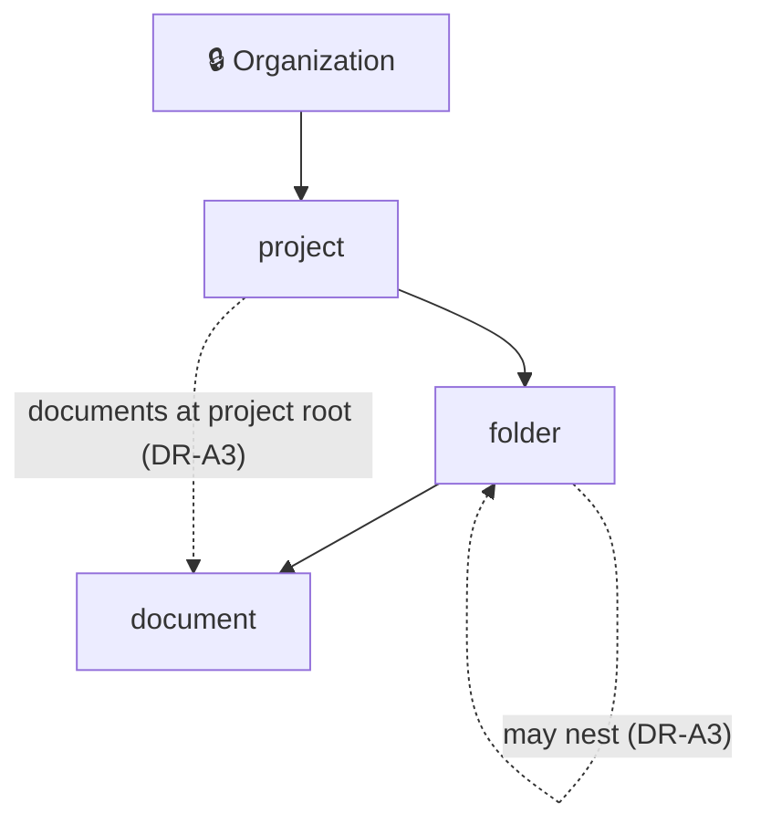

</details>

<details>
<summary><b>Step 2 · Scope permissions</b></summary>

| Permission | Resource type scope |
| --- | --- |
| `members:update`, `api_key:create`, `billing:read` | Organization |
| `project:manage` | project |
| `folder:view`, `folder:edit` | folder |
| `document:view`, `document:edit`, `document:share` | document |

</details>

<details>
<summary><b>Step 3 · Scope roles</b></summary>

| Role | Scope | Bundles | Allowed because |
| --- | --- | --- | --- |
| `admin` | Organization | everything | Organization is the root, so every type is below it |
| `member` | Organization | none | A member gets access only through roles lower down |
| `project-admin` | project | `project:manage`, `folder:edit`, `document:view`, `document:edit`, `document:share` | folder and document are below project |
| `folder-viewer` | folder | `folder:view`, `document:view` | document is below folder |
| `document-viewer` | document | `document:view` | its own type |

A role scoped to `document` can't bundle `project:manage`. The UI only offers permissions of the role's type and the types below it, so the invalid combination can't even be selected.

These five are **managed roles**: the Product defines them once, and every Organization assigns the same rows by the same IDs. An Organization may add a **custom role** of its own, such as `billing-auditor`, next to them. `member` is optional: a member who holds no Organization role at all is still a member, with the same access as `member` gives ([DR-D5](#dr-d5), [DR-D8](#dr-d8)).

</details>

<details>
<summary><b>Step 4 · The product registers resources as it creates them</b></summary>

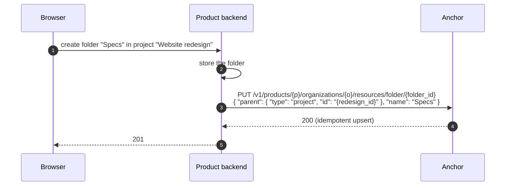

DR-B1 decides which resources must be registered: every one, or only those a role is assigned on.

</details>

<details>
<summary><b>Step 5 · Assign roles</b></summary>

```http
PUT /v1/products/{p}/organizations/{o}/resources/project/{redesign_id}/members/{maya}
{ "role_id": "role_project_admin" }

PUT /v1/products/{p}/organizations/{o}/resources/document/{pricing_id}/members/{alice}
{ "role_id": "role_document_viewer" }      ← sharing one document with Alice
```

</details>

<details>
<summary><b>Step 6 · Ask</b></summary>

```json
POST /v1/products/{p}/access/v1/evaluation
{
  "subject":  { "type": "user", "id": "user_2NNE…dan" },
  "action":   { "name": "document:view" },
  "resource": { "type": "document", "id": "{pricing_id}",
                "properties": { "organization_id": "{acme}" } }
}
```

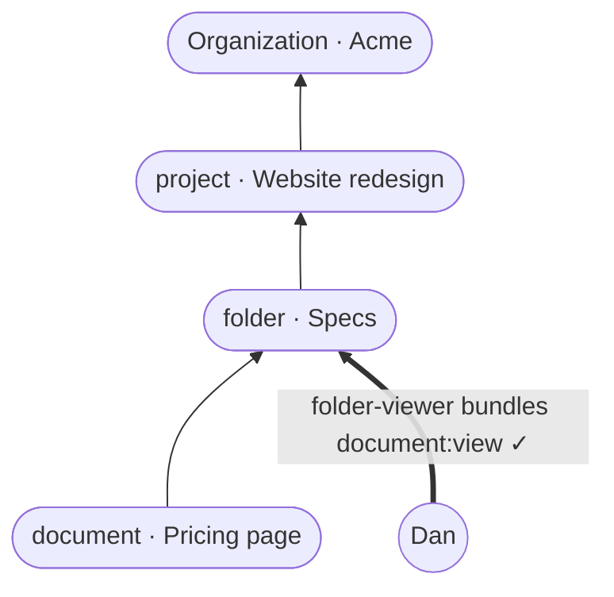

Anchor walks up from the document until a role held on the document or one of its ancestors bundles `document:view`, and answers `decision: true`. Bob, who holds only `member` on Acme, gets `MISSING_PERMISSION`.

</details>

<details>
<summary><b>Step 7 · Products that change nothing</b></summary>

Every existing permission and role becomes Organization-scoped, so every existing check gives the same answer. A product that never opens the Resource types page sees no difference.

</details>

---

## 3. Decision records

| State | Means |
| :-- | :-- |
| 🟡 **Pending** | needs your answer |
| 🔵 **Proposed** | recommended, accepted unless you object |
| ⚪ **Deferred** | not in this change |
| ✅ **Accepted** · ❌ **Rejected** | after review |

<details open>
<summary><b>Index of all 41 records</b></summary>

| Theme | Record | State | ❓ |
| :-- | :-- | :-- | :-: |
| **A. Resource types** | [DR-A0](#dr-a0) · What Anchor stores, and what it never stores | ✅ Accepted |  |
|  | [DR-A1](#dr-a1) · A resource type is a Product catalog entry | ✅ Accepted |  |
|  | [DR-A2](#dr-a2) · Organization is built in and locked | ✅ Accepted |  |
|  | [DR-A3](#dr-a3) · Tree shape: one parent type, or several | ✅ Accepted |  |
|  | [DR-A4](#dr-a4) · Depth limits | ✅ Accepted |  |
|  | [DR-A5](#dr-a5) · What can change once a type is in use | ✅ Accepted |  |
|  | [DR-A6](#dr-a6) · Workspace stops being built in | ✅ Accepted |  |
| **B. Resources** | [DR-B1](#dr-b1) · Which resources a product registers | ✅ Accepted |  |
|  | [DR-B2](#dr-b2) · A resource is named by the product's own ID | ✅ Accepted |  |
|  | [DR-B3](#dr-b3) · Parent rules | ✅ Accepted |  |
|  | [DR-B4](#dr-b4) · Deleting a resource is refused unless it cascades | ✅ Accepted |  |
| **C. Permissions** | [DR-C1](#dr-c1) · Every permission is scoped to one resource type | ✅ Accepted |  |
|  | [DR-C2](#dr-c2) · Permission names keep their free form | ✅ Accepted |  |
|  | [DR-C3](#dr-c3) · `scope_modifier` is deprecated | ✅ Accepted |  |
|  | [DR-C4](#dr-c4) · A permission's scope never changes | ✅ Accepted |  |
| **D. Roles and role assignments** | [DR-D1](#dr-d1) · Every role is scoped to one resource type | ✅ Accepted |  |
|  | [DR-D2](#dr-d2) · A role's scope never changes | ✅ Accepted |  |
|  | [DR-D3](#dr-d3) · One role per member per resource, several as a Product option | ✅ Accepted |  |
|  | [DR-D4](#dr-d4) · Organization membership stays separate; every other assignment is generic | ✅ Accepted |  |
|  | [DR-D5](#dr-d5) · The Organization role is optional (revised: replaces the default role) | ✅ Accepted |  |
|  | [DR-D6](#dr-d6) · Role priority | ⚪ Deferred |  |
|  | [DR-D7](#dr-d7) · Organization API keys | ✅ Accepted |  |
|  | [DR-D8](#dr-d8) · Managed roles shared by every Organization, and custom roles (revised: replaces template copies) | ✅ Accepted |  |
|  | [DR-D9](#dr-d9) · Custom roles open per resource type: Organization first, then the Product's own types | ✅ Accepted |  |
|  | [DR-D10](#dr-d10) · Role changes, deletes and limits (revised) | ✅ Accepted |  |
|  | [DR-D11](#dr-d11) · A custom role never blocks the Product's tree | ✅ Accepted |  |
| **E. Access decisions** | [DR-E1](#dr-e1) · Grants only, inherited downward | ✅ Accepted |  |
|  | [DR-E2](#dr-e2) · The evaluation API takes any resource type | ✅ Accepted |  |
|  | [DR-E3](#dr-e3) · Roles are data; the Product's OpenFGA model holds only types and permissions | ✅ Accepted (depends on ADR-0021) |  |
|  | [DR-E4](#dr-e4) · Listing what a subject can reach | ⚪ Deferred |  |
|  | [DR-E5](#dr-e5) · Anchor's tables stay the source of truth; OpenFGA holds a mirror written after each commit | ✅ Accepted |  |
| **F. Admin UI** | [DR-F1](#dr-f1) · Three catalog pages | ✅ Accepted |  |
|  | [DR-F2](#dr-f2) · The canvas: React Flow with computed layout | ✅ Accepted |  |
|  | [DR-F3](#dr-f3) · Canvas interaction and motion | ✅ Accepted |  |
|  | [DR-F4](#dr-f4) · Roles and permissions pages | ✅ Accepted |  |
|  | [DR-F5](#dr-f5) · An access explainer on the canvas | ✅ Accepted |  |
| **G. Migration and rollout** | [DR-G1](#dr-g1) · Backfill everything to Organization | ✅ Accepted |  |
|  | [DR-G2](#dr-g2) · Compatibility | ✅ Accepted |  |
|  | [DR-G3](#dr-g3) · Events | ✅ Accepted |  |
|  | [DR-G4](#dr-g4) · Delivery order: milestones of small PRs | ✅ Accepted |  |
|  | [DR-G5](#dr-g5) · The catalog is managed through the Terraform provider | ✅ Accepted |  |
|  | [DR-G6](#dr-g6) · Cleanup once every Product runs on the new model | ✅ Accepted |  |

</details>

### A. Resource types

<a id="dr-a0"></a>
<details>
<summary><b>DR-A0</b> · What Anchor stores, and what it never stores — <i>✅ Accepted</i></summary>

**Decision.** Anchor stores what every Product needs to decide access, and nothing about what a Product does:

| | In Anchor | Why |
| :-- | :-- | :-- |
| **Who** | Product users, Organization memberships, Organization API keys, invitations | No decision without a subject; a member exists only in Anchor |
| **Where** | Organizations, resource types, **resource references** (id, type, parent, name) | The parent chain is what inheritance walks; without it, a role on a folder can't reach its documents |
| **What** | Permissions, **roles**, **role assignments** | A decision needs the permission, the role that bundles it, and who holds that role |
| **Decide** | Evaluation | The point of all the above |

<details>
<summary>📌 Real example</summary>

Acme Corp uses a document product. Anchor holds who, where and what; the product's database holds the documents themselves.

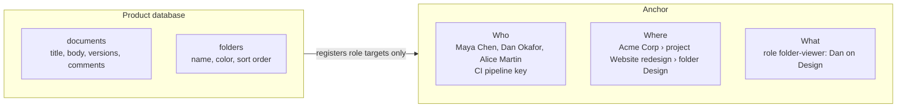

| Lives in Anchor | Lives in the product |
| :-- | :-- |
| `{ "type": "folder", "id": "3b7e91d2-0c4a-4f6e-9d21-8a5c7e4b2f60", "name": "Design", "parent": { "type": "project", "id": "9f1c2a4e-6b3d-4c8e-a1f0-2d7e5b9c3a11" } }` | the folder's colour, sort order, created-by, every document inside it |

</details>

<details>
<summary>Never in Anchor</summary>

- **A Product's own records and their fields.** Resources are references, not records: no `metadata` object, no custom fields, no resource type whose instances Anchor stores in full. Organization is the only resource Anchor stores in full (A6 removes the built-in Workspace).
- **Search or sorting over a Product's data.** Anchor lists members and role assignments, never a Product's items by their own attributes.

</details>

<details>
<summary>Already in Anchor and consistent with this</summary>

Licensing (what an Organization is entitled to, which every SaaS needs), and the events and emails that report changes to the records above.

</details>

<details>
<summary>Test for a future request</summary>

Would every Product built on Anchor need it, and does it describe tenancy or access? If not, it belongs in the Product.

</details>

<details>
<summary>Related records</summary>

[A6](#dr-a6) removes the built-in Workspace · [B2](#dr-b2) defines a resource reference · [E5](#dr-e5) keeps Anchor's tables as the source of truth.

</details>

</details>

<a id="dr-a1"></a>
<details>
<summary><b>DR-A1</b> · A resource type is a Product catalog entry — <i>✅ Accepted</i></summary>

**Decision.** A resource type belongs to a Product, alongside its permissions and roles. It has:
- an ID (`rtype_…`, KSUID);
- a **slug**, unique per Product, matching `^[a-z][a-z0-9_]{0,48}$` so it is also a valid OpenFGA type name;
- a name and a description;
- its allowed parent types and whether it nests in itself (see A3).

It is managed under `/v1/products/{product_id}/resource-types` with a create route, a read route and a cursor search, as every catalog collection is. A whole tree can also be replaced in one call (see F3).

<details>
<summary>📌 Real example</summary>

```http
POST /v1/products/prd_2qL8vH1nX0aR7mB3cK5dT9wQ/resource-types
{ "slug": "folder", "name": "Folder", "description": "Groups documents.",
  "parent_types": ["project"], "nests_in_itself": true }

201 Created
{ "id": "rtype_2qLCf0ld3r2nT8vK5xR1", "slug": "folder", "name": "Folder",
  "parent_types": ["project"], "nests_in_itself": true,
  "created_at": "2026-10-24T09:12:31Z" }
```

| id | slug | parent_types | nests_in_itself |
| :-- | :-- | :-- | :-- |
| `rtype_2qLC0rg4n1z8tR5vN2xK` | `organization` | — | false |
| `rtype_2qLCpr0j3ct7kR2vN9xT` | `project` | `organization` | false |
| `rtype_2qLCf0ld3r2nT8vK5xR1` | `folder` | `project` | true |
| `rtype_2qLCd0cum3nt4rT9vN6x` | `document` | `folder`, `project` | false |

</details>

<details>
<summary>Why</summary>

The type tree is part of the catalog: it decides how roles and permissions combine. Storing it next to them keeps one authority per Product, and one input to the compiled model (E3).

</details>

</details>

<a id="dr-a2"></a>
<details>
<summary><b>DR-A2</b> · Organization is built in and locked — <i>✅ Accepted</i></summary>

**Decision.** Every Product has exactly one `organization` type. It is seeded on Product creation and backfilled for existing Products. It is the root: it has no parent, and its slug, its root position and its existence can't change. The API answers `409 BUILT_IN_RESOURCE_TYPE` to any attempt. Its display name is fixed as "Organization".

<details>
<summary>📌 Real example</summary>

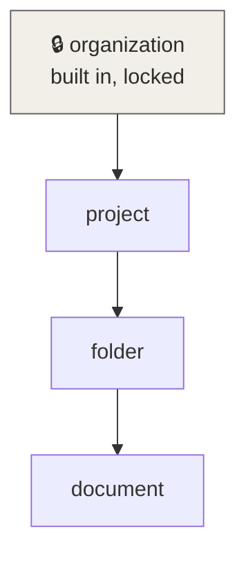

```http
DELETE /v1/products/prd_2qL8vH1nX0aR7mB3cK5dT9wQ/resource-types/rtype_2qLC0rg4n1z8tR5vN2xK

409 Conflict
{ "code": "BUILT_IN_RESOURCE_TYPE",
  "message": "The organization resource type is built in and can't be deleted, renamed or moved." }
```

</details>

<details>
<summary>Why</summary>

Anchor's Organizations, memberships, invitations, licenses and API keys all hang off it. A Product that could delete or move it would break all of them.

</details>

</details>

<a id="dr-a3"></a>
<details>
<summary><b>DR-A3</b> · Tree shape: one parent type, or several — <i>✅ Accepted</i></summary>

**Decision.** Option **c**. Each *resource* keeps exactly one parent, so a check still walks one path upward and "why does Dan have access?" has one answer. Only the *type* graph becomes a DAG. Cycles between different types are refused; a type nesting in itself is the only loop allowed. "Types below *T*", used by roles (D1), means every type reachable downward from *T*.

**Implementation.** Self-nesting is declared with a boolean on the resource type, never by listing the type among its own parents:

| Field | Meaning |
| :-- | :-- |
| `parent_types` | the *other* types an instance may sit under, e.g. `folder` → `[project]`; a type never lists itself |
| `nests_in_itself` | `true` lets an instance's parent be an instance of the same type (a folder inside a folder); default `false` |

The compiled OpenFGA model adds the type to its own `parent` relation only when `nests_in_itself` is `true`. Anchor checks the boolean when a resource is registered or moved (B3), and the canvas shows it as the "nests in itself" badge (F2).

<details>
<summary>📌 Real example</summary>

```http
PUT /v1/products/prd_2qL8vH1nX0aR7mB3cK5dT9wQ/organizations/org_2qL9aC3mE8xP1rT6vN4bK2sJ/resources/folder/c41d8e07-52b9-4a3f-bc18-6e0f9d2a7c45
{ "name": "Specs", "parent": { "type": "folder", "id": "3b7e91d2-0c4a-4f6e-9d21-8a5c7e4b2f60" } }
→ 200: allowed, because folder nests_in_itself

PUT /v1/products/prd_2qL8vH1nX0aR7mB3cK5dT9wQ/organizations/org_2qL9aC3mE8xP1rT6vN4bK2sJ/resources/document/5d0b3c9a-e261-4f8d-a7c4-92b1e6f0d384
{ "name": "Readme", "parent": { "type": "project", "id": "9f1c2a4e-6b3d-4c8e-a1f0-2d7e5b9c3a11" } }
→ 200: allowed, because project is in document's parent_types
```

</details>

<details>
<summary>Context and options</summary>

The simplest shape is a strict tree, where each type has one parent type. Two common shapes don't fit it:
- folders inside folders, as in most file and document products;
- items at the root of a container, such as a document directly in a project with no folder.

| Option | Type level | Instance level | Fits both shapes |
| --- | --- | --- | --- |
| **a.** Strict tree | one parent type, no self-nesting | one parent | ❌ needs a hidden root folder per project, and no nested folders |
| **b.** Tree + self-nesting | one parent type, and may also nest in itself | one parent | ⚠️ nested folders work; root-level items don't |
| **c.** Several parent types + self-nesting | a type lists its allowed parent types, which may include itself | **still exactly one parent** | ✅ |

</details>

<details>
<summary>How OpenFGA handles option c</summary>

In the compiled model, a type with `nests_in_itself: true` appears in its own `parent` relation. Each resource still points at exactly one parent:

```text
type folder
  relations
    define parent: [project, folder]          # project from parent_types, folder from nests_in_itself
    define role_folder_viewer: [user]
    define can_document_view: role_folder_viewer or can_document_view from parent

type document
  relations
    define parent: [folder, project]          # a document sits in a folder or at the project root
    define can_document_view: can_document_view from parent
```

```text
folder:design   # parent @ project:redesign
folder:specs    # parent @ folder:design          ← nested folder
document:pricing# parent @ folder:specs
document:readme # parent @ project:redesign       ← at the project root
folder:design   # role_folder_viewer @ user:dan
```


🟩 allowed: *Can Dan view pricing?* · 🟥 denied: *Can Dan view readme?* · 🟦 Dan's only role assignment.

`from parent` follows whichever parent a given resource has. To check Dan on `document:pricing`, OpenFGA walks pricing → specs → design, where Dan holds `role_folder_viewer`, and allows it. `document:readme` walks straight to the project. Every type that can be a parent (`project`, `folder`) defines `can_document_view`, which is what lets the walk continue from either. OpenFGA bounds the walk with its resolve-node limit, which A4's resource depth limit stays under.

</details>

<details>
<summary>Sources</summary>

- [OpenFGA: parent-child objects](https://openfga.dev/docs/modeling/parent-child)

</details>

> **Q-A3.1** Option a, b or c? *(recommended: c)*
>
> **Answer:** c, with self-nesting declared by a boolean on the resource type.

</details>

<a id="dr-a4"></a>
<details>
<summary><b>DR-A4</b> · Depth limits — <i>✅ Accepted</i></summary>

**Decision.** Two limits:
- **Type depth:** at most 5 levels including Organization (Organization › project › folder › document uses 4).
- **Resource depth:** if a type may nest in itself (A3), a resource chain may be at most 15 deep, counting the Organization (acme › project › folder › folder › document is 5). This bounds the walk in every check, and Anchor refuses a move or registration that would exceed it.

<details>
<summary>📌 Real example</summary>

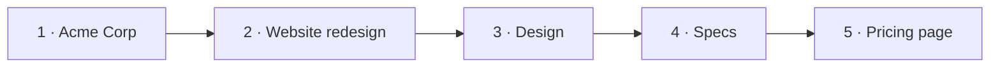

Four type levels (organization, project, folder, document) and a five-level resource chain, because two folders nest. Registering a sixteenth level is refused:

```json
409 Conflict
{ "code": "RESOURCE_TOO_DEEP",
  "message": "A resource chain may be at most 15 levels deep, counting the organization. This one would be 16.",
  "max_depth": 15 }
```

</details>

<details>
<summary>Why Anchor enforces the limit, not OpenFGA</summary>

OpenFGA's model language can't express "at most N levels". Its only depth control is a server-wide safety valve, the resolve-node limit (default 25, with a breadth limit of 10). A check that walks deeper fails with `resolution depth exceeded`, an error rather than a denial, and the limit applies to every type alike. So Anchor refuses a registration or a move that would make a chain deeper than 15 (B3) at write time, and keeps OpenFGA's limit above that so a valid check never reaches it.

Unrolling levels as separate types (`folder_l1`, `folder_l2`, …) would make OpenFGA enforce a depth, but every permission and role would then exist once per level. Rejected.

</details>

> **Q-A4.1** Are 5 type levels and 16 resource levels the right limits? *(recommended: yes; both are easy to raise later, hard to lower)*
>
> **Answer:** yes, rounded to multiples of 5: 5 type levels and 15 resource levels.

</details>

<a id="dr-a5"></a>
<details>
<summary><b>DR-A5</b> · What can change once a type is in use — <i>✅ Accepted</i></summary>

| Change | Allowed | Otherwise |
| --- | --- | --- |
| Add a type | always | |
| Rename, change description | always | |
| Change slug | never | slugs name OpenFGA types and appear in API calls and permission names |
| Add an allowed parent type | always | |
| Remove an allowed parent type | only if no resource uses that parent type | `409` with the count |
| Turn `nests_in_itself` on | always | |
| Turn `nests_in_itself` off | only if no resource sits under one of its own type | `409` with the count |
| Delete a type | only with no child types, resources, roles or permissions scoped to it | `409` listing what blocks it |

<details>
<summary>📌 Real example</summary>

```http
DELETE /v1/products/prd_2qL8vH1nX0aR7mB3cK5dT9wQ/resource-types/rtype_2qLCf0ld3r2nT8vK5xR1

409 Conflict
{ "code": "RESOURCE_TYPE_IN_USE",
  "message": "folder can't be deleted while other records use it.",
  "blocked_by": { "child_types": 1, "resources": 42, "roles": 2, "permissions": 2 } }
```

The canvas shows the same counts next to a disabled Delete button: "42 folders, 2 roles and 2 permissions use folder".

</details>

<details>
<summary>Why</summary>

A slug and a scope fixed after creation keep every assignment and API call valid (C4 and D2 apply the same rule to permissions and roles). Moving a type that already has resources would silently change who can see what. A product that really needs it creates a new type and migrates.

</details>

</details>

<a id="dr-a6"></a>
<details>
<summary><b>DR-A6</b> · Workspace stops being built in — <i>✅ Accepted</i></summary>

**Decision.** The built-in Workspace is replaced by the generic model, then **deleted once no Product depends on it**. Until that day it keeps working unchanged.

| Phase | What happens | Built-in Workspace |
| :-- | :-- | :-- |
| **1. Generic model available** | A Product that wants workspaces declares a `workspace` resource type under Organization, registers references to its own workspaces (B1, B2) and assigns roles on them (D4) | works as today; deprecated, no new features |
| **2. Data migrated** | For each Product with workspaces, a migration declares a `workspace` type; each workspace becomes a reference with the **same ID** and its name as display name; each workspace role becomes a role assignment | works as today, alongside the generic model |
| **3. Products moved** | Each Product, and its released tools, switch from `/workspaces` to the generic routes | works, with no remaining caller |
| **4. Deleted** | Only when no Product calls the `/workspaces` routes or subscribes to `workspace.*` events: the `workspaces` table, its routes and pages, its events and `workspace_memberships` are removed | gone |

- **Checking the condition for phase 4:** request logs show no call to a `/workspaces` route and no endpoint subscribes to a `workspace.*` event, over a period agreed at the time. It is a deliberate, recorded step, not a side effect of another change.
- **Access evaluation** answers `"type": "workspace"` through the generic model from phase 2. `WORKSPACE_NOT_IN_ORGANIZATION` stays until phase 4, then gives way to `RESOURCE_NOT_IN_ORGANIZATION` (E2).
- **Today** the only consumer is Nanostack's own product, so phase 3 is one coordinated change on that side.

<details>
<summary>📌 Real example</summary>

What one existing workspace becomes after phase 2:

| Before: `workspaces` row | After: resource reference |
| :-- | :-- |
| `id = ws_2qLEp4ymT8vN3xK6rQ1wZ9c` | `id = ws_2qLEp4ymT8vN3xK6rQ1wZ9c` (same) |
| `organization_id = org_2qL9aC3mE8xP1rT6vN4bK2sJ` | `organization = org_2qL9aC3mE8xP1rT6vN4bK2sJ` |
| `name = Payments`, `description = Billing team space` | `type = workspace`, `name = Payments`, `parent = organization` |
| `workspace_memberships`: Maya, role editor | `resource_role_assignments`: Maya, role editor, on that resource |

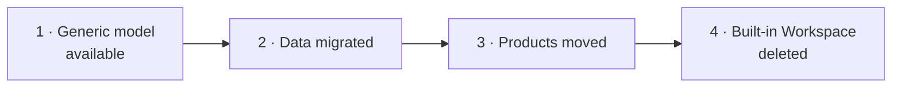

</details>

<details>
<summary>Context</summary>

Workspace is built into Anchor today: its own table, API, admin UI, events, and the workspace roles in its schema. Under A0, Organization is the only resource Anchor stores in full. Anchor has no external customers yet, so no long compatibility layer is needed; the built-in Workspace only has to outlive its last caller.

</details>

<details>
<summary>Why</summary>

One model instead of a generic model plus a special case. A Product that has no workspaces never sees the concept, and one that names them "projects" or "spaces" uses its own word.

</details>

</details>

### B. Resources

<a id="dr-b1"></a>
<details>
<summary><b>DR-B1</b> · Which resources a product registers — <i>✅ Accepted</i></summary>

**Decision.** Sparse registry. **Access comes from roles held on ancestors; a role assigned on a single item is the exception, and only a role assignment forces registration.** A product registers a resource only when someone holds a role on it, together with the ancestors it hangs from. Every other item is checked by naming its parent in the request.

| What the product wants | What it registers | How it checks a document |
| :-- | :-- | :-- |
| Organization roles only (`admin`, `member`) | nothing | `{ "type": "document", "id": "B", "properties": { "parent": { "type": "organization", "id": "acme" } } }` |
| Roles on projects and folders | those projects and folders | the same, with `parent` set to the document's folder |
| Share one document with one person | that document as well | `{ "type": "document", "id": "A" }`; its stored parent is used |

**Rules.**
- The parent a request names must be registered, or be the Organization. When an item's direct container holds no roles and is not registered, the product names the nearest registered ancestor; that container would grant nothing anyway.
- When a resource is registered, its stored parent wins over a parent the request names, and Anchor logs the mismatch.
- The product backend is already trusted to name the subject and the Organization, so trusting it with an unregistered item's parent adds no new trust.

<details>
<summary>📌 Real example</summary>

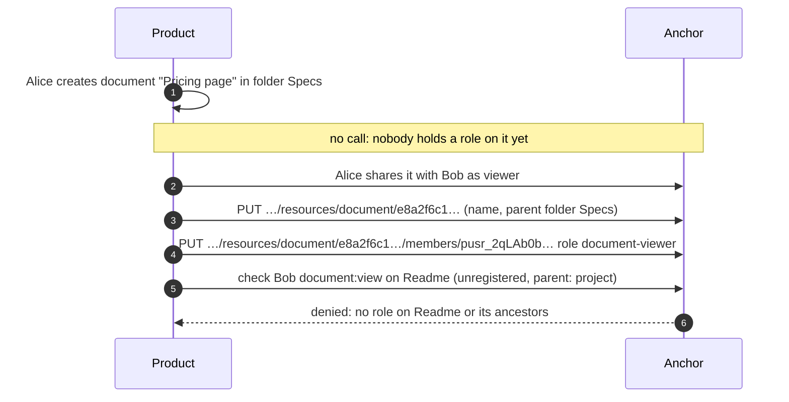

</details>

<details>
<summary>Context and options</summary>

A check on a document needs the document's chain of ancestors. Either Anchor stores it, or the product sends it with each check (a contextual parent, as in the ADR-0021 proof of concept).

| Option | Product must register | Check request | Product effort |
| --- | --- | --- | --- |
| **a.** Full registry | every resource of every declared type (every document, every folder) | resource ID only | a create, move or delete call to Anchor on every write, for possibly millions of items |
| **b.** Sparse registry | containers (projects, folders) and any resource a role is assigned on (a shared document) | resource ID, plus `properties.parent` when the resource isn't registered | a call only for containers and shares |

</details>

<details>
<summary>Sources</summary>

- [OpenFGA: contextual tuples](https://openfga.dev/docs/interacting/contextual-tuples), the mechanism behind a caller-supplied parent

</details>

> **Q-B1.1** Full or sparse registry? *(recommended: sparse)*
>
> **Answer:** sparse. Access comes from roles held on ancestors; only a role assigned on a single item registers that item.

</details>

<a id="dr-b2"></a>
<details>
<summary><b>DR-B2</b> · A resource is named by the product's own ID — <i>✅ Accepted</i></summary>

**Decision.** A resource's identity is `(organization, type, id)`, where `id` is the product's own identifier, such as its document UUID. The product never stores an Anchor ID.

| Field | Rule |
| :-- | :-- |
| `id` | the product's identifier, unique per **Organization and resource type**, fixed after registration |
| `type` | a resource type of the product (A1) |
| `organization` | the Organization it belongs to, checked against its parent's |
| `parent` | its one parent (B3) |
| `name` | **required**, 1 to 200 characters, not unique; the product re-sends it when the item is renamed |

Registration is an idempotent `PUT` on that identity: the same call creates the reference, renames it or moves it.

<details>
<summary>📌 Real example</summary>

```http
PUT /v1/products/prd_2qL8vH1nX0aR7mB3cK5dT9wQ/organizations/org_2qL9aC3mE8xP1rT6vN4bK2sJ/resources/folder/3b7e91d2-0c4a-4f6e-9d21-8a5c7e4b2f60
{ "name": "Design", "parent": { "type": "project", "id": "9f1c2a4e-6b3d-4c8e-a1f0-2d7e5b9c3a11" } }

200 OK
{ "type": "folder", "id": "3b7e91d2-0c4a-4f6e-9d21-8a5c7e4b2f60", "organization_id": "org_2qL9aC3mE8xP1rT6vN4bK2sJ",
  "name": "Design", "parent": { "type": "project", "id": "9f1c2a4e-6b3d-4c8e-a1f0-2d7e5b9c3a11" },
  "created_at": "2026-10-24T09:20:02Z", "updated_at": "2026-10-24T09:20:02Z" }
```

| organization | type | id | allowed |
| :-- | :-- | :-- | :-- |
| Acme Corp | folder | `3b7e91d2…` | ✅ |
| Globex | folder | `3b7e91d2…` | ✅ another Organization |
| Acme Corp | document | `3b7e91d2…` | ✅ another type |
| Acme Corp | folder | `3b7e91d2…` again | ↺ the same resource: renamed or moved |

</details>

<details>
<summary>Why these two choices</summary>

- **Scope per Organization and type.** Two Organizations, or two types in one Organization, may reuse the same ID without colliding, and every lookup is already Organization-scoped.
- **Required name.** Only role targets are registered (B1), and every one of them appears in member pages, the canvas explainer and role assignments. An ID alone is unreadable there. A name can drift if the product forgets to re-send it on rename; that only affects display, never a decision.

</details>

> **Q-B2.1** Store an optional display name, for the canvas, the explainer and the members pages? It can drift when the product renames the resource, unless the product re-sends it. *(recommended: yes, optional)*
>
> **Answer:** a required name, and IDs unique per Organization and resource type.

</details>

<a id="dr-b3"></a>
<details>
<summary><b>DR-B3</b> · Parent rules — <i>✅ Accepted</i></summary>

**Decision.** A resource has exactly one parent, and:
- the parent's type is one of its type's `parent_types`, or its own type when the type `nests_in_itself` (A3);
- the parent is in the same Organization (the Organization itself is a valid parent for its direct children);
- the parent is not the resource itself, nor any of its descendants;
- the chain respects the resource depth limit (A4).

Moving a resource is a `PUT` with a new parent, checked by the same rules, and its whole sub-tree moves with it. Anchor refuses a parent that isn't registered yet with `409 PARENT_NOT_REGISTERED`, so products register top-down.

<details>
<summary>📌 Real example</summary>

```http
PUT /v1/products/prd_2qL8vH1nX0aR7mB3cK5dT9wQ/organizations/org_2qL9aC3mE8xP1rT6vN4bK2sJ/resources/folder/3b7e91d2-0c4a-4f6e-9d21-8a5c7e4b2f60
{ "name": "Design", "parent": { "type": "folder", "id": "c41d8e07-52b9-4a3f-bc18-6e0f9d2a7c45" } }

409 Conflict
{ "code": "RESOURCE_CYCLE",
  "message": "Specs is inside Design, so Design can't move into Specs.",
  "chain": ["folder:c41d8e07…", "folder:3b7e91d2…"] }
```

</details>

<details>
<summary>Self-nesting is allowed, cycles are not</summary>

Nesting is about **types**; cycles are about **instances**.

| Move | Allowed | Why |
| :-- | :-- | :-- |
| folder *specs* into folder *design* | ✅ | `folder` nests in itself; different instances |
| folder *design* into itself | ❌ `409 RESOURCE_CYCLE` | an instance can't be its own parent |
| folder *design* into *specs*, while *specs* is inside *design* | ❌ `409 RESOURCE_CYCLE` | *design* would become its own ancestor, and every check on it would walk forever |

Anchor detects the cycle by walking up from the new parent: if it meets the resource being moved, the move is refused.

</details>

</details>

<a id="dr-b4"></a>
<details>
<summary><b>DR-B4</b> · Deleting a resource is refused unless it cascades — <i>✅ Accepted</i></summary>

**Decision.** Deleting a resource that still has registered children or role assignments is refused with `409 RESOURCE_IN_USE`, listing what blocks it. With `?cascade=true`, Anchor deletes the resource, its registered descendants and every role assignment on them, in one transaction, and emits their events. A resource with neither is deleted directly.

Deleting an Organization always removes all its resources and assignments, as membership rows cascade today.

<details>
<summary>📌 Real example</summary>

```http
DELETE /v1/products/prd_2qL8vH1nX0aR7mB3cK5dT9wQ/organizations/org_2qL9aC3mE8xP1rT6vN4bK2sJ/resources/folder/3b7e91d2-0c4a-4f6e-9d21-8a5c7e4b2f60

409 Conflict
{ "code": "RESOURCE_IN_USE",
  "message": "Design still has 1 registered child and 3 role assignments. Send cascade=true to delete them too.",
  "children": 1, "role_assignments": 3 }

DELETE /v1/products/prd_2qL8vH1nX0aR7mB3cK5dT9wQ/organizations/org_2qL9aC3mE8xP1rT6vN4bK2sJ/resources/folder/3b7e91d2-0c4a-4f6e-9d21-8a5c7e4b2f60?cascade=true
204 No Content
→ events: resource.role_assignment.deleted ×3, resource.deleted ×2 (Specs, then Design)
```

</details>

<details>
<summary>Why</summary>

A mistaken delete of a folder would otherwise silently remove every share beneath it. Making the cascade explicit costs a product one parameter when it really means it: typically when the item is already gone from its own database.

</details>

</details>

### C. Permissions

<a id="dr-c1"></a>
<details>
<summary><b>DR-C1</b> · Every permission is scoped to one resource type — <i>✅ Accepted</i></summary>

**Decision.** `product_resource_permissions` gains a required `resource_type_id`, and `resource_type` is **required** on create, in the API and in Terraform. Anchor never picks a scope for the caller: a missing `resource_type` is `400 RESOURCE_TYPE_REQUIRED`. Permission responses include `resource_type`.

- **Existing permissions** get `organization` once, through the backfill (G1). That is a migration of existing data, not a default.
- **The admin UI** may preselect Organization in the create form. The user still sees and confirms the scope, and the request always names it.

<details>
<summary>📌 Real example</summary>

```http
POST /v1/products/prd_2qL8vH1nX0aR7mB3cK5dT9wQ/resource-permissions
{ "name": "document:share", "description": "Share a document with someone.",
  "resource_type": "document" }
→ 201

POST /v1/products/prd_2qL8vH1nX0aR7mB3cK5dT9wQ/resource-permissions
{ "name": "document:archive" }
→ 400 { "code": "RESOURCE_TYPE_REQUIRED", "message": "Name the resource type this permission applies to." }
```

</details>

</details>

<a id="dr-c2"></a>
<details>
<summary><b>DR-C2</b> · Permission names keep their free form — <i>✅ Accepted</i></summary>

**Decision.** Keep names free-form and unique per Product. The UI pre-fills `{type slug}:` when creating a permission from a type, but Anchor doesn't enforce it.

<details>
<summary>📌 Real example</summary>

| name | resource_type | valid |
| :-- | :-- | :-- |
| `document:view` | document | ✅ follows the `{type}:{action}` form |
| `documents:read` | document | ✅ free form, prefix isn't a type slug |
| `api_key:create` | organization | ✅ |
| `document:view` (again) | folder | ❌ `409`: names are unique per Product |

</details>

<details>
<summary>Context</summary>

A strict `{type}:{action}` form (`folder:delete`) would make each permission's scope readable from its name. Existing catalogs already hold names such as `documents:read` or `api_key:create` whose prefix is not a type slug (`documents` vs a type called `document`).

</details>

> **Q-C2.1** Enforce the `{type}:{action}` form for new permissions? *(recommended: no; existing names would become second-class)*
>
> **Answer:** no; names stay free-form, and the UI pre-fills the type slug.

</details>

<a id="dr-c3"></a>
<details>
<summary><b>DR-C3</b> · <code>scope_modifier</code> is deprecated — <i>✅ Accepted</i></summary>

**Decision.** Mark it deprecated in the OpenAPI contract, keep accepting and returning it, and hide it in the UI. It is removed in the cleanup (G6), once no Product uses it.

<details>
<summary>📌 Real example</summary>

```yaml
# openapi.yaml
scope_modifier:
  type: [string, "null"]
  deprecated: true
  description: Deprecated. Use the permission's resource_type and role assignments on resources. Removed in the cleanup (ADR-0022 G6).
```

</details>

<details>
<summary>Context</summary>

`scope_modifier` is an optional free-text qualifier on a permission ("own", "team"). Anchor stores it and filters searches by it, but no decision ever reads it. Consumers can only read it back. Resource type scope, and a role assigned on a resource (an "owner" role on a document), cover what it was meant for.

</details>

> **Q-C3.1** Deprecate `scope_modifier` as above? *(recommended: yes)*
>
> **Answer:** yes; deprecate now, remove in the cleanup (G6).

</details>

<a id="dr-c4"></a>
<details>
<summary><b>DR-C4</b> · A permission's scope never changes — <i>✅ Accepted</i></summary>

**Decision.** `resource_type` is fixed after creation. To move a permission, create one with a new name, add it to the roles, roll the product over, then delete the old one. Otherwise, a role bundling the permission could suddenly violate D1.

<details>
<summary>📌 Real example</summary>

```http
PATCH /v1/products/prd_2qL8vH1nX0aR7mB3cK5dT9wQ/resource-permissions/document:share
{ "resource_type": "folder" }

409 Conflict
{ "code": "PERMISSION_SCOPE_IMMUTABLE",
  "message": "A permission's resource type can't change. Create folder:share, add it to the roles, then delete document:share." }
```

</details>

</details>

### D. Roles and role assignments

<a id="dr-d1"></a>
<details>
<summary><b>DR-D1</b> · Every role is scoped to one resource type — <i>✅ Accepted</i></summary>

**Decision.** `product_roles` gains a required `resource_type_id`, and `resource_type` is **required** on create, in the API and in Terraform, as for permissions (C1): a missing one is `400 RESOURCE_TYPE_REQUIRED`. Existing roles get `organization` through the backfill (G1), and the admin UI may preselect Organization. A role may bundle only permissions scoped to its own type or to a type below it. Assigning any other permission answers `400 PERMISSION_OUTSIDE_ROLE_SCOPE`.

<details>
<summary>📌 Real example</summary>

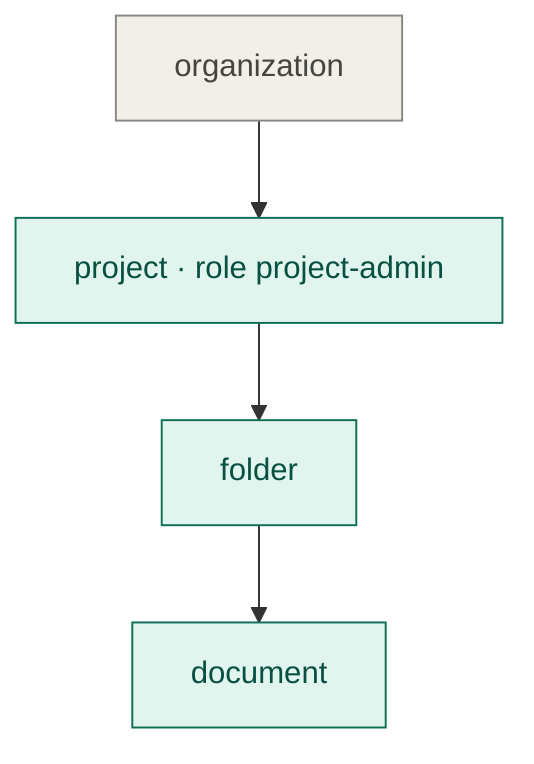

```http
POST /v1/products/prd_2qL8vH1nX0aR7mB3cK5dT9wQ/roles
{ "name": "project-admin", "resource_type": "project",
  "permissions": ["project:manage", "folder:edit", "document:view", "document:edit"] }
→ 201

POST /v1/products/prd_2qL8vH1nX0aR7mB3cK5dT9wQ/roles
{ "name": "project-admin", "resource_type": "project", "permissions": ["members:update"] }
→ 400 { "code": "PERMISSION_OUTSIDE_ROLE_SCOPE",
        "message": "members:update applies to organization, which is above project." }
```

</details>

<details>
<summary>Example</summary>

`project-admin` (project) may bundle `document:edit` (document is below project). `document-viewer` (document) may not bundle `project:manage`.

</details>

<details>
<summary>Sources</summary>

- [OpenFGA: custom roles](https://openfga.dev/docs/modeling/custom-roles)

</details>

</details>

<a id="dr-d2"></a>
<details>
<summary><b>DR-D2</b> · A role's scope never changes — <i>✅ Accepted</i></summary>

**Decision.** Fixed after creation, for the same reason as C4: existing assignments on resources of the old type would become invalid.

<details>
<summary>📌 Real example</summary>

```http
PATCH /v1/products/prd_2qL8vH1nX0aR7mB3cK5dT9wQ/roles/role_2qLBf0ldV1ew8nT3xK6pR2
{ "resource_type": "project" }

409 Conflict
{ "code": "ROLE_SCOPE_IMMUTABLE",
  "message": "folder-viewer is assigned on 18 folders. Create a project role instead." }
```

</details>

</details>

<a id="dr-d3"></a>
<details>
<summary><b>DR-D3</b> · One role per member per resource, several as a Product option — <i>✅ Accepted</i></summary>

**Decision.** By default a member holds **one** role per resource, with "replace" semantics, as today. A Product may switch on **several roles per resource** (`editor_x` and `editor_y` on the same project), and the member then holds the union of their permissions. The contract is list-shaped from day one, so switching the option on never changes it.

| | Product setting `roles_per_resource: single` (default) | `roles_per_resource: multiple` |
| :-- | :-- | :-- |
| Assign | `PUT …/members/{user}` with `role_ids: ["…"]`, exactly one; it replaces the current role | the same call with several `role_ids`; it replaces the set |
| Responses, events, decision context | `roles: [{ id, name }]` with one item | the same list, with several items |
| Organization role | the membership's single role | the Organization's role assignments (D4) hold the set |
| Admin UI | single select | multi select |

<details>
<summary>📌 Real example</summary>

With `roles_per_resource: multiple`, Maya holds two roles on the same project:

```http
PUT /v1/products/prd_2qL8vH1nX0aR7mB3cK5dT9wQ/organizations/org_2qL9aC3mE8xP1rT6vN4bK2sJ/resources/project/9f1c2a4e-6b3d-4c8e-a1f0-2d7e5b9c3a11/members/pusr_2qLAm9yQ4cH7eN1xK8rT3vZ
{ "role_ids": ["role_2qLBedXr4kT9vN2xQ6pK1w", "role_2qLBedYm8vR3xK7tN1pQ5z"] }

200 OK
{ "product_user_id": "pusr_2qLAm9yQ4cH7eN1xK8rT3vZ",
  "roles": [ { "id": "role_2qLBedXr4kT9vN2xQ6pK1w", "name": "editor_x" },
             { "id": "role_2qLBedYm8vR3xK7tN1pQ5z", "name": "editor_y" } ] }
```

With the default `single`, the same call with two `role_ids` answers `400 SINGLE_ROLE_PER_RESOURCE`.

</details>

<details>
<summary>Why a list now</summary>

The engine already takes the union: two role assignments are two tuples, and a check succeeds if either grants the permission. The only costly part is the API contract, which is what clients parse. Shaping `role_ids` and `roles` as lists today means allowing several roles later is lifting a "maximum one" check, with no breaking change.

</details>

> **Q-D3.1** One role per member per resource, or several? *(recommended: one)*
>
> **Answer:** one role per member per resource.

> **Q-D3.2** Add the `roles_per_resource` Product setting now, with the list-shaped contract? *(recommended: yes for the list-shaped contract; the setting itself can ship later, since `single` is the only value at first)*
>
> **Answer:** the list-shaped contract now; the `roles_per_resource` setting later, with `single` as the only value until then.

</details>

<a id="dr-d4"></a>
<details>
<summary><b>DR-D4</b> · Organization membership stays separate; every other assignment is generic — <i>✅ Accepted</i></summary>

**Decision.**
- **Organization membership** keeps its own record. It carries the Organization-scoped role plus everything that is not about access: joined date, invitations, events. Every member must hold one.
- **Every other role** a member holds lives in one generic table, `resource_role_assignments (resource, product user, role)`. It replaces `workspace_memberships`, whose rows migrate across.
- **Rules carried over from workspace roles:**
  - only a member of the resource's Organization can hold an assignment;
  - removing the member removes all their assignments in that Organization, in the same transaction;
  - the role's scope type must equal the resource's type.

<details>
<summary>📌 Real example</summary>

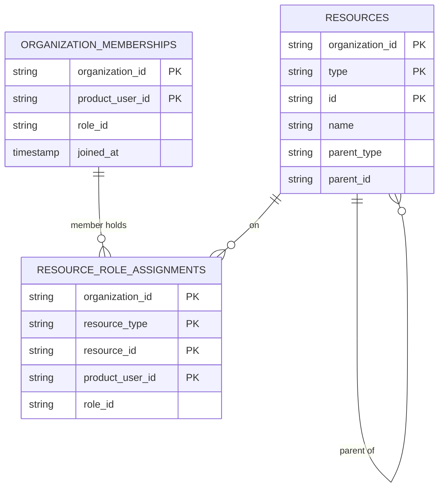

| organization_memberships | resource_role_assignments |
| :-- | :-- |
| Acme Corp · Maya Chen · admin | — |
| Acme Corp · Dan Okafor · member | folder Design · Dan Okafor · folder-viewer |
| Acme Corp · Bob Lee · member | document Pricing page · Bob Lee · document-viewer |

</details>

</details>

<a id="dr-d5"></a>
<details>
<summary><b>DR-D5</b> · The Organization role is optional (revised: replaces the default role) — <i>✅ Accepted</i></summary>

> **Revised 2026-10-26.** The default role is replaced by an optional role. The accepted version is kept folded below.

**Decision.** Adding a member or creating an invitation may leave out the role. A member with no Organization role belongs to the Organization and holds no permission there: every check on the Organization answers deny until the member gets a role, on the Organization or on a resource below it. Anchor never picks a role for the member, and there is no default role to configure. Updating a member with `"role_id": null` removes their Organization role; leaving the field out of an update still answers `400`.

<details>
<summary>📌 Real example</summary>

```http
POST /v1/products/prd_2qL8vH1nX0aR7mB3cK5dT9wQ/organizations/org_2qL9aC3mE8xP1rT6vN4bK2sJ/invitations
{ "email": "priya.nair@acme.example" }

201 Created
{ "id": "oinv_2qLEn8vR3xK6tQ1wZ9cP4m", "email": "priya.nair@acme.example",
  "role": null, "status": "PENDING" }
```

Priya joins Acme Corp with no access. The Product then gives her `folder-viewer` on the folder Design, and she reads its documents and nothing else.

| Acme Corp member | Organization role | `document:view` on Pricing page |
| :-- | :-- | :-- |
| Maya Chen | `admin` | allowed |
| Priya Nair | none | denied, `MISSING_PERMISSION` |

</details>

<details>
<summary>Why no role, and not a default role</summary>

A default role answered one need: adding a member, for example through directory sync, without picking a role. A missing role meets the same need with nothing to configure, no per-Organization override, and no question of what happens when the default role is deleted. A Product that wants every new member to hold `member` sends that role itself.

Released clients always send a role, so they never receive `"role": null`. Only a Product that adds members without a role sees it.

</details>

<details>
<summary>Superseded: a default Organization role (accepted 2026-10-25)</summary>

**Decision.** Let a Product mark at most one Organization-scoped role as default. Leaving out `role_ids` (D3) when adding a member or creating an invitation then means the default role. With no default role set, `role_ids` stays required. The default is a role the Product chose explicitly, not a scope Anchor picks (C1, D1).

> **Q-D5.1** Add a default role now? *(recommended: yes; it is what makes a `member` role with no permissions useful)*
>
> **Answer:** yes, a Product may mark one Organization-scoped role as its default.

</details>

> **Q-D5.2** Replace the default role with an optional role? *(recommended: yes)*
>
> **Answer:** yes. A member may hold no role, and then has no access. (2026-10-26)

</details>

<a id="dr-d6"></a>
<details>
<summary><b>DR-D6</b> · Role priority — <i>⚪ Deferred</i></summary>

**Decision.** Not in this change. Enterprise customers often assign roles through groups in their own identity provider (Okta, Microsoft Entra, Google Workspace): each group maps to a role. A person in two groups maps to two roles. With one role per resource (D3, `single`), one must win, and role priority is the ordered list that picks it.

It isn't needed now: Anchor maps no identity-provider groups to roles, so the conflict can't occur, and a Product using several roles per resource (D3, `multiple`) simply keeps both. Per-organization custom roles, which this record used to defer, are decided in [DR-D8](#dr-d8).

<details>
<summary>📌 Real example</summary>

Acme Corp connects its Okta and maps groups to roles:

| Okta group | Role |
| :-- | :-- |
| `Engineering` | `editor` |
| `Engineering Leads` | `admin` |
| everyone else | `member` |

Maya Chen is in both `Engineering` and `Engineering Leads`, so the mapping yields `editor` and `admin`. With the priority `admin` > `editor` > `member`, she gets `admin`.

</details>

<details>
<summary>When to revisit</summary>

When Anchor adds group-to-role mapping for enterprise sign-in.

</details>

</details>

<a id="dr-d7"></a>
<details>
<summary><b>DR-D7</b> · Organization API keys — <i>✅ Accepted</i></summary>

**Decision.** An Organization API key keeps its explicit permission list. Those permissions may be of any type and apply to **every resource of its Organization, at every level**, as an Organization-scoped role would. One key can therefore act on the Organization and on any project, folder or document in it.

Limiting a key to part of the tree is deferred, with no design chosen. Representing keys as subjects holding roles on resources was explored and set aside for now.

<details>
<summary>📌 Real example</summary>

```http
POST /v1/products/prd_2qL8vH1nX0aR7mB3cK5dT9wQ/organizations/org_2qL9aC3mE8xP1rT6vN4bK2sJ/api-keys
{ "name": "CI pipeline", "permissions": ["document:view", "document:edit"] }
→ 201 { "id": "oak_2qLDc1K3yR7vN2xT8pQ4wZ", "value": "lmn_org_apikey_7Hq2…" }

POST /v1/products/prd_2qL8vH1nX0aR7mB3cK5dT9wQ/access/v1/evaluation
{ "subject": { "type": "organization_api_key", "id": "lmn_org_apikey_7Hq2…" },
  "action": { "name": "document:edit" },
  "resource": { "type": "document", "id": "e8a2f6c1-7d34-4b9e-8f05-1c6a3e9d4b72",
                "properties": { "parent": { "type": "folder", "id": "c41d8e07-52b9-4a3f-bc18-6e0f9d2a7c45" } } } }
→ { "decision": true }: the key's permissions apply across the whole Organization
```

</details>

> **Q-D7.1** Do you want keys limited to one resource, such as a CI key that only reaches one project? It was discussed earlier as a resource allowlist on the key. *(recommended: defer to its own change; the evaluation already has the resource to compare against)*
>
> **Answer:** defer. For now a key works across every resource of its Organization.

</details>

<a id="dr-d8"></a>
<details>
<summary><b>DR-D8</b> · Managed roles shared by every Organization, and custom roles (revised: replaces template copies) — <i>✅ Accepted</i></summary>

> **Revised 2026-10-26.** Template copies are replaced by managed roles that every Organization shares. The accepted version is kept folded below.

**Decision.** Roles stay in one table, `product_roles`, and come in two types, told apart by a `type` column.

- **A managed role** (`type: MANAGED`, no `organization_id`) is the Product's. The Product manages it in the Anchor admin UI and through Terraform (G5), under `/v1/products/{p}/roles`. Every Organization of the Product may assign it, and every Organization assigns **the same row, by the same ID**.
- **A custom role** (`type: CUSTOM`, with an `organization_id`) is one Organization's own: its name, scope and bundle, under the same scope rules as any role (D1). Which scopes allow custom roles is a Product setting (D9). No other Organization sees it.
- **A change reaches everyone at once.** A membership or an assignment references the role row, so a rename or a permission added or removed applies to every member who holds the role, in every Organization, with nothing to copy or sync.
- **An Organization only reaches its own roles.** A membership, invitation or role assignment in Organization O may name a managed role of its Product or a custom role of O. Any other role ID answers `400 ROLE_NOT_FOUND_IN_REQUEST`, the same answer as an unknown ID, so it reveals nothing about other Organizations.
- **Roles are addressed by ID.** A managed role has one ID in every Organization, so the Product, its Terraform configuration and released clients keep the IDs they hold. There is no role key and no `role_keys`.
- **A role in use is never deleted.** Deleting a role that a membership, a pending invitation or an assignment still names answers `409 ROLE_IN_USE` with the number of assignments, counted across every Organization for a managed role. The caller reassigns them first.
- **Names.** A managed role's name is unique in its Product, and a custom role's name is unique in its Organization, both regardless of case. A custom role can't take the name of one of its Product's managed roles (`409 ROLE_NAME_DUPLICATE`). A managed role created later may reuse a name a custom role holds, so a customer never blocks the Product; responses carry `type` to tell them apart.
- **The rules live in code.** `type` has no SQL default and no check constraint. The domain builds a role only as managed (no Organization) or custom (with one), and the service enforces the boundary and the names.
- **The routes.** The Product manages managed roles under `/v1/products/{p}/roles`. `…/organizations/{o}/roles` lists the managed roles and O's custom roles, each with its `type`, and creates, edits and deletes O's custom roles (D9). Anchor doesn't know who the customer's admins are, so the Product calls these routes from its own settings page, behind its own Organization-scoped permission such as `roles:manage`.

<details>
<summary>📌 Real example</summary>

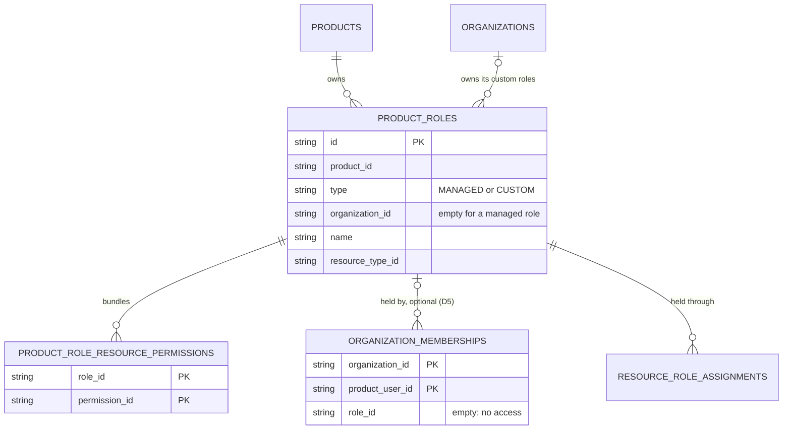

Two customers of the same Product, after Acme Corp added a custom role:

| Role | Type | Organization | Scope | Bundles | Assignable in |
| :-- | :-- | :-- | :-- | :-- | :-- |
| `admin` · `role_2qLBa0` | MANAGED | — | organization | everything | Acme Corp, Globex |
| `project-admin` · `role_2qLBp7` | MANAGED | — | project | `project:manage`, `folder:edit`, `document:view`, `document:edit`, `document:share` | Acme Corp, Globex |
| `billing-auditor` · `role_2qLGa7` | CUSTOM | Acme Corp | organization | `billing:read`, `document:view` | Acme Corp only |

Globex never sees `billing-auditor`. When the Product removes `document:share` from `project-admin`, every project admin in both Organizations loses it on the next check.

```http
POST /v1/products/prd_2qL8vH1nX0aR7mB3cK5dT9wQ/organizations/org_2qL9aC3mE8xP1rT6vN4bK2sJ/roles
{ "name": "Billing auditor", "resource_type": "organization",
  "permissions": ["billing:read", "document:view"] }

201 Created
{ "id": "role_2qLGa7kT3vN8xR1pQ5wZ2m", "type": "CUSTOM", "name": "Billing auditor",
  "organization_id": "org_2qL9aC3mE8xP1rT6vN4bK2sJ", "resource_type": "organization",
  "permissions": ["billing:read", "document:view"] }

PUT /v1/products/prd_2qL8vH1nX0aR7mB3cK5dT9wQ/organizations/org_2qL9aC3mE8xP1rT6vN4bK2sJ/members/pusr_2qLAp4rN8xK1vT6yQ3cW7jB
{ "role_ids": ["role_2qLGa7kT3vN8xR1pQ5wZ2m"] }

200 OK
{ "product_user_id": "pusr_2qLAp4rN8xK1vT6yQ3cW7jB",
  "roles": [ { "id": "role_2qLGa7kT3vN8xR1pQ5wZ2m", "name": "Billing auditor", "type": "CUSTOM" } ] }
```

The same `role_ids` sent for a member of Globex answers `400 ROLE_NOT_FOUND_IN_REQUEST`.

The life of that role, from creation to a decision:

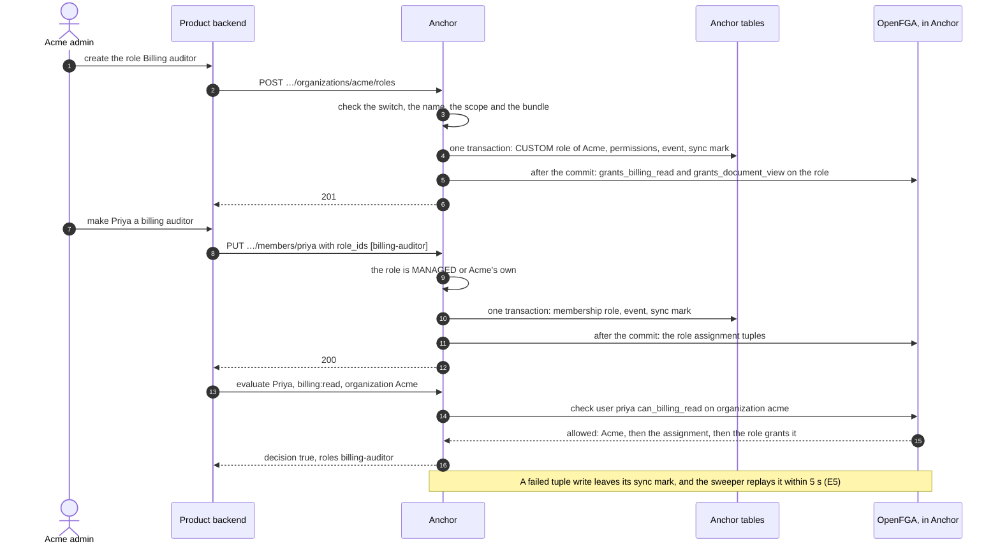

</details>

<details>
<summary>Why shared managed roles, and not a copy per Organization</summary>

| | A copy of each template per Organization (accepted 2026-10-25) | **Managed roles shared by every Organization (chosen)** |
| :-- | :-- | :-- |
| Rows | one per template per Organization: 10,000 Organizations with 8 templates is 80,000 rows, and their tuples in OpenFGA | one per managed role |
| A Product edits a role | the change is copied to every copy in the same transaction | the row changes; nothing to copy |
| Role IDs | each Organization has its own, so assignment needs `role_keys` and a template ID must resolve to the copy | one ID everywhere |
| A customer edits a Product role | edits its copy, which then stops following the template | creates a custom role instead |
| Delete of a role in use | detach the copies into custom roles | `409 ROLE_IN_USE` |
| Evaluation and the model (E3) | one path | one path: a membership or assignment holds a role row, whatever its type |

The cost is that an Organization can't change a managed role for itself. It writes a custom role with the bundle it wants and assigns that one.

</details>

<details>
<summary>Sources</summary>

- [OpenFGA: custom roles](https://openfga.dev/docs/modeling/custom-roles)

</details>

<details>
<summary>Superseded: every role belongs to an Organization, template copies and custom roles (accepted 2026-10-25)</summary>

**Decision.** Roles become data that each Organization owns, with the same template-and-copy split as licenses ([ADR-0004](0004-license-schema-template-and-copy.md), [ADR-0018](0018-license-follows-its-template.md)).

- **The Product's roles become role templates.** A template has a `key` (`admin`, `member`, `project-admin`), a name, a scope (D1) and a permission bundle. A template is never assigned directly.
- **Every Organization gets its own copy of each template** when it is created. A copy keeps the template's key and points back to it with `template_id`.
- **The customer may edit a copy.** Editing marks it `customized`, and template changes then stop reaching it (Q-D10.1). "Reset to template" brings it back in step.
- **The customer may create custom roles** in its Organization: its own key, name, scope and bundle, under the same scope rules as any role (D1). Which scopes allow them is a Product setting (D9).
- **A member holds a default role or a custom role through the same call.** Assignment (D3, D4), the default role (D5), events, the decision context and the evaluation never tell them apart. Responses add `origin: "template" | "custom"`, for display only.
- **Products address roles by key.** Each Organization has its own role IDs, so assignment calls also accept `role_keys: ["project-admin"]`, resolved inside the Organization. A key is unique in its Organization, and a custom role can't take a template's key.
- **Released clients keep working.** A template ID in `role_ids`, which is what today's clients send as a role ID, resolves to that Organization's copy.
- **A role in use is never deleted.** Deleting an assigned custom role answers `409 ROLE_IN_USE` with the number of assignments; the customer reassigns them first.
- **The routes** are `…/organizations/{o}/roles`. Anchor doesn't know who the customer's admins are, so the Product calls these routes from its own settings page, behind its own Organization-scoped permission such as `roles:manage`.

<details>
<summary>📌 Real example</summary>

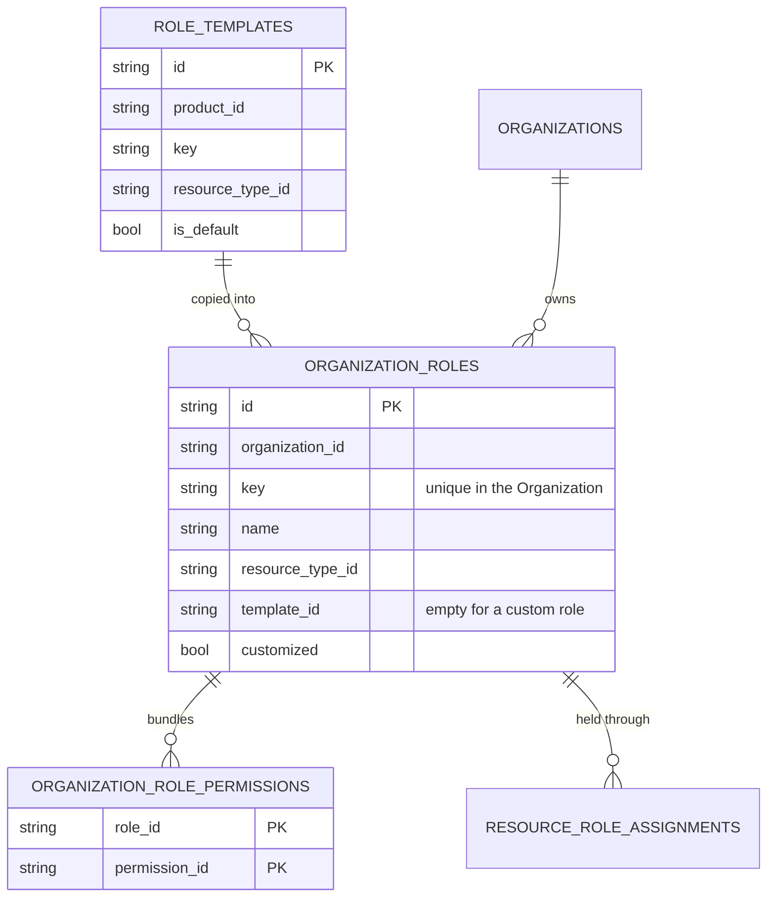

Two customers of the same Product, after Acme Corp edited one copy and added a custom role:

| Organization | Key | Origin | Scope | Bundles |
| :-- | :-- | :-- | :-- | :-- |
| Acme Corp | `admin` | template | organization | everything |
| Acme Corp | `member` | template, default | organization | nothing |
| Acme Corp | `project-admin` | template, **customized** | project | `project:manage`, `folder:edit`, `document:view`, `document:edit` (removed `document:share`) |
| Acme Corp | `billing-auditor` | **custom** | organization | `billing:read`, `document:view` |
| Globex | `admin`, `member`, `project-admin` | template | as the templates | as the templates |

Globex never sees `billing-auditor`, and its `project-admin` still bundles `document:share`.

```http
POST /v1/products/prd_2qL8vH1nX0aR7mB3cK5dT9wQ/organizations/org_2qL9aC3mE8xP1rT6vN4bK2sJ/roles
{ "key": "billing-auditor", "name": "Billing auditor", "resource_type": "organization",
  "permissions": ["billing:read", "document:view"] }

201 Created
{ "id": "orole_2qLGa7kT3vN8xR1pQ5wZ2m", "key": "billing-auditor", "name": "Billing auditor",
  "origin": "custom", "resource_type": "organization", "permissions": ["billing:read", "document:view"] }

PUT /v1/products/prd_2qL8vH1nX0aR7mB3cK5dT9wQ/organizations/org_2qL9aC3mE8xP1rT6vN4bK2sJ/members/pusr_2qLAp4rN8xK1vT6yQ3cW7jB
{ "role_keys": ["billing-auditor"] }

200 OK
{ "product_user_id": "pusr_2qLAp4rN8xK1vT6yQ3cW7jB",
  "roles": [ { "id": "orole_2qLGa7kT3vN8xR1pQ5wZ2m", "key": "billing-auditor",
               "name": "Billing auditor", "origin": "custom" } ] }
```

The life of that role, from creation to a decision:

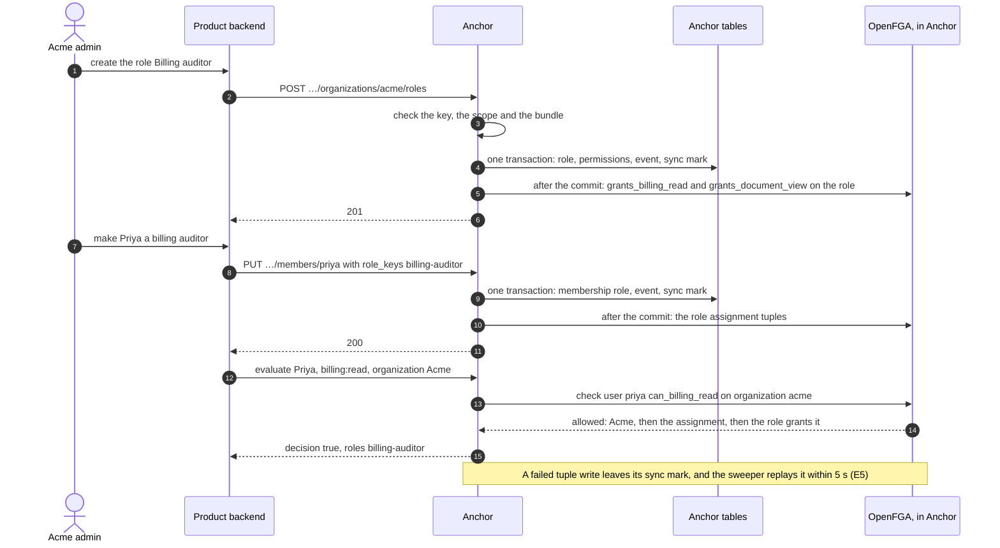

</details>

<details>
<summary>Why copies, and not Product roles plus Organization overrides</summary>

| | Product roles, with per-Organization overrides | **Every role belongs to an Organization (chosen)** |
| :-- | :-- | :-- |
| What a member holds | a Product role, plus an override to look up | a role of its Organization, always |
| A custom role | a second kind of role, with its own table and rules | the same row as a copy, with no `template_id` |
| Evaluation and the model (E3) | two paths | one path |
| Precedent in Anchor | none | license templates and copies (ADR-0004, ADR-0018) |

The cost is one row per template per Organization: 10,000 Organizations with 8 templates is 80,000 small rows.

</details>

<details>
<summary>Sources</summary>

- [OpenFGA: custom roles](https://openfga.dev/docs/modeling/custom-roles)
- [ADR-0004](0004-license-schema-template-and-copy.md) and [ADR-0018](0018-license-follows-its-template.md), the license template and copy

</details>

</details>

</details>

<a id="dr-d9"></a>
<details>
<summary><b>DR-D9</b> · Custom roles open per resource type: Organization first, then the Product's own types — <i>✅ Accepted</i></summary>

**Decision.** Each resource type gets an `allows_custom_roles` switch the Product turns on. It is off by default, so an existing Product changes nothing (G2). A customer may create a custom role only on a type whose switch is on.

| Phase | Customers can create custom roles on | Example in Acme Corp |
| :-- | :-- | :-- |
| 1 | Organization | `billing-auditor` |
| 2 | any of the Product's own types whose switch is on | `release-manager` on `project`, `reviewer` on `folder` |

Phase 2 changes nothing in the engine, the tables or the assignment API: a custom role is a row with a scope, whatever that scope is. It adds the switch on the Product's own types, its validation, and the scope picker in the role editor. Managed roles exist on every type from the start, so a Product can offer `project-admin` everywhere before it lets customers write their own project roles.

<details>
<summary>📌 Real example</summary>

```http
PATCH /v1/products/prd_2qL8vH1nX0aR7mB3cK5dT9wQ/resource-types/project
{ "allows_custom_roles": true }

POST /v1/products/prd_2qL8vH1nX0aR7mB3cK5dT9wQ/organizations/org_2qL9aC3mE8xP1rT6vN4bK2sJ/roles
{ "name": "Release manager", "resource_type": "project",
  "permissions": ["project:manage", "document:view"] }
→ 201

POST /v1/products/prd_2qL8vH1nX0aR7mB3cK5dT9wQ/organizations/org_2qL9aC3mE8xP1rT6vN4bK2sJ/roles
{ "name": "Reviewer", "resource_type": "folder", "permissions": ["document:view"] }
→ 400 { "code": "CUSTOM_ROLES_DISABLED",
        "message": "This product doesn't allow custom roles on folder." }
```

</details>

> **Implementation note (PR 3).** The switch is `allows_custom_roles`: nullable with no default, so a type the previous release writes during the deploy reads as off. Turning it off keeps the existing custom roles and the access they grant; the Organization can still delete them but not create or change them (`400 CUSTOM_ROLES_DISABLED`). See [managed and custom roles](../technical/managed-and-custom-roles.md#custom-roles).
>
> **Implementation note (PR 14).** Phase 2 is in: every resource type of the Product accepts `allows_custom_roles: true`, and `CUSTOM_ROLES_NOT_AVAILABLE` is gone. Each switch opens custom roles scoped to its own type only, under the same scope rule as any role (D1). The 50 custom roles of an Organization (D10) count every type together. The admin UI enables the switch on every published type.

> **Q-D9.1** Is Organization behind the same switch, or always open to custom roles? *(recommended: behind the switch, off by default; each Product decides whether its customers write roles at all)*
>
> **Answer:** behind the switch, off by default, Organization included.

</details>

<a id="dr-d10"></a>
<details>
<summary><b>DR-D10</b> · Role changes, deletes and limits (revised) — <i>✅ Accepted</i></summary>

> **Revised 2026-10-26** to follow the revised D8: no copies, so nothing to propagate or detach. The accepted version is kept folded below.

**Decision.**

| When | Behaviour |
| :-- | :-- |
| The Product edits a managed role | The row changes, so every member who holds it, in every Organization, gets the new bundle on the next check. |
| An Organization edits its custom role | Only its own members who hold that role are affected. |
| The Product deletes a managed role | `409 ROLE_IN_USE` while any membership, pending invitation or assignment in any Organization names it, with the count. Otherwise it is deleted. |
| An Organization deletes its custom role | `409 ROLE_IN_USE` while one of its memberships, pending invitations or assignments names it. |
| An Organization is deleted | Its custom roles are deleted with it. |
| The Product deletes a permission | It is removed from every role that bundles it, custom roles included, and from Organization API keys, in one transaction, with a role-updated event per role changed. A customer's custom role never blocks the Product's catalog. |
| An Organization creates custom roles | At most 50 per Organization. |

A delete locks the role row `FOR UPDATE` before it counts, so a member added at the same moment waits and then fails with `400 ROLE_NOT_FOUND_IN_REQUEST`, instead of being removed by the cascade.

<details>
<summary>📌 Real example</summary>

The Product deletes the permission `document:share`. Two roles bundle it:

| Role | Type | Before | After, in the same transaction |
| :-- | :-- | :-- | :-- |
| `project-admin` | MANAGED | `document:view`, `document:share` | `document:view` |
| `billing-auditor` (Acme Corp) | CUSTOM | `billing:read`, `document:share` | `billing:read`; Acme Corp gets a role-updated event |

Refusing the delete instead would let one customer's custom role block the Product's own catalog, and the Product can't edit that role.

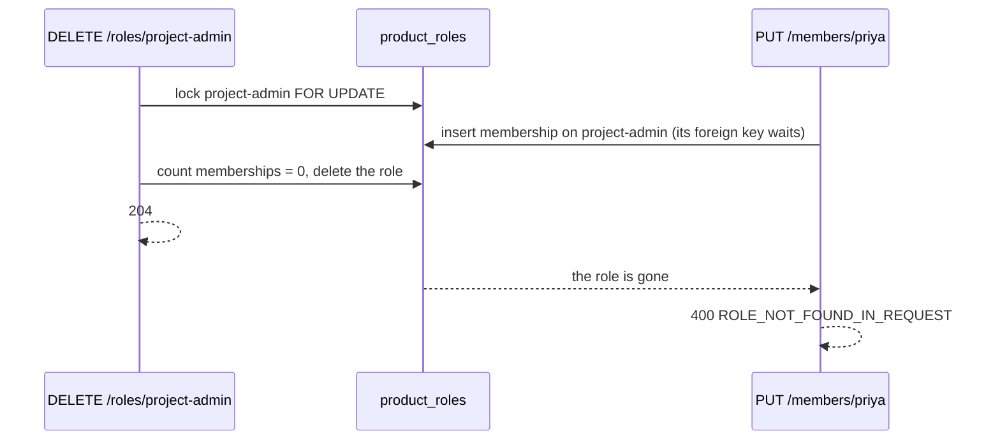

</details>

> **Q-D10.4** A limit on custom roles per Organization? *(recommended: 50)*
>
> **Answer:** at most 50 per Organization.

> **Q-D10.5** When the Product deletes a permission a custom role bundles? *(recommended: remove it from every role, custom roles included)*
>
> **Answer:** remove it from every role, with an event. (2026-10-26)

<details>
<summary>Superseded: template changes, deletes, the default role and limits (accepted 2026-10-25)</summary>


**Decision.**

| When | Recommended behaviour |
| :-- | :-- |
| The Product edits a template | Copies that aren't customized follow it in the same transaction, as licenses follow their template (ADR-0018). Customized copies keep their bundle, and the role editor shows "template changed" with the difference and a reset. |
| The Product adds a template | Every Organization gets a copy, through a background job like the license bulk migration ([ADR-0014](0014-organization-licenses-are-migrated-in-bulk.md)). |
| The Product deletes a template | Its copies are detached: they become custom roles of their Organization, so no member loses access. |
| An Organization's default role (D5) | Starts as the copy of the Product's default template. The customer may choose any of its Organization-scoped roles instead. |
| An Organization creates custom roles | At most 50 per Organization. |

<details>
<summary>📌 Real example</summary>

The Product removes `document:share` from the `project-admin` template:

| Organization | Its `project-admin` | Result |
| :-- | :-- | :-- |
| Globex | not customized | loses `document:share` in the same transaction; one tuple deleted per copy |
| Acme Corp | customized | unchanged; the editor shows "The template removed `document:share`" with **Reset** |

</details>

> **Q-D10.1** When a template changes, do its copies follow? *(recommended: yes, except customized copies)*
>
> **Answer:** yes, except customized copies.

> **Q-D10.2** When a template is deleted, what happens to its copies? *(recommended: they become custom roles of their Organization)*
>
> **Answer:** they become custom roles of their Organization.

> **Q-D10.3** Can an Organization choose its own default role? *(recommended: yes, among its Organization-scoped roles)*
>
> **Answer:** yes, among its Organization-scoped roles.

> **Q-D10.4** A limit on custom roles per Organization? *(recommended: 50)*
>
> **Answer:** at most 50 per Organization.

</details>

</details>

<a id="dr-d11"></a>
<details>
<summary><b>DR-D11</b> · A custom role never blocks the Product's tree — <i>✅ Accepted</i></summary>

> **Added 2026-10-29** with PR 14, which opens custom roles on every type of the Product (D9 phase 2). Before it, a custom role could only be scoped to `organization`, which sits above every type and can't be deleted, so it never touched a tree change.

**Context.** A custom role on a Product type now uses that type like a managed role does: its permissions sit at or below its scope (D1). Two tree changes would refuse because of it:

- moving a type so that a custom role's permission falls out of its scope (`PATCH` of the type or the tree `PUT`);
- deleting the type the custom role is scoped to.

The Product can't edit or delete an Organization's custom role. A 409 that names one leaves the Product stuck until the Organization acts, which D10 rules out.

**Decision.**

| When | Managed role | Custom role |
| :-- | :-- | :-- |
| A tree change moves a permission out of the role's scope | `409 RESOURCE_TYPE_IN_USE` with the role in `metadata.role_ids`, as before | The role loses that permission in the same transaction, with `organization.role.updated`. It keeps its other permissions and its holders. |
| The Product deletes the role's type | `409 RESOURCE_TYPE_IN_USE`, counted in `blocked_by.roles` | Nobody holds it: deleted with the type, with `organization.role.deleted`. A membership, an assignment or a pending invitation holds it: `409 RESOURCE_TYPE_IN_USE`, counted in `blocked_by.custom_roles_held`. |

A type delete still needs its child types, permissions and registered resources gone first. Each permission delete already strips that permission from custom roles (D10), so a custom role deleted with its type grants nothing by then.

The delete locks the type's custom roles `FOR UPDATE` before it counts their holders, as a role delete does (D10). A member added on one at the same moment waits, then fails its foreign key, instead of being removed by the cascade.

<details>
<summary>📌 Real example</summary>

Acme Corp's custom role `release-manager` is scoped to `project` and holds `project:manage` and `document:view`. The Product moves `document` to sit under `organization` only:

```http
PATCH /v1/products/prd_acme/resource-types/rt_document
{ "parent_types": ["organization"] }

200 OK
```

| Role | Before | After, in the same transaction |
| :-- | :-- | :-- |
| `release-manager` (Acme Corp, CUSTOM) | `project:manage`, `document:view` | `project:manage`; Acme Corp gets `organization.role.updated` |

The Product then deletes `document:view`, then the type `document`. Globex's custom role `reader` is scoped to `document`:

| `reader` is | `DELETE /resource-types/rt_document` |
| :-- | :-- |
| held by nobody | `204`; `reader` is deleted, Globex gets `organization.role.deleted` |
| Ana's Organization role in Globex | `409 RESOURCE_TYPE_IN_USE`, `blocked_by: {child_types: 0, roles: 0, permissions: 0, custom_roles_held: 1}` |

</details>

**Rejected.**

- **Block on every custom role, and record it as accepted.** The Product would wait on each Organization. With the type's switch off, an Organization can't even change the role, only delete it.
- **Delete held custom roles too.** A membership's role cascades away with the role (`ON DELETE CASCADE`), so Ana would leave Globex without anyone asking. Refusing a held role costs one 409 and loses no member.

> **Q-D11.1** When the Product deletes a type that an Organization's custom role is scoped to? *(recommended: delete the custom roles nobody holds; refuse while one is held)*
>
> **Answer:** delete the unheld ones with an event, refuse with `blocked_by.custom_roles_held` while one is held. (2026-10-29)

> **Follow-up.** A membership or invitation may still name a role of any type as the Organization role, which D4 doesn't intend: such a role grants nothing on the Organization. Requiring an Organization-scoped role there removes the held case for memberships. Tracked in [#301](https://github.com/nanostack-dev/anchor/issues/301).

</details>

### E. Access decisions

<a id="dr-e1"></a>
<details>
<summary><b>DR-E1</b> · Grants only, inherited downward — <i>✅ Accepted</i></summary>

**Decision.** A subject holds *P* on *R* when:
- a role it holds on *R* or on any ancestor of *R*, its Organization role included, bundles *P*; or
- it is an Organization API key of *R*'s Organization that holds *P*.

There is no deny, no exclusion and no condition. Those stay out until a product needs one; a deny layer would come after this, as discussed earlier.

<details>
<summary>📌 Real example</summary>

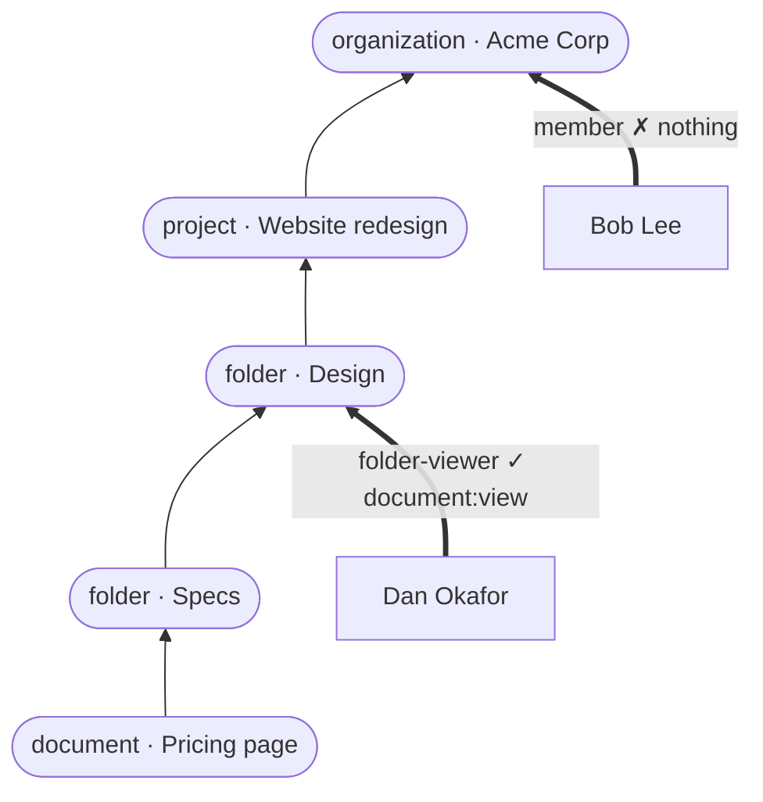

| Asked | Walk | Result |
| :-- | :-- | :-- |
| Dan, `document:view`, Pricing page | Pricing page → Specs → **Design** (folder-viewer bundles it) | allowed |
| Dan, `document:edit`, Pricing page | … → Website redesign → Acme Corp, nothing bundles it | denied, `MISSING_PERMISSION` |
| Bob, `document:view`, Pricing page | … → Acme Corp (`member`, no permissions) | denied, `MISSING_PERMISSION` |

</details>

<details>
<summary>Sources</summary>

- [Zanzibar: Google's consistent, global authorization system](https://research.google/pubs/zanzibar-googles-consistent-global-authorization-system/)

</details>

</details>

<a id="dr-e2"></a>
<details>
<summary><b>DR-E2</b> · The evaluation API takes any resource type — <i>✅ Accepted</i></summary>

**Decision.**
- **Request:** `resource.type` accepts any resource type slug of the Product, and `resource.id` is the product's ID (B2). A user subject still needs `properties.organization_id`. `properties.parent` names the parent of an unregistered resource (B1).
- **Organization** behaves as today. `workspace` becomes an ordinary type (A6); `WORKSPACE_NOT_IN_ORGANIZATION` stays until the built-in Workspace is deleted, then gives way to `RESOURCE_NOT_IN_ORGANIZATION`.
- **New deny reasons:** `RESOURCE_TYPE_NOT_FOUND`, `RESOURCE_NOT_FOUND` (unregistered with no parent given), and `RESOURCE_NOT_IN_ORGANIZATION`.
- **Explaining a decision** is an **Anchor extension to AuthZEN**. A caller that sends `options.explain: true` gets `granted_by`, the roles and resources that granted the permission. It lives **inside `context`**, which AuthZEN leaves free-form, so the response stays valid for any AuthZEN client, which ignores the key. Without the option, no `granted_by` is computed and a decision costs no more than a plain check.

> **Implementation note (M4, PR 13).** A parent of a type the resource's type can't sit under is denied with a fourth reason, `PARENT_TYPE_NOT_ALLOWED`. An unregistered resource with no parent is `RESOURCE_NOT_FOUND` even when another Organization registered the same ID: under B2 that is a different resource, and naming it would reveal the ID exists there. `RESOURCE_NOT_IN_ORGANIZATION` is kept for a named parent registered only in another Organization, or a parent that is another Organization; it reveals that the parent exists in another Organization of the Product. `granted_by` lists `{ role: { id, name }, resource: { type, id } }`, and an API key's own grant is `{ api_key: { id, name }, resource: { type: "organization", id } }`. An unregistered resource is checked through a contextual parent tuple. Until M5 moves workspaces into the generic model (A6 phase 2), `workspace` keeps naming the built-in workspace even when a Product declares that slug. See [Access evaluation](../technical/access-evaluation.md#resources).

<details>
<summary>📌 Real example</summary>

```http
POST /v1/products/prd_2qL8vH1nX0aR7mB3cK5dT9wQ/access/v1/evaluation
{ "subject":  { "type": "user", "id": "user_2NNEqL2nrIRdJ194ndJqow38MB1" },
  "action":   { "name": "document:view" },
  "resource": { "type": "document", "id": "5d0b3c9a-e261-4f8d-a7c4-92b1e6f0d384",
                 "properties": { "organization_id": "org_2qL9aC3mE8xP1rT6vN4bK2sJ",
                                 "parent": { "type": "project", "id": "9f1c2a4e-6b3d-4c8e-a1f0-2d7e5b9c3a11" } } },
  "options":  { "explain": true } }

200 OK
{ "decision": true,
  "context": { "roles": [ { "id": "role_2qLBpr0jAdm4kR9tV2xN7q", "name": "project-admin" } ],
               "granted_by": [ { "role": "project-admin",
                                 "resource": { "type": "project", "id": "9f1c2a4e-6b3d-4c8e-a1f0-2d7e5b9c3a11" } } ] } }
```

| Request | Reason |
| :-- | :-- |
| `resource.type: "dashboard"`, not declared | `RESOURCE_TYPE_NOT_FOUND` |
| unregistered document, no `parent` | `RESOURCE_NOT_FOUND` |
| parent in Globex while the user asks in Acme Corp | `RESOURCE_NOT_IN_ORGANIZATION` |

</details>

<details>
<summary>What AuthZEN is, and what it leaves to Anchor</summary>

**AuthZEN** is the OpenID Foundation's standard way to ask an authorization service for a decision: the **Authorization API 1.0**, from the OpenID AuthZEN working group, marked Final on 11 January 2026. It makes "can this subject do this action on this resource?" look the same across products, as OpenID Connect did for sign-in.

| AuthZEN defines | Anchor |
| :-- | :-- |
| `POST /access/v1/evaluation` and `/evaluations` with `subject`, `action`, `resource`, `context` | follows it (ADR-0021's evaluation endpoint) |
| `options.evaluations_semantic`: `execute_all`, `deny_on_first_deny`, `permit_on_first_permit` | follows it |
| response: required `decision`, optional free-form `context` | `context` carries `reason`, `roles`, `permissions` and, on request, `granted_by` |
| `/access/v1/search/subject`, `/resource`, `/action` | not yet (E4) |
| an explain option | **not defined**; `options.explain` is Anchor's extension |

The spec only shows reasons in a non-normative example (`reason_admin`, `reason_user`), so how to explain a decision is left to each implementation.

</details>

<details>
<summary>Sources</summary>

- [OpenID Authorization API 1.0 (AuthZEN)](https://openid.net/specs/authorization-api-1_0.html)

</details>

> **Q-E2.1** Should the decision context say *where* access came from, e.g. `granted_by: [{ role: "folder-viewer", resource: { type: "folder", id: "…" } }]`? It costs one more walk per allowed decision and powers the explainer (F5). *(recommended: yes, only on request with `options.explain: true`)*
>
> **Answer:** yes, as an Anchor extension: `options.explain: true` adds `granted_by` inside `context`.

</details>

<a id="dr-e3"></a>
<details>
<summary><b>DR-E3</b> · Roles are data; the Product's OpenFGA model holds only types and permissions — <i>✅ Accepted (depends on ADR-0021)</i></summary>

**Decision.** Anchor compiles the Product's types and permissions into its OpenFGA model, and writes roles as tuples. The model never names a role, so creating, editing or deleting a role, whether managed or custom (D8), never changes it.

The model has two fixed types, plus one type per resource type:
- **`role`**: one `grants_<permission>` relation per permission, of type `[user:*]`. A role's bundle is one tuple per permission.
- **`role_assignment`**: which role (`role`) is held by whom (`assignee`), and `can_<permission>: assignee and grants_<permission> from role`.
- **Each resource type *T***: `parent`, `assignment: [role_assignment]`, and, for each permission scoped to *T* or below, `can_<permission>: can_<permission> from assignment or can_<permission> from parent`. Organization also lists `[api_key]` on each permission (D7).

Anchor still enforces the scope rules (D1) when it writes the rows; the model follows the tuples. The proof of concept compiles roles into the model, and moves to this shape.

The semantics don't depend on OpenFGA. If ADR-0021 is rejected, the same walk is a short recursive query in Postgres.

> **Implementation note (M4, PR 11).** A resource's object is `rt_<slug>:<Anchor row id>`, not the product's identifier. OpenFGA objects are at most 256 characters, and a product's identifier is unique only in its Organization and type, so it can't name an object in the Product's one store. See [Resources](../technical/resources.md).

<details>
<summary>The problem it solves, with numbers</summary>

**Roles can't live in the model.** OpenFGA refuses models over 256 KB, and the review measured about 58 bytes per role reference. Compiling roles into the model makes its size grow with the number of roles, and per-Organization roles (D8) multiply that by the number of Organizations. Every role edit would also publish a new model version for the whole Product.

Estimated model size for four types (organization, project, folder, document), with roles and permissions spread evenly:

| Catalog | Roles in the model, on every type (ADR-0021 proof of concept) | Roles in the model, on their own type only | **Roles as data (chosen)** |
| :-- | --: | --: | --: |
| 10 roles · 35 permissions | ≈ 81 KB | ≈ 18 KB | ≈ 10 KB |
| 100 roles · 50 permissions | ≈ 1.2 MB ❌ | ≈ 189 KB | ≈ 13 KB |
| 10,000 Organizations · 3 custom roles each · 35 permissions | ❌ 30,000 roles | ❌ 30,000 roles | ≈ 10 KB, unchanged |
| What one role edit writes | a new model for the whole Product | a new model for the whole Product | a few tuples |

With roles as data, the model costs about 265 bytes per permission at four types, so the 256 KB limit is near 1,000 permissions, whatever the number of roles or Organizations.

**What moves into tuples.**

| Data | Tuples |
| :-- | --: |
| A role bundling *k* permissions | *k* |
| One role assignment | 3 |
| 10,000 Organizations × 8 roles × 12 permissions | ≈ 1 million |

Tuples are rows in the `openfga` schema, read by index. A check reads a handful of them, whatever the total.

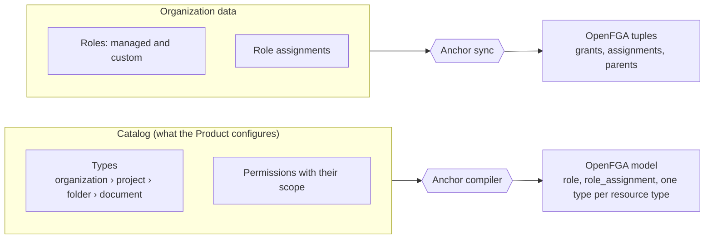

</details>

<details>
<summary>📌 Real example</summary>

Priya Nair holds Acme Corp's custom `billing-auditor` (D8). Its tuples, with IDs shortened:

```text
role:acme_billing_auditor   # grants_billing_read   @ user:*
role:acme_billing_auditor   # grants_document_view  @ user:*
role_assignment:acme_priya  # role                  @ role:acme_billing_auditor
role_assignment:acme_priya  # assignee              @ user:priya
organization:acme           # assignment            @ role_assignment:acme_priya
```

`check user:priya can_billing_read organization:acme` walks:

1. `organization:acme` → `can_billing_read from assignment` → `role_assignment:acme_priya`;
2. its `assignee` is Priya ✓, and `grants_billing_read from role` → `role:acme_billing_auditor` grants it to every user ✓;
3. **allowed**.

Removing `billing:read` from the role deletes the first tuple, and the same check is denied. The model doesn't change.

</details>

<details>
<summary>Example: the compiled model for a document product</summary>

```text
type role
  relations
    define grants_billing_read: [user:*]
    define grants_document_view: [user:*]

type role_assignment
  relations
    define role: [role]
    define assignee: [user]
    define can_billing_read: assignee and grants_billing_read from role
    define can_document_view: assignee and grants_document_view from role

type organization
  relations
    define assignment: [role_assignment]
    define can_billing_read: [api_key] or can_billing_read from assignment
    define can_document_view: [api_key] or can_document_view from assignment

type folder
  relations
    define parent: [project, folder]
    define assignment: [role_assignment]
    define can_document_view: can_document_view from assignment or can_document_view from parent
```

</details>

<details>
<summary>Sources</summary>

- [OpenFGA: custom roles](https://openfga.dev/docs/modeling/custom-roles)
- [OpenFGA: concepts](https://openfga.dev/docs/concepts)
- [OpenFGA: parent-child objects](https://openfga.dev/docs/modeling/parent-child)
- [ADR-0021](0021-access-decisions-come-from-openfga.md), the engine and its sync

</details>

</details>

<a id="dr-e4"></a>
<details>
<summary><b>DR-E4</b> · Listing what a subject can reach — <i>⚪ Deferred</i></summary>

**Decision.** "Which documents can Alice see?" is not in this change. When it comes, it returns registered containers plus directly shared resources, and the product filters its own rows, as the Zanzibar discussion concluded.

<details>
<summary>📌 Real example</summary>

What a later list call could look like, for reference only:

```http
POST /v1/products/prd_2qL8vH1nX0aR7mB3cK5dT9wQ/access/v1/search/resources
{ "subject": { "type": "user", "id": "user_2NNE…dan" },
  "action": { "name": "document:view" }, "resource": { "type": "document" } }

→ { "containers": [ { "type": "folder", "id": "3b7e91d2-0c4a-4f6e-9d21-8a5c7e4b2f60" } ],
     "resources":  [ ] }
```

The product then lists its own documents whose folder is Design or below.

</details>

<details>
<summary>Sources</summary>

- [OpenFGA: ListObjects](https://openfga.dev/docs/getting-started/perform-list-objects)

</details>

</details>

<a id="dr-e5"></a>
<details>
<summary><b>DR-E5</b> · Anchor's tables stay the source of truth; OpenFGA holds a mirror written after each commit — <i>✅ Accepted</i></summary>

**Decision.** Mirror. Anchor's tables remain the only source of truth for Organizations, memberships, resources and role assignments. OpenFGA is a derived index for decisions and inherited lists, and can be rebuilt from the tables at any time. Products follow the same split towards Anchor: their entities stay in their own database, and they send Anchor only the facts that grant access (parent links, role assignments), as DR-B1 describes.

**When a write reaches OpenFGA.** Right after its transaction commits, the request that changed access replays its Organization's sync marks: the same diff the sweeper runs, under the same lock. The next request already sees the change. If the tuple write fails or the process stops, the mark stays, and the sweeper replays it within 5 s; a full reconcile every 15 min catches anything else. Decisions never look for marks.

This replaces the proof of concept's check before each decision (ADR-0021). That check cost every decision one more query to protect writes, which are far rarer.

> **Implementation note (M4, PR 11).** A resource write marks its own object (`rt_<slug>:<Anchor row id>`), not its Organization, and its replay syncs only that object, so the cost of a write never grows with the Organization's registry. See [Authorization engine](../technical/authorization-engine.md#resource-tuples).

<details>
<summary>📌 Who owns what</summary>

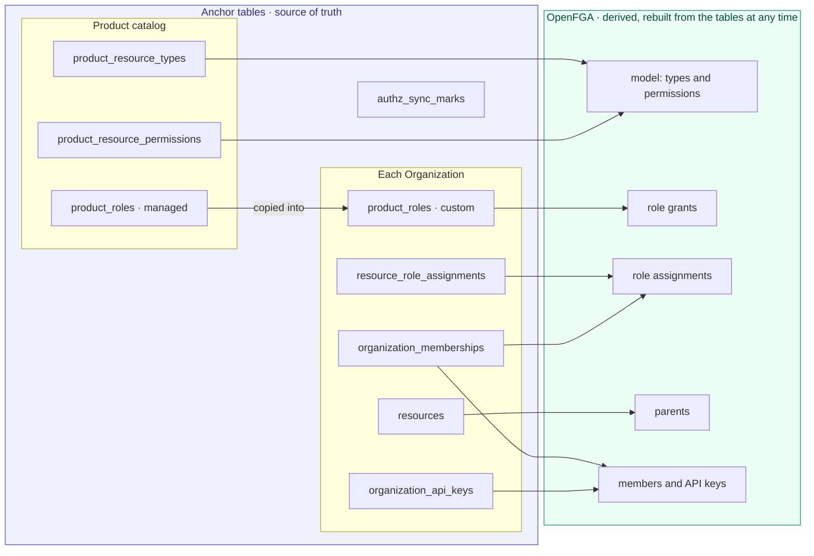

</details>

<details>
<summary>When a write reaches OpenFGA: the options</summary>

| | Check marks before each decision (proof of concept) | **Write right after the commit (chosen)** |
| :-- | :-- | :-- |
| A write counts on the next request | yes | yes, when the tuple write succeeds |
| Extra cost on each decision | one query for marks | none |
| If the tuple write fails | the next decision replays it | the sweeper replays it within 5 s; until then, the previous answer |

OpenFGA leaves keeping the two stores in step to the application, and names the risk the dual-write problem. The sync mark is a transactional outbox: written in the same transaction as the change, and replayed until it succeeds.

</details>

<details>
<summary>📌 Real example</summary>

The same fact, Dan holds folder-viewer on Design, in both places:

| Anchor table (source of truth) | OpenFGA tuple (mirror) |
| :-- | :-- |
| `resource_role_assignments`: Acme Corp · folder · `3b7e91d2…` · Dan Okafor · folder-viewer | `role_assignment:… # role @ role:…folder_viewer`<br/>`role_assignment:… # assignee @ user:pusr_2qLAd3nO7kF2jY6uM1sB9cV`<br/>`folder:3b7e91d2… # assignment @ role_assignment:…` |

| Question | Answered by |
| :-- | :-- |
| "Members of Design, sorted by email, page 2" | SQL over `resource_role_assignments` joined to product users |
| "Can Dan view Pricing page?" | OpenFGA check |
| "Who can view Pricing page, through any path?" | OpenFGA `ListUsers` |

</details>

<details>
<summary>Context and options</summary>

A relationship store such as OpenFGA can be used in two ways. Its read APIs (`Read`, `ListUsers`, `ListObjects`, `Expand`) can answer "who is a member of this Organization" on their own, so Anchor *could* keep relationships only there.

| | **Mirror** (recommended) | **Source of truth for relationships** |
| :-- | :-- | :-- |
| Where memberships, role assignments and parent links live | Anchor's tables, copied into OpenFGA as tuples | only in OpenFGA |
| Checks and inherited lists ("who can view this document?") | OpenFGA | OpenFGA |
| Member and assignment pages: search, sort, cursor paging, counts | SQL, as today | IDs from `ListUsers`, then names fetched and sorted in code; results capped by a server maximum and deadline |
| A write, its event and a related row (an accepted invitation) in one transaction | yes | no: OpenFGA writes sit outside Postgres transactions |
| Keeping two stores in step | needed: sync marks, sweeper, periodic reconcile ([ADR-0021](0021-access-decisions-come-from-openfga.md)) | not needed |
| Backup, migration, audit | one database | two, with access data only in the second |
| Changing engine later (DR-E3) | rebuild from the tables | export from OpenFGA first |

</details>

<details>
<summary>Why</summary>

Every Anchor collection is a cursor search with sort and filters, and every write emits its event in the same transaction as the row. Neither works if relationships live only in OpenFGA. The cost of the mirror, keeping it in step, is already built and reviewed in the proof of concept.

</details>

<details>
<summary>Sources</summary>

- [OpenFGA: relationship queries](https://openfga.dev/docs/interacting/relationship-queries) (Read, Expand, ListObjects, ListUsers)
- [OpenFGA: ListUsers](https://openfga.dev/docs/getting-started/perform-list-users)
- [OpenFGA: consistency](https://openfga.dev/docs/interacting/consistency)

</details>

> **Q-E5.1** Mirror, or OpenFGA as the only store of relationships? *(recommended: mirror)*
>
> **Answer:** mirror: Anchor's tables own every fact, and OpenFGA is derived.

> **Q-E5.2** Bring OpenFGA up to date before each decision, or right after each write? *(recommended: after each write, with the sync mark as backup)*
>
> **Answer:** right after each write; the mark and the sweeper are the backup.

</details>

### F. Admin UI

<a id="dr-f1"></a>
<details>
<summary><b>DR-F1</b> · Three catalog pages — <i>✅ Accepted</i></summary>

**Decision.** Under **Product**:
- **Resource types:** the canvas.
- **Permissions:** gains a *Resource type scope* column and filter.
- **Roles:** gains a *Resource type scope* column, a filter, a *Default* chip (D5) and a permission count.

Creating or editing a role or a permission is a route, not a dialog; dialogs are kept for delete confirmations. React Flow (`@xyflow/react`) becomes a dependency of `anchor-ui`. It is already used in the Anchor workflows prototype.

<details>
<summary>📌 Real example</summary>

```mermaid
flowchart LR
    product["Product: Lumen Docs"] --> rt["Resource types<br/>canvas"]
    product --> perms["Permissions<br/>with scope column"]
    product --> roles["Roles<br/>with scope column"]
    rt -- "node › view roles" --> roles
    rt -- "node › view permissions" --> perms
```

</details>

</details>

<a id="dr-f2"></a>
<details>
<summary><b>DR-F2</b> · The canvas: React Flow with computed layout — <i>✅ Accepted</i></summary>

**Decision.**
- **Layout is computed, never stored.** Positions come from a top-down layered layout (`@dagrejs/dagre`, small and synchronous), recomputed on every change. Nodes can't be dragged, so the tree always reads top to bottom and no coordinates live in the database.
- **Edges** go from parent type to child type. A self-nesting type (A3) shows a small loop badge ("nests in itself") instead of an edge that circles back.
- **Organization** is drawn first and locked, with a lock icon and a "Built in" tooltip, and can't be selected for delete.
- **Pan and zoom** come with zoom controls (+ / − / fit) and fit-to-view on load.
- **Known React Flow 12 traps,** each with its fix (below).

<details>
<summary>📌 Real example</summary>

```text
┌ Resource types ───────────────────────────────── [ Edit resource types ] ┐
│                                                                           │
│                    ┌──────────────────┐                                   │
│                    │ 🔒 Organization   │                                   │
│                    └────────┬─────────┘                                   │
│                    ┌────────┴─────────┐                                   │
│                    │ project          │                                   │
│                    └───┬──────────┬───┘                                   │
│          ┌─────────────┴────┐     │                                       │
│          │ folder  ↻ nests  │     │                                       │
│          └─────────┬────────┘     │                                       │
│                    ┌──────────────┴───┐                                   │
│                    │ document         │  parents: folder, project         │
│                    └──────────────────┘                                   │
│ [+] [−] [⤢]                                                               │
└───────────────────────────────────────────────────────────────────────────┘
```

</details>

<details>
<summary>Known React Flow 12 traps</summary>

| Trap | Fix |
| --- | --- |
| Clicks on non-draggable nodes do nothing | Pass a no-op `onNodeClick` |
| Buttons inside a node don't respond | Give them the `nodrag nopan` classes |
| Edges snap while nodes slide | Never put a CSS transition on `.react-flow__node` transforms |
| The attribution link fails the a11y check | Override its colour with the muted-foreground token |

</details>

<details>
<summary>Sources</summary>

- [React Flow: learn](https://reactflow.dev/learn)
- [dagre layout](https://github.com/dagrejs/dagre)

</details>

</details>

<a id="dr-f3"></a>
<details>
<summary><b>DR-F3</b> · Canvas interaction and motion — <i>✅ Accepted</i></summary>

**Decision (following Emil Kowalski's design engineering rules):**

- **Read mode by default; edit mode on demand.** An *Edit resource types* button switches the canvas into editing. Reading the tree is the common case and should show no editing controls.
- **Draft, then publish.** Edits stay a local draft, shown with a summary ("2 types added, 1 renamed"). *Publish* sends the whole tree in one call. Anchor validates it as a whole (cycles, depth, in-use rules from A5) and compiles one new model, instead of a model version per keystroke. *Discard* restores the published tree.
- **Adding a type.** In edit mode, hovering or focusing a node reveals a `+` handle below it. Activating it inserts a child in a naming state with a focused input: Enter commits, Escape removes it.
- **Inspector beside the canvas,** not a modal, for the selected type:
  - its name, and its slug, editable only until first publish;
  - its allowed parent types (A3);
  - counts of its roles, permissions and resources;
  - delete, disabled with the reason ("3 roles are scoped to folder") when A5 forbids it.
- **Keyboard.**
  - **Keys:** arrow keys move between nodes along the tree, Enter renames, `N` adds a child, Delete asks to delete.
  - **Motion:** keyboard actions never animate; they're repeated too often.
- **Motion,** with a purpose for each (below).

<details>
<summary>📌 Real example</summary>

```text
┌ Resource types · editing ─────────────────────────── [ Discard ] [ Publish ] ┐
│ Draft: 1 type added · 1 renamed                                               │
│                                                    ┌ folder ───────────────┐ │
│        ┌──────────────┐                            │ Name   Folder          │ │
│        │ 🔒 Organization│                           │ Slug   folder          │ │
│        └──────┬───────┘                            │ Parents  project       │ │
│        ┌──────┴───────┐                            │ ☑ Nests in itself      │ │
│        │ project      │                            │ 2 roles · 2 perms      │ │
│        └──────┬───────┘                            │ 42 resources           │ │
│        ┌──────┴───────┐                            │ [Delete] disabled:     │ │
│        │ folder  ◉    │ ← selected                 │ 2 roles use it         │ │
│        └──────┬───────┘                            └────────────────────────┘ │
│            ( + ) add a child                                                  │
│ ┌──────────────┐                                                               │
│ │ section▍     │ ← new, naming (Enter to keep, Esc to drop)                    │
│ └──────────────┘                                                               │
└───────────────────────────────────────────────────────────────────────────────┘
```

</details>

<details>
<summary>Motion, with a purpose for each</summary>

| Moment | Motion | Why |
| --- | --- | --- |
| A new node appears | opacity 0→1 and scale 0.96→1, 150 ms, `cubic-bezier(0.23, 1, 0.32, 1)` | Nothing should pop out of nowhere; never start from `scale(0)` |
| The layout reflows after an add or delete | node positions interpolated over 200 ms with the same ease-out, edges following each frame | Keeps the reader's place in the tree; no CSS transform transitions, which make edges snap |
| Pressing a button | `scale(0.97)` on `:active`, 120 ms | The interface confirms it heard the press |
| Hovering a node | border colour only, 120 ms; behind `(hover: hover) and (pointer: fine)` | Hover is frequent, so it stays subtle and is off on touch |
| Publishing | the draft summary collapses, nodes keep their place | Nothing to celebrate; it should feel quick |
| `prefers-reduced-motion` | layout changes are instant, fades remain | Fewer, gentler animations; not none |

</details>

> **Q-F3.1** Draft-then-publish, or save each change immediately? *(recommended: draft then publish; tree edits change the access model, and one validated publish gives one model version)*
>
> **Answer:** draft then publish; one validated publish gives one model version.

</details>

<a id="dr-f4"></a>
<details>
<summary><b>DR-F4</b> · Roles and permissions pages — <i>✅ Accepted</i></summary>

**Decision.**
- **Creating a role** starts with its scope. The permission picker then lists only permissions of that type and the types below it, grouped by type in tree order (Organization first). Invalid bundles can't be chosen, rather than erroring after the fact.
- **The permissions table** shows the scope and the roles that bundle each permission.
- **Clicking a node** on the canvas links to both pages, filtered to that type.
- **The roles page lists managed roles** (D8). Each resource type's form carries the `allows_custom_roles` switch (D9). An Organization's page lists the roles its members can hold, read-only: the managed roles and its custom roles, each marked with its type. Customers edit custom roles in the Product's own settings page.

<details>
<summary>📌 Real example</summary>

```text
┌ New role ─────────────────────────────────────────────────────────┐
│ Name   [ project-admin            ]                                │
│ Scope  [ project ▾ ]                                               │
│                                                                    │
│ Permissions this role can bundle                                   │
│  project      ☑ project:manage                                     │
│  folder       ☑ folder:view   ☑ folder:edit                        │
│  document     ☑ document:view ☑ document:edit ☐ document:share     │
│  (organization permissions aren't offered: it is above project)    │
│                                                     [ Create role ] │
└────────────────────────────────────────────────────────────────────┘
```

</details>

</details>

<a id="dr-f5"></a>
<details>
<summary><b>DR-F5</b> · An access explainer on the canvas — <i>✅ Accepted</i></summary>

**Decision.** A *Check access* panel takes a member, a permission and a resource, and answers *allowed* or *denied*. It also lights up the path on the canvas: the resource, its ancestors, and the node where the granting role is held. It's the "why can Dan see this?" tool every FGA product ships, and the main way to trust the model. It needs E2's `granted_by`.

<details>
<summary>📌 Real example</summary>

```text
┌ Check access ──────────────────────────────────────────────────────┐
│ Member      [ Dan Okafor ▾ ]                                        │
│ Permission  [ document:view ▾ ]                                     │
│ Resource    [ document · Pricing page ▾ ]          [ Check ]        │
│                                                                     │
│ ✅ Allowed: folder-viewer on folder Design                           │
│    Pricing page → Specs → Design ◀ highlighted on the canvas        │
└─────────────────────────────────────────────────────────────────────┘
```

</details>

> **Q-F5.1** In the first UI delivery, or a follow-up? *(recommended: follow-up, right after the canvas)*
>
> **Answer:** a follow-up, right after the canvas.

</details>

### G. Migration and rollout

<a id="dr-g1"></a>
<details>
<summary><b>DR-G1</b> · Backfill everything to Organization — <i>✅ Accepted</i></summary>

**Decision.** One migration:
- seeds the `organization` type for every Product;
- sets every existing permission's and role's scope to it;
- marks every existing role as a managed role (D8). Memberships and role assignments keep pointing at the same rows, so nothing is copied or moved.

After it, every decision is unchanged, because Organization-scoped roles reach every resource below the Organization. The workspace move (A6) is a separate, later migration.

> **Implementation note (PR 1).** Public IDs are KSUIDs, which SQL cannot mint, and a rolling deploy runs the previous release beside the new one. The seed and the scope backfill therefore run as an idempotent startup step, `resource_type_id` stays nullable, and a null scope reads as Organization until the G6 cleanup makes it `NOT NULL`. See [resource types](../technical/resource-types.md#backfill).

> **Implementation note (PR 2).** The same holds for the role `type`: it is added nullable with no default, the code reads a null type as `MANAGED` (the previous release writes only managed roles), a startup step writes `MANAGED`, and a later contract step makes it `NOT NULL`.

<details>
<summary>📌 Real example</summary>

```sql
-- One migration, run once
INSERT INTO product_resource_types (id, product_id, slug, name)
SELECT gen_ksuid('rtype'), id, 'organization', 'Organization' FROM products;

UPDATE product_resource_permissions p SET resource_type_id = t.id
FROM product_resource_types t WHERE t.product_id = p.product_id AND t.slug = 'organization';

UPDATE product_roles r SET resource_type_id = t.id
FROM product_resource_types t WHERE t.product_id = r.product_id AND t.slug = 'organization';

-- every existing role is a managed role; nothing is copied
UPDATE product_roles SET type = 'MANAGED' WHERE type IS NULL;
```

| Before | After |
| :-- | :-- |
| role `admin`, 34 permissions | role `admin`, scope organization, the same 34 permissions |
| Maya Chen holds `admin` in Acme Corp | she holds the same `admin` row, now a managed role; every check gives the same answer |

</details>

</details>

<a id="dr-g2"></a>
<details>
<summary><b>DR-G2</b> · Compatibility — <i>✅ Accepted</i></summary>

**Decision.**
- **No external customers yet.** This change may remove or reshape Anchor APIs where that simplifies the model. A removed API is deleted only once no Product depends on it, as A6 does for Workspace.
- **Explicit scopes:** creating a permission or a role requires `resource_type` (C1, D1). Existing ones keep working, because the backfill (G1) gives them `organization`; scripts and Terraform configurations that create them must name the scope.
- **Nanostack's own product** is the only consumer. Each breaking step ships with its migration on that side, and its released tools (CLI, MCP server, CI action) are handled by the cross-repo rollout rule in `AGENTS.md`.
- **Terraform provider:** the new attributes and resources are described in G5.

<details>
<summary>📌 Real example</summary>

| Caller | Change needed |
| :-- | :-- |
| Script that creates a permission | add `"resource_type": "organization"` (or another type) |
| Terraform `anchor_product_role` | add `resource_type = data.anchor_product_resource_type.organization.slug` |
| Code that reads `role` on a member | read `roles[0]` (D3) |
| Code that assigns a role by its current ID | nothing: a managed role keeps its ID in every Organization (D8) |
| Released CLI calling `/workspaces` | nothing until the cleanup (G6) |

</details>

</details>

<a id="dr-g3"></a>
<details>
<summary><b>DR-G3</b> · Events — <i>✅ Accepted</i></summary>

**Decision.** New catalogued event types:
- `product.resource_type.created|updated|deleted`;
- `resource.created|updated|deleted`;
- `resource.role_assignment.created|updated|deleted`.

They replace the `workspace.*` and `workspace.membership.*` events, which keep firing until the built-in Workspace is deleted (A6, phase 4).

<details>
<summary>📌 Real example</summary>

```json
{
  "type": "resource.role_assignment.created",
  "timestamp": "2026-10-24T10:02:44.512Z",
  "data": {
    "organization_id": "org_2qL9aC3mE8xP1rT6vN4bK2sJ",
    "resource_type": "document",
    "resource_id": "e8a2f6c1-7d34-4b9e-8f05-1c6a3e9d4b72",
    "product_user_id": "pusr_2qLAb0bL7kP4vT9zH1yU6gF",
    "role_id": "role_2qLBd0cV1ew5mR8tN2xQ7p"
  }
}
```

</details>

> **Q-G3.1** Send resource and assignment events to product webhooks, or keep them internal? Resource events can be frequent (every registered folder). *(recommended: assignments to webhooks, resources internal-only at first)*
>
> **Answer:** assignment events go to webhooks; resource events stay internal at first.

</details>

<a id="dr-g4"></a>
<details>
<summary><b>DR-G4</b> · Delivery order: milestones of small PRs — <i>✅ Accepted</i></summary>

**Decision.** The change ships as milestones. Each milestone has one GitHub issue and is made of small PRs.

**Rules for every PR:**
- It is cut from `main`. The POC branch (`poc/openfga-authz`) stays a draft reference that PRs take code from; it is never merged.
- It is one of three kinds: **invisible** (no change for products), **new behind a switch**, or **a switch-over** of behaviour a previous PR proved.
- It ships its migration and its tests. Tests that existed before it pass unchanged.

| Milestone | PRs | Kind | Done when |
| :-- | :-- | :-- | :-- |
| [#259](https://github.com/nanostack-dev/anchor/issues/259) **M0 · Decisions on `main`** | 0. ADR-0021 and ADR-0022, docs only | invisible | merged |
| [#260](https://github.com/nanostack-dev/anchor/issues/260) **M1 · Catalog scopes** | 1. Resource types table and API (A1–A5), `organization` seeded, every role and permission scoped to it (G1), `resource_type` required on create (G2), `product.resource_type.*` events (G3)<br/>2. Managed and custom roles in one table (D8): `type` and `organization_id` on roles, Product role routes read managed roles only, the Organization boundary on every role a request names, `409 ROLE_IN_USE` under a row lock (D10)<br/>2b. The Organization role becomes optional (D5)<br/>3. Organization custom roles behind `allows_custom_roles` (D9 phase 1), at most 50 (D10)<br/>3b. Terraform provider (G5), in its own repository | invisible, then behind a switch | every existing check gives the same answer before and after the migrations; one test per limit and switch state |
| [#261](https://github.com/nanostack-dev/anchor/issues/261) **M2 · Decisions from OpenFGA** | 4. Embedded engine and relationship store, not read yet<br/>5. Catalog compiler (E3) and the write after commit with mark, sweeper and reconcile (E5)<br/>6. **Shadow:** each decision runs on both evaluators and logs any difference<br/>7. **Switch:** decisions come from OpenFGA; the old evaluator is deleted | invisible, then switch-over | zero differences on the CT suite and in dev before PR 7; a reconcile repairs a deleted tuple |
| [#262](https://github.com/nanostack-dev/anchor/issues/262) **M3 · Admin UI** (parallel to M2, after M1) | 8. Resource types canvas: React Flow, computed layout, draft then publish (F1–F3)<br/>9. Scoped Roles and Permissions pages, managed roles, `allows_custom_roles` switch, an Organization's roles read-only (F4)<br/>10. Access explainer (F5) | new | stories and E2E on mobile, tablet and desktop |
| [#263](https://github.com/nanostack-dev/anchor/issues/263) **M4 · Product resources** (after M2) | 11. Resource registry (B1–B4); `resource.*` events internal<br/>12. `resource_role_assignments` (D3, D4) with the `roles[]` contract; `resource.role_assignment.*` events to webhooks<br/>13. Evaluation on any resource type (E2), `RESOURCE_NOT_IN_ORGANIZATION`, `granted_by`<br/>14. Custom roles on the Product's own types (D9 phase 2) | new | a role on a folder grants its documents and nothing above it |
| [#264](https://github.com/nanostack-dev/anchor/issues/264) **M5 · Workspace becomes generic** | 15. Workspaces migrate into a `workspace` resource type and assignments; the old routes are deprecated (A6 phases 1–2)<br/>16. Nanostack's own product moves to the generic API, under the cross-repo rollout rule in `AGENTS.md` | switch-over | released clients still pass against the deprecated routes |
| [#265](https://github.com/nanostack-dev/anchor/issues/265) **M6 · First adopting product** | planned in its own change | new | — |
| [#266](https://github.com/nanostack-dev/anchor/issues/266) **M7 · Cleanup** | the G6 checklist | removal | request logs show no remaining caller over the agreed period |

<details>
<summary>📌 Real example</summary>

```mermaid
flowchart LR
    m0["M0 · ADRs"] --> m1["M1 · Catalog scopes"]
    m1 --> m2["M2 · OpenFGA<br/>shadow, then switch"]
    m1 --> m3["M3 · Admin UI"]
    m2 --> m4["M4 · Product resources"]
    m4 --> m5["M5 · Workspace generic"]
    m5 --> m6["M6 · First product"]
    m6 --> m7["M7 · Cleanup"]
```

PR 6 in practice: one decision, both answers, one log line when they differ.

```text
authz.shadow_mismatch product=prod_2qL9 org=org_2qL9aC3m subject=pusr_2qLAb0bL
  permission=documents:read resource=organization:org_2qL9aC3m legacy=allow openfga=deny
```

</details>

</details>

<a id="dr-g5"></a>
<details>
<summary><b>DR-G5</b> · The catalog is managed through the Terraform provider — <i>✅ Accepted</i></summary>

**Decision.** Everything a Product designs once (resource types, permissions and roles) can be managed as code with the Anchor Terraform provider (`nanostack-dev/terraform-provider-anchor`), through the same API the admin UI uses.

| Terraform | Anchor | Notes |
| :-- | :-- | :-- |
| `anchor_product_resource_type` (new) | resource type (A1) | `slug`, `name`, `description`, `parent_types`, `nests_in_itself` |
| `data.anchor_product_resource_type` (new) | the built-in `organization` type (A2) | read only, so other resources can reference it |
| `anchor_product_permission` | permission | gains a **required** `resource_type` (C1); existing configurations add it, e.g. `resource_type = data.anchor_product_resource_type.organization.slug` |
| `anchor_product_role` | role | gains a **required** `resource_type` (D1), added to existing configurations the same way |

- **Not in Terraform:** resources and role assignments. They are runtime data the Product writes as its users work (B1, D4).
- **Order and validation:** references between the resources give Terraform the right create and destroy order (a type before its permissions, permissions before roles). Anchor validates every apply with the same rules as the UI: scope (D1), in-use changes (A5) and depth (A4). A refused change fails the apply with Anchor's `400` or `409`.
- **UI and Terraform together:** both write the same catalog. A change published from the canvas shows up as drift on the next `terraform plan`, the usual Terraform behaviour.

<details>
<summary>📌 Real example</summary>

A change made in the canvas, then seen by Terraform:

```text
$ terraform plan
anchor_product_resource_type.folder: Refreshing state... [id=rtype_2qLCf0ld3r2nT8vK5xR1]

  # anchor_product_resource_type.folder will be updated in-place
  ~ resource "anchor_product_resource_type" "folder" {
      ~ name            = "Folders" -> "Folder"
        nests_in_itself = true
    }

Plan: 0 to add, 1 to change, 0 to destroy.
```

</details>

<details>
<summary>Example</summary>

```hcl
data "anchor_product_resource_type" "organization" {
  product_id = local.product_id
  slug       = "organization"
}

resource "anchor_product_resource_type" "project" {
  product_id   = local.product_id
  slug         = "project"
  name         = "Project"
  parent_types = [data.anchor_product_resource_type.organization.slug]
}

resource "anchor_product_resource_type" "folder" {
  product_id      = local.product_id
  slug            = "folder"
  name            = "Folder"
  parent_types    = [anchor_product_resource_type.project.slug]
  nests_in_itself = true
}

resource "anchor_product_resource_type" "document" {
  product_id   = local.product_id
  slug         = "document"
  name         = "Document"
  parent_types = [anchor_product_resource_type.folder.slug, anchor_product_resource_type.project.slug]
}

resource "anchor_product_permission" "document_view" {
  product_id    = local.product_id
  name          = "document:view"
  resource_type = anchor_product_resource_type.document.slug
}

resource "anchor_product_role" "folder_viewer" {
  product_id    = local.product_id
  name          = "folder-viewer"
  resource_type = anchor_product_resource_type.folder.slug
  permissions   = [anchor_product_permission.document_view.name]
}
```

</details>

</details>

<a id="dr-g6"></a>
<details>
<summary><b>DR-G6</b> · Cleanup once every Product runs on the new model — <i>✅ Accepted</i></summary>

**Decision.** Everything this ADR deprecates or replaces is removed in one deliberate cleanup, when every Product has moved to resource types and decisions from OpenFGA. The trigger is the same as A6's phase 4: request logs show no remaining caller and no event subscription, over a period agreed at the time.

| Remove | From | Replaced by |
| :-- | :-- | :-- |
| `scope_modifier`: column, API field, search filter, Terraform attribute | permissions | resource type scope (C1, C3) |
| nullable `resource_type_id` on `product_roles` and `product_resource_permissions`, and the read that counts a null scope as `organization` | roles and permissions | `NOT NULL`, after a final run of the startup backfill |
| `workspaces` table, `/workspaces` routes, admin pages, `workspace.*` events | built-in Workspace | a `workspace` resource type a Product declares (A6) |
| `workspace_memberships` table, workspace member routes, `workspace.membership.*` events | workspace roles | `resource_role_assignments` (D4) |
| `WORKSPACE_NOT_IN_ORGANIZATION` | access evaluation | `RESOURCE_NOT_IN_ORGANIZATION` (E2) |
| ADR-0021's fixed two-type model builder | `internal/authz/model` | the catalog compiler (E3) |
| Workspace and workspace-member methods | Go SDK, UI client, Terraform provider (where present) | generic resource and assignment methods |
| "Workspace" and "workspace role" entries | `CONTEXT.md` | "resource type", "resource", "role assignment" |

- **Each Product keeps its own list** of what it can drop on its side once it relies on Anchor's decisions, such as local membership or permission caches. It is tracked in that Product's repository, not here.
- **This table is the checklist.** Anything else this ADR deprecates later is added to it, so the cleanup never depends on memory.

<details>
<summary>📌 Real example</summary>

The check before the cleanup, as a log query over the agreed period:

```sql
SELECT route, count(*) AS calls, max(ts) AS last_call
FROM request_logs
WHERE route LIKE '/v1/products/%/organizations/%/workspaces%'
  AND ts > now() - interval '30 days'
GROUP BY route;
-- 0 rows → the built-in Workspace can be deleted
```

</details>

</details>

---

## 4. Glossary changes

<details>
<summary><b>7 new terms, 1 changed entry and 1 removed entry for CONTEXT.md</b></summary>

To add to [CONTEXT.md](../../CONTEXT.md) once the records they depend on are accepted:

| term | means | not |
| --- | --- | --- |
| **resource type** | A kind of thing a Product protects, declared in its catalog and placed in a tree under Organization (`project`, `folder`, `document`). | Not "resource" — that is one instance. |
| **resource** | One registered instance of a resource type, named by the Product's own ID, with exactly one parent. | Not "object" (OpenFGA's word) in Anchor's API or UI. |
| **scope** | The resource type a permission or role belongs to. | Not `scope_modifier`, which is deprecated (C3). |
| **role assignment** | A member holding a role on one resource. On the Organization itself, it is the membership's role. | Replaces "workspace role" once A6 lands. |
| **ancestor** | A resource's parent, its parent's parent, and so on up to the Organization. | |
| **managed role** | A role the Product defines once, in the Anchor admin UI or through Terraform; every Organization of the Product assigns the same row. | Not "role template": nothing is copied. |
| **custom role** | A role an Organization creates for itself, next to the managed roles. | Not visible to other Organizations. |

**Changes to existing entries:**
- **role**: "A named bundle of permissions scoped to one resource type and assignable on resources of that type: a managed role of the Product, or a custom role of one Organization."
- **Workspace**: removed as an Anchor term once A6 lands. A Product may declare a resource type of that name.

</details>

---

## Open questions

Answer here or inline; each line links to its record.

| # | Question | Recommendation | Answer |
| --- | --- | --- | --- |
| [Q-A3.1](#dr-a3) | Type shape: strict tree, tree + self-nesting, or several parent types + self-nesting? | several parent types + self-nesting (c) | **c**, self-nesting as a boolean |
| [Q-A4.1](#dr-a4) | 5 type levels, 16 resource levels? | yes | **5 and 15** (multiples of 5) |
| [Q-B1.1](#dr-b1) | Full or sparse registry? | sparse | **sparse**: only role targets are registered |
| [Q-B2.1](#dr-b2) | Optional display name on resources? | yes | **required** name; IDs unique per Organization and type |
| [Q-C2.1](#dr-c2) | Enforce `{type}:{action}` names? | no | **no**, free-form |
| [Q-C3.1](#dr-c3) | Deprecate `scope_modifier`? | yes | **yes**, removed in G6 |
| [Q-D3.1](#dr-d3) | One or several roles per member per resource? | one | **one** |
| [Q-D3.2](#dr-d3) | `roles_per_resource` Product setting with a list-shaped contract? | list-shaped contract now, setting later | **contract now**, setting later |
| [Q-D5.1](#dr-d5) | Default Organization role now? | yes | **yes**, superseded by Q-D5.2 |
| [Q-D5.2](#dr-d5) | Optional role instead of a default role? | yes | **yes** (2026-10-26) |
| [Q-D7.1](#dr-d7) | API keys limited to one resource? | defer | **defer**; keys reach every resource |
| [Q-D9.1](#dr-d9) | Organization behind the custom-roles switch too? | yes, off by default | **yes**, off by default |
| [Q-D10.1](#dr-d10) | Copies follow template changes? | yes, except customized copies | superseded: no copies (2026-10-26) |
| [Q-D10.2](#dr-d10) | A deleted template's copies? | become custom roles | superseded: `409 ROLE_IN_USE` (2026-10-26) |
| [Q-D10.3](#dr-d10) | Organization picks its own default role? | yes | superseded: no default role (2026-10-26) |
| [Q-D10.4](#dr-d10) | Custom roles per Organization? | at most 50 | **50** |
| [Q-D10.5](#dr-d10) | Permission delete with custom roles bundling it? | remove it everywhere | **remove it everywhere**, with an event (2026-10-26) |
| [Q-E2.1](#dr-e2) | `granted_by` in the decision context? | yes, on request | **yes**, extension, inside `context` |
| [Q-E5.1](#dr-e5) | Mirror, or OpenFGA as the only store of relationships? | mirror | **mirror** |
| [Q-E5.2](#dr-e5) | Sync before each decision, or after each write? | after each write | **after each write**, mark as backup |
| [Q-F3.1](#dr-f3) | Draft-then-publish or immediate saves? | draft then publish | **draft then publish** |
| [Q-F5.1](#dr-f5) | Access explainer in the first UI delivery? | follow-up | **follow-up** |
| [Q-G3.1](#dr-g3) | Resource and assignment events to webhooks? | assignments yes, resources internal | **assignments to webhooks**, resources internal |
