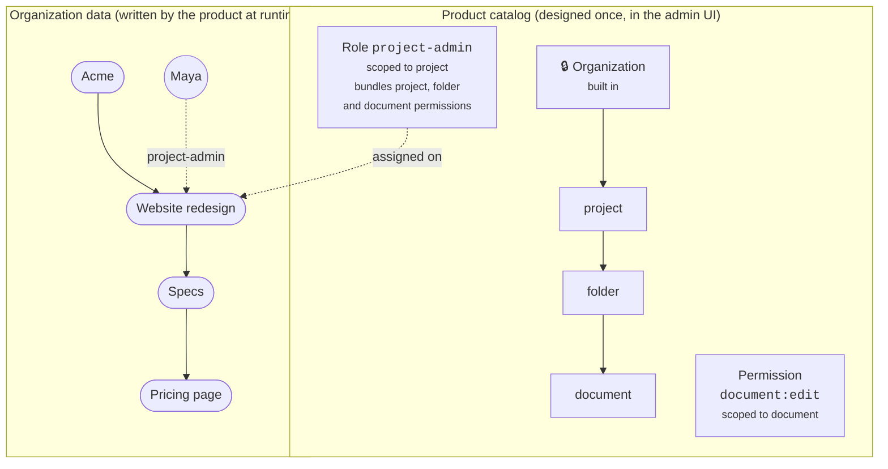
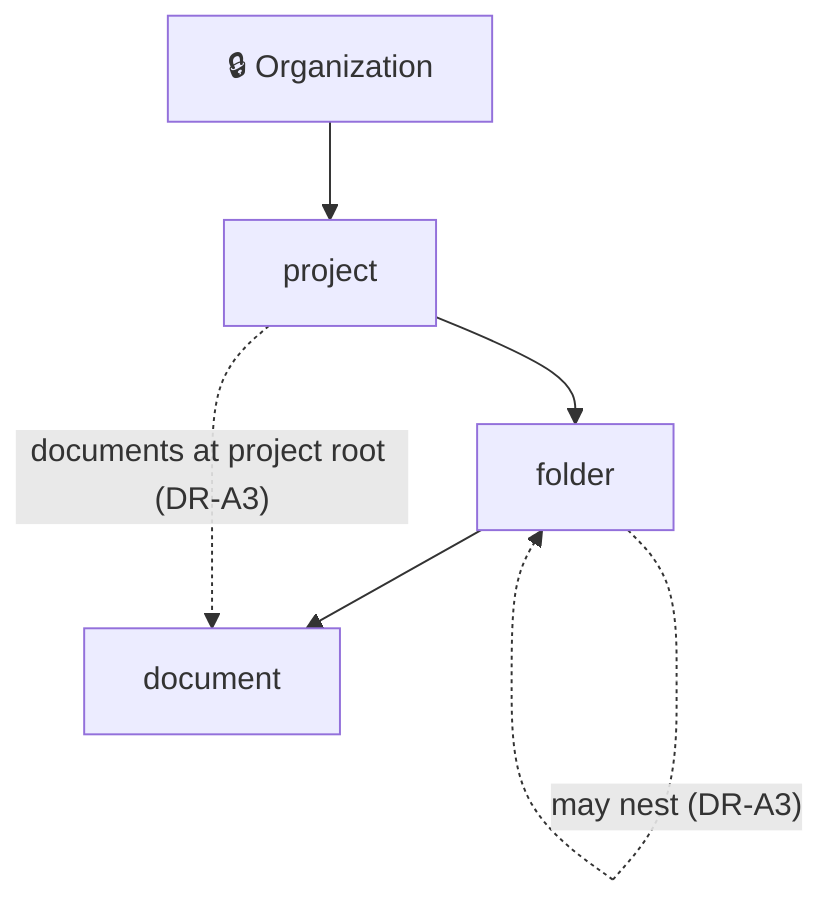
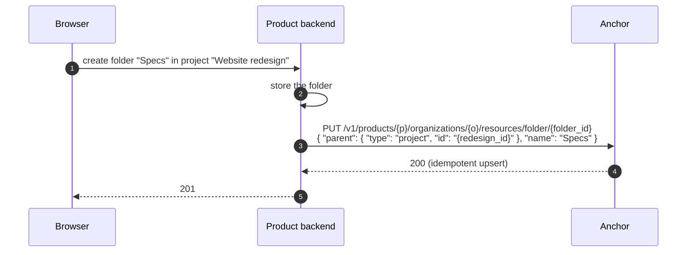
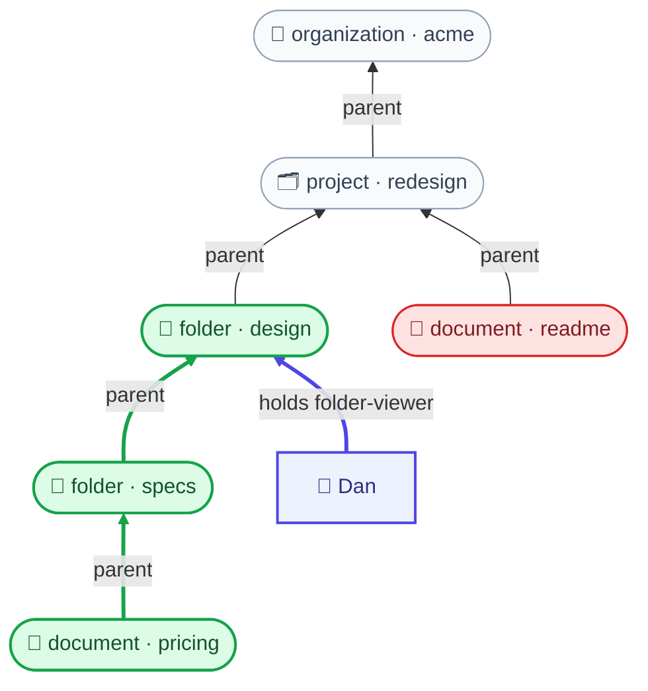

# ADR-0022: Resource types scope roles and permissions

| Status | Date | Where | Builds on |
| :-- | :-- | :-- | :-- |
| 🟡 **Pending** | 2026-10-23 | branch `poc/openfga-authz` | [ADR-0021](0021-access-decisions-come-from-openfga.md), access decisions from OpenFGA |

> [!NOTE]
> A Product declares a tree of **resource types** under the built-in **Organization** type: a document product would declare `project → folder → document`. Every **permission** and every **role** is scoped to one resource type. A role assigned on a resource covers that resource and everything under it. Anchor keeps OpenFGA from ADR-0021 underneath, and products never write model language.

> [!TIP]
> **How to answer.** Each decision record is folded: its line shows its state and whether it has questions. Open it to read and fill the `Answer:` lines, or answer in the [open questions table](#open-questions) at the end.

## Contents

1. [Explanation](#1-explanation)
2. [How it works, functionally](#2-how-it-works-functionally)
3. [Decision records](#3-decision-records)
   - [A. Resource types](#a-resource-types)
   - [B. Resources](#b-resources)
   - [C. Permissions](#c-permissions)
   - [D. Roles and role assignments](#d-roles-and-role-assignments)
   - [E. Access decisions](#e-access-decisions)
   - [F. Admin UI](#f-admin-ui)
   - [G. Migration and rollout](#g-migration-and-rollout)
4. [Glossary changes](#4-glossary-changes)
5. [Open questions](#open-questions) — 15 to answer

---

## 1. Explanation

<details>
<summary><b>Where Anchor is today, and where it stops</b></summary>

| Concept | Today | Limit |
| --- | --- | --- |
| Permission | A flat catalog per Product (`documents:read`), with an optional free-text `scope_modifier` that nothing evaluates | It says nothing about *what kind of thing* it applies to |
| Role | A flat bundle of permissions | Assignable on an Organization, and since this branch on a Workspace, with no rule about which |
| Organization | Built in; a member holds exactly one role | — |
| Workspace | Built in, one fixed level under Organization | A Product cannot add its own levels: projects, folders, documents |
| Workspace role | Added on this branch, hard-coded to workspaces | Every new level would need another hard-coded table, API and evaluator branch |

Each new kind of thing a product wants to protect (a project, a folder, a document) would currently need its own table, API, UI and evaluator code in Anchor. That doesn't scale across products.

</details>

### The model we adopt

The shape is a **tree of resource types**, **permissions and roles scoped to a type**, and **inheritance that only flows down the tree**.



Three rules define everything:

> [!IMPORTANT]
> 1. **One tree.** Every resource type except Organization has a parent type, and every resource has exactly one parent resource.
> 2. **Scoped bundles.** A role scoped to type *T* bundles permissions scoped to *T* or to any type below *T*.
> 3. **Inheritance flows down.** A subject holds permission *P* on resource *R* if any role it holds on *R* or on an ancestor of *R* bundles *P*. Its Organization role counts, because the Organization is the root ancestor.

Access only ever grows: there is no deny. That matches the earlier decision to start with grants only.

<details>
<summary><b>Why a typed tree and not a product-written schema</b></summary>

| | Product writes the model | Product configures a typed tree (**chosen**) |
| --- | --- | --- |
| What the product learns | The Zanzibar model language | Types, permissions and roles in a UI |
| Can a product break access? | Yes: one wrong `from parent` leaks a whole workspace | Hard to: the tree only allows downward inheritance |
| Who writes OpenFGA models | Every product | Only Anchor, under the product lock from ADR-0021 |
| Arbitrary rules (`but not`, conditions) | Yes | Not in v1 |

</details>

---

## 2. How it works, functionally

This walks through a generic document product, from an empty catalog to a decision. Any Product follows the same steps with its own types.

<details open>
<summary><b>Step 1 · Design the tree</b></summary>

In **Product › Resource types**, an admin adds `project` under Organization, `folder` under project, and `document` under folder.



</details>

<details>
<summary><b>Step 2 · Scope permissions</b></summary>

| Permission | Resource type scope |
| --- | --- |
| `members:update`, `api_key:create`, `billing:read` | Organization |
| `project:manage` | project |
| `folder:view`, `folder:edit` | folder |
| `document:view`, `document:edit`, `document:share` | document |

</details>

<details>
<summary><b>Step 3 · Scope roles</b></summary>

| Role | Scope | Bundles | Allowed because |
| --- | --- | --- | --- |
| `admin` | Organization | everything | Organization is the root, so every type is below it |
| `member` (default) | Organization | none | A member gets access only through roles lower down |
| `project-admin` | project | `project:manage`, `folder:edit`, `document:view`, `document:edit`, `document:share` | folder and document are below project |
| `folder-viewer` | folder | `folder:view`, `document:view` | document is below folder |
| `document-viewer` | document | `document:view` | its own type |

A role scoped to `document` can't bundle `project:manage`. The UI only offers permissions of the role's type and the types below it, so the invalid combination can't even be selected.

</details>

<details>
<summary><b>Step 4 · The product registers resources as it creates them</b></summary>



DR-B1 decides which resources must be registered: every one, or only those a role is assigned on.

</details>

<details>
<summary><b>Step 5 · Assign roles</b></summary>

```http
PUT /v1/products/{p}/organizations/{o}/resources/project/{redesign_id}/members/{maya}
{ "role_id": "role_project_admin" }

PUT /v1/products/{p}/organizations/{o}/resources/document/{pricing_id}/members/{alice}
{ "role_id": "role_document_viewer" }      ← sharing one document with Alice
```

</details>

<details>
<summary><b>Step 6 · Ask</b></summary>

```json
POST /v1/products/{p}/access/v1/evaluation
{
  "subject":  { "type": "user", "id": "user_2NNE…dan" },
  "action":   { "name": "document:view" },
  "resource": { "type": "document", "id": "{pricing_id}",
                "properties": { "organization_id": "{acme}" } }
}
```


Anchor walks up from the document until a role held on the document or one of its ancestors bundles `document:view`, and answers `decision: true`. Bob, who holds only `member` on Acme, gets `MISSING_PERMISSION`.

</details>

<details>
<summary><b>Step 7 · Products that change nothing</b></summary>

Every existing permission and role becomes Organization-scoped, so every existing check gives the same answer. A product that never opens the Resource types page sees no difference.

</details>

---

## 3. Decision records

| State | Means |
| :-- | :-- |
| 🟡 **Pending** | needs your answer |
| 🔵 **Proposed** | recommended, accepted unless you object |
| ⚪ **Deferred** | not in this change |
| ✅ **Accepted** · ❌ **Rejected** | after review |

<details open>
<summary><b>Index of all 36 records</b></summary>

| Theme | Record | State | ❓ |
| :-- | :-- | :-- | :-: |
| **A. Resource types** | [DR-A0](#dr-a0) · What Anchor stores, and what it never stores | 🔵 Proposed |  |
|  | [DR-A1](#dr-a1) · A resource type is a Product catalog entry | ✅ Accepted |  |
|  | [DR-A2](#dr-a2) · Organization is built in and locked | ✅ Accepted |  |
|  | [DR-A3](#dr-a3) · Tree shape: one parent type, or several | ✅ Accepted |  |
|  | [DR-A4](#dr-a4) · Depth limits | ✅ Accepted |  |
|  | [DR-A5](#dr-a5) · What can change once a type is in use | ✅ Accepted |  |
|  | [DR-A6](#dr-a6) · Workspace stops being built in | ✅ Accepted |  |
| **B. Resources** | [DR-B1](#dr-b1) · Which resources a product registers | 🟡 Pending | 1 |
|  | [DR-B2](#dr-b2) · A resource is named by the product's own ID | 🟡 Pending | 1 |
|  | [DR-B3](#dr-b3) · Parent rules | 🔵 Proposed |  |
|  | [DR-B4](#dr-b4) · Deleting a resource cascades | 🔵 Proposed |  |
| **C. Permissions** | [DR-C1](#dr-c1) · Every permission is scoped to one resource type | 🔵 Proposed |  |
|  | [DR-C2](#dr-c2) · Permission names keep their free form | 🟡 Pending | 1 |
|  | [DR-C3](#dr-c3) · `scope_modifier` is deprecated | 🟡 Pending | 1 |
|  | [DR-C4](#dr-c4) · A permission's scope never changes | 🔵 Proposed |  |
| **D. Roles and role assignments** | [DR-D1](#dr-d1) · Every role is scoped to one resource type | 🔵 Proposed |  |
|  | [DR-D2](#dr-d2) · A role's scope never changes | 🔵 Proposed |  |
|  | [DR-D3](#dr-d3) · One role per member per resource | 🟡 Pending | 1 |
|  | [DR-D4](#dr-d4) · Organization membership stays separate; every other assignment is generic | 🔵 Proposed |  |
|  | [DR-D5](#dr-d5) · A default Organization role | 🟡 Pending | 1 |
|  | [DR-D6](#dr-d6) · Role priority and per-organization custom roles | ⚪ Deferred | 1 |
|  | [DR-D7](#dr-d7) · Organization API keys | 🟡 Pending | 1 |
| **E. Access decisions** | [DR-E1](#dr-e1) · Grants only, inherited downward | 🔵 Proposed |  |
|  | [DR-E2](#dr-e2) · The evaluation API takes any resource type | 🟡 Pending | 1 |
|  | [DR-E3](#dr-e3) · Compiled to the Product's OpenFGA model | 🔵 Proposed (depends on ADR-0021) |  |
|  | [DR-E4](#dr-e4) · Listing what a subject can reach | ⚪ Deferred |  |
|  | [DR-E5](#dr-e5) · Anchor's tables stay the source of truth; OpenFGA holds a mirror | 🟡 Pending | 1 |
| **F. Admin UI** | [DR-F1](#dr-f1) · Three catalog pages | 🔵 Proposed |  |
|  | [DR-F2](#dr-f2) · The canvas: React Flow with computed layout | 🔵 Proposed |  |
|  | [DR-F3](#dr-f3) · Canvas interaction and motion | 🟡 Pending | 1 |
|  | [DR-F4](#dr-f4) · Roles and permissions pages | 🔵 Proposed |  |
|  | [DR-F5](#dr-f5) · An access explainer on the canvas | 🟡 Pending | 1 |
| **G. Migration and rollout** | [DR-G1](#dr-g1) · Backfill everything to Organization | 🔵 Proposed |  |
|  | [DR-G2](#dr-g2) · Compatibility | 🔵 Proposed |  |
|  | [DR-G3](#dr-g3) · Events | 🟡 Pending | 1 |
|  | [DR-G4](#dr-g4) · Delivery order | 🔵 Proposed |  |

</details>

### A. Resource types

<a id="dr-a0"></a>
<details>
<summary><b>DR-A0</b> · What Anchor stores, and what it never stores — <i>🔵 Proposed</i></summary>

**Decision.** Anchor stores what every Product needs to decide access, and nothing about what a Product does:

| | In Anchor | Why |
| :-- | :-- | :-- |
| **Who** | Product users, Organization memberships, Organization API keys, invitations | No decision without a subject; a member exists only in Anchor |
| **Where** | Organizations, resource types, **resource references** (id, type, parent, optional display name) | The parent chain is what inheritance walks; without it, a role on a folder can't reach its documents |
| **What** | Permissions, **roles**, **role assignments** | A decision needs the permission, the role that bundles it, and who holds that role |
| **Decide** | Evaluation | The point of all the above |

<details>
<summary>Never in Anchor</summary>

- **A Product's own records and their fields.** Resources are references, not records: no `metadata` object, no custom fields, no resource type whose instances Anchor stores in full. Organization is the only resource Anchor stores in full (A6 removes the built-in Workspace).
- **Search or sorting over a Product's data.** Anchor lists members and role assignments, never a Product's items by their own attributes.

</details>

<details>
<summary>Already in Anchor and consistent with this</summary>

Licensing (what an Organization is entitled to, which every SaaS needs), and the events and emails that report changes to the records above.

</details>

<details>
<summary>Test for a future request</summary>

Would every Product built on Anchor need it, and does it describe tenancy or access? If not, it belongs in the Product.

</details>

<details>
<summary>Related records</summary>

[A6](#dr-a6) removes the built-in Workspace · [B2](#dr-b2) defines a resource reference · [E5](#dr-e5) keeps Anchor's tables as the source of truth.

</details>

</details>

<a id="dr-a1"></a>
<details>
<summary><b>DR-A1</b> · A resource type is a Product catalog entry — <i>✅ Accepted</i></summary>

**Decision.** A resource type belongs to a Product, alongside its permissions and roles. It has:
- an ID (`rtype_…`, KSUID);
- a **slug**, unique per Product, matching `^[a-z][a-z0-9_]{0,48}$` so it is also a valid OpenFGA type name;
- a name and a description;
- its allowed parent types and whether it nests in itself (see A3).

It is managed under `/v1/products/{product_id}/resource-types` with a create route, a read route and a cursor search, as every catalog collection is. A whole tree can also be replaced in one call (see F3).

<details>
<summary>Why</summary>

The type tree is part of the catalog: it decides how roles and permissions combine. Storing it next to them keeps one authority per Product, and one input to the compiled model (E3).

</details>

</details>

<a id="dr-a2"></a>
<details>
<summary><b>DR-A2</b> · Organization is built in and locked — <i>✅ Accepted</i></summary>

**Decision.** Every Product has exactly one `organization` type. It is seeded on Product creation and backfilled for existing Products. It is the root: it has no parent, and its slug, its root position and its existence can't change. The API answers `409 BUILT_IN_RESOURCE_TYPE` to any attempt. Its display name is fixed as "Organization".

<details>
<summary>Why</summary>

Anchor's Organizations, memberships, invitations, licenses and API keys all hang off it. A Product that could delete or move it would break all of them.

</details>

</details>

<a id="dr-a3"></a>
<details>
<summary><b>DR-A3</b> · Tree shape: one parent type, or several — <i>✅ Accepted</i></summary>

**Decision.** Option **c**. Each *resource* keeps exactly one parent, so a check still walks one path upward and "why does Dan have access?" has one answer. Only the *type* graph becomes a DAG. Cycles between different types are refused; a type nesting in itself is the only loop allowed. "Types below *T*", used by roles (D1), means every type reachable downward from *T*.

**Implementation.** Self-nesting is declared with a boolean on the resource type, never by listing the type among its own parents:

| Field | Meaning |
| :-- | :-- |
| `parent_types` | the *other* types an instance may sit under, e.g. `folder` → `[project]`; a type never lists itself |
| `nests_in_itself` | `true` lets an instance's parent be an instance of the same type (a folder inside a folder); default `false` |

The compiled OpenFGA model adds the type to its own `parent` relation only when `nests_in_itself` is `true`. Anchor checks the boolean when a resource is registered or moved (B3), and the canvas shows it as the "nests in itself" badge (F2).

<details>
<summary>Context and options</summary>

The simplest shape is a strict tree, where each type has one parent type. Two common shapes don't fit it:
- folders inside folders, as in most file and document products;
- items at the root of a container, such as a document directly in a project with no folder.

| Option | Type level | Instance level | Fits both shapes |
| --- | --- | --- | --- |
| **a.** Strict tree | one parent type, no self-nesting | one parent | ❌ needs a hidden root folder per project, and no nested folders |
| **b.** Tree + self-nesting | one parent type, and may also nest in itself | one parent | ⚠️ nested folders work; root-level items don't |
| **c.** Several parent types + self-nesting | a type lists its allowed parent types, which may include itself | **still exactly one parent** | ✅ |

</details>

<details>
<summary>How OpenFGA handles option c</summary>

In the compiled model, a type with `nests_in_itself: true` appears in its own `parent` relation. Each resource still points at exactly one parent:

```text
type folder
  relations
    define parent: [project, folder]          # project from parent_types, folder from nests_in_itself
    define role_folder_viewer: [user]
    define can_document_view: role_folder_viewer or can_document_view from parent

type document
  relations
    define parent: [folder, project]          # a document sits in a folder or at the project root
    define can_document_view: can_document_view from parent
```

```text
folder:design   # parent @ project:redesign
folder:specs    # parent @ folder:design          ← nested folder
document:pricing# parent @ folder:specs
document:readme # parent @ project:redesign       ← at the project root
folder:design   # role_folder_viewer @ user:dan
```



🟩 allowed: *Can Dan view pricing?* · 🟥 denied: *Can Dan view readme?* · 🟦 Dan's only role assignment.

`from parent` follows whichever parent a given resource has. To check Dan on `document:pricing`, OpenFGA walks pricing → specs → design, where Dan holds `role_folder_viewer`, and allows it. `document:readme` walks straight to the project. Every type that can be a parent (`project`, `folder`) defines `can_document_view`, which is what lets the walk continue from either. OpenFGA bounds the walk with its resolve-node limit, which A4's resource depth limit stays under.

</details>

<details>
<summary>Sources</summary>

- [OpenFGA: parent-child objects](https://openfga.dev/docs/modeling/parent-child)

</details>

> **Q-A3.1** Option a, b or c? *(recommended: c)*
>
> **Answer:** c, with self-nesting declared by a boolean on the resource type.

</details>

<a id="dr-a4"></a>
<details>
<summary><b>DR-A4</b> · Depth limits — <i>✅ Accepted</i></summary>

**Decision.** Two limits:
- **Type depth:** at most 5 levels including Organization (Organization › project › folder › document uses 4).
- **Resource depth:** if a type may nest in itself (A3), a resource chain may be at most 15 deep, counting the Organization (acme › project › folder › folder › document is 5). This bounds the walk in every check, and Anchor refuses a move or registration that would exceed it.

<details>
<summary>Why Anchor enforces the limit, not OpenFGA</summary>

OpenFGA's model language can't express "at most N levels". Its only depth control is a server-wide safety valve, the resolve-node limit (default 25, with a breadth limit of 10). A check that walks deeper fails with `resolution depth exceeded`, an error rather than a denial, and the limit applies to every type alike. So Anchor refuses a registration or a move that would make a chain deeper than 15 (B3) at write time, and keeps OpenFGA's limit above that so a valid check never reaches it.

Unrolling levels as separate types (`folder_l1`, `folder_l2`, …) would make OpenFGA enforce a depth, but every permission and role would then exist once per level. Rejected.

</details>

> **Q-A4.1** Are 5 type levels and 16 resource levels the right limits? *(recommended: yes; both are easy to raise later, hard to lower)*
>
> **Answer:** yes, rounded to multiples of 5: 5 type levels and 15 resource levels.

</details>

<a id="dr-a5"></a>
<details>
<summary><b>DR-A5</b> · What can change once a type is in use — <i>✅ Accepted</i></summary>

| Change | Allowed | Otherwise |
| --- | --- | --- |
| Add a type | always | |
| Rename, change description | always | |
| Change slug | never | slugs name OpenFGA types and appear in API calls and permission names |
| Add an allowed parent type | always | |
| Remove an allowed parent type | only if no resource uses that parent type | `409` with the count |
| Turn `nests_in_itself` on | always | |
| Turn `nests_in_itself` off | only if no resource sits under one of its own type | `409` with the count |
| Delete a type | only with no child types, resources, roles or permissions scoped to it | `409` listing what blocks it |

<details>
<summary>Why</summary>

A slug and a scope fixed after creation keep every assignment and API call valid (C4 and D2 apply the same rule to permissions and roles). Moving a type that already has resources would silently change who can see what. A product that really needs it creates a new type and migrates.

</details>

</details>

<a id="dr-a6"></a>
<details>
<summary><b>DR-A6</b> · Workspace stops being built in — <i>✅ Accepted</i></summary>

**Decision.** The built-in Workspace is replaced by the generic model, then **deleted once no Product depends on it**. Until that day it keeps working unchanged.

| Phase | What happens | Built-in Workspace |
| :-- | :-- | :-- |
| **1. Generic model available** | A Product that wants workspaces declares a `workspace` resource type under Organization, registers references to its own workspaces (B1, B2) and assigns roles on them (D4) | works as today; deprecated, no new features |
| **2. Data migrated** | For each Product with workspaces, a migration declares a `workspace` type; each workspace becomes a reference with the **same ID** and its name as display name; each workspace role becomes a role assignment | works as today, alongside the generic model |
| **3. Products moved** | Each Product, and its released tools, switch from `/workspaces` to the generic routes | works, with no remaining caller |
| **4. Deleted** | Only when no Product calls the `/workspaces` routes or subscribes to `workspace.*` events: the `workspaces` table, its routes and pages, its events and `workspace_memberships` are removed | gone |

- **Checking the condition for phase 4:** request logs show no call to a `/workspaces` route and no endpoint subscribes to a `workspace.*` event, over a period agreed at the time. It is a deliberate, recorded step, not a side effect of another change.
- **Access evaluation** answers `"type": "workspace"` through the generic model from phase 2. `WORKSPACE_NOT_IN_ORGANIZATION` stays until phase 4, then gives way to `RESOURCE_NOT_IN_ORGANIZATION` (E2).
- **Today** the only consumer is Nanostack's own product, so phase 3 is one coordinated change on that side.

<details>
<summary>Context</summary>

Workspace is built into Anchor today: its own table, API, admin UI, events, and the workspace roles added on this branch. Under A0, Organization is the only resource Anchor stores in full. Anchor has no external customers yet, so no long compatibility layer is needed; the built-in Workspace only has to outlive its last caller.

</details>

<details>
<summary>Why</summary>

One model instead of a generic model plus a special case. A Product that has no workspaces never sees the concept, and one that names them "projects" or "spaces" uses its own word.

</details>

</details>

### B. Resources

<a id="dr-b1"></a>
<details>
<summary><b>DR-B1</b> · Which resources a product registers — <i>🟡 Pending</i> · ❓ 1 question</summary>

**Recommendation.** Option **b**. Most items are never shared, so registering them costs every write a call and buys nothing. When a resource is registered, its stored parent wins over a parent the request sends, and Anchor logs the mismatch. The product backend is already trusted to name the subject and the organization, so trusting it with an unregistered resource's parent adds no new trust.

<details>
<summary>Context and options</summary>

A check on a document needs the document's chain of ancestors. Either Anchor stores it, or the product sends it with each check (a contextual parent, as in the ADR-0021 proof of concept).

| Option | Product must register | Check request | Product effort |
| --- | --- | --- | --- |
| **a.** Full registry | every resource of every declared type (every document, every folder) | resource ID only | a create, move or delete call to Anchor on every write, for possibly millions of items |
| **b.** Sparse registry | containers (projects, folders) and any resource a role is assigned on (a shared document) | resource ID, plus `properties.parent` when the resource isn't registered | a call only for containers and shares |

</details>

<details>
<summary>Sources</summary>

- [OpenFGA: contextual tuples](https://openfga.dev/docs/interacting/contextual-tuples), the mechanism behind a caller-supplied parent

</details>

> **Q-B1.1** Full or sparse registry? *(recommended: sparse)*
>
> **Answer:** _pending_

</details>

<a id="dr-b2"></a>
<details>
<summary><b>DR-B2</b> · A resource is named by the product's own ID — <i>🟡 Pending</i> · ❓ 1 question</summary>

**Decision.** A resource's identity is `(product, type, id)`, where `id` is the product's own identifier, such as its document UUID. The product never stores an Anchor ID. Anchor also stores the organization (checked against the parent), the parent, and an optional display name. Registration is an idempotent `PUT` on that identity.

> **Q-B2.1** Store an optional display name, for the canvas, the explainer and the members pages? It can drift when the product renames the resource, unless the product re-sends it. *(recommended: yes, optional)*
>
> **Answer:** _pending_

</details>

<a id="dr-b3"></a>
<details>
<summary><b>DR-B3</b> · Parent rules — <i>🔵 Proposed</i></summary>

**Decision.** A resource has exactly one parent, and:
- the parent's type is one of its type's allowed parent types;
- the parent is in the same Organization (the Organization itself is a valid parent for its direct children);
- the chain contains no cycle;
- the chain respects the resource depth limit (A4).

Moving a resource is a `PUT` with a new parent, checked by the same rules, and its whole sub-tree moves with it. Anchor refuses a parent that isn't registered yet with `409 PARENT_NOT_REGISTERED`, so products register top-down.

</details>

<a id="dr-b4"></a>
<details>
<summary><b>DR-B4</b> · Deleting a resource cascades — <i>🔵 Proposed</i></summary>

**Decision.** Deleting a resource deletes its registered descendants and every role assignment on them, in one transaction. Deleting an Organization deletes all its resources, as membership rows cascade today. The product has already deleted the thing itself, so refusing would only leave Anchor out of step.

</details>

### C. Permissions

<a id="dr-c1"></a>
<details>
<summary><b>DR-C1</b> · Every permission is scoped to one resource type — <i>🔵 Proposed</i></summary>

**Decision.** `product_resource_permissions` gains a required `resource_type_id`. On create, `resource_type` is optional in the API and defaults to `organization`, so existing callers and the Terraform provider keep working. Permission responses include `resource_type`.

</details>

<a id="dr-c2"></a>
<details>
<summary><b>DR-C2</b> · Permission names keep their free form — <i>🟡 Pending</i> · ❓ 1 question</summary>

**Recommendation.** Keep names free-form and unique per Product. The UI pre-fills `{type slug}:` when creating a permission from a type, but Anchor doesn't enforce it.

<details>
<summary>Context</summary>

A strict `{type}:{action}` form (`folder:delete`) would make each permission's scope readable from its name. Existing catalogs already hold names such as `documents:read` or `api_key:create` whose prefix is not a type slug (`documents` vs a type called `document`).

</details>

> **Q-C2.1** Enforce the `{type}:{action}` form for new permissions? *(recommended: no; existing names would become second-class)*
>
> **Answer:** _pending_

</details>

<a id="dr-c3"></a>
<details>
<summary><b>DR-C3</b> · <code>scope_modifier</code> is deprecated — <i>🟡 Pending</i> · ❓ 1 question</summary>

**Recommendation.** Mark it deprecated in the OpenAPI contract, keep accepting and returning it, hide it in the UI, and remove it in a later breaking release.

<details>
<summary>Context</summary>

`scope_modifier` is an optional free-text qualifier on a permission ("own", "team"). Anchor stores it and filters searches by it, but no decision ever reads it. Consumers can only read it back. Resource type scope, and a role assigned on a resource (an "owner" role on a document), cover what it was meant for.

</details>

> **Q-C3.1** Deprecate `scope_modifier` as above? *(recommended: yes)*
>
> **Answer:** _pending_

</details>

<a id="dr-c4"></a>
<details>
<summary><b>DR-C4</b> · A permission's scope never changes — <i>🔵 Proposed</i></summary>

**Decision.** `resource_type` is fixed after creation. To move a permission, create one with a new name, add it to the roles, roll the product over, then delete the old one. Otherwise, a role bundling the permission could suddenly violate D1.

</details>

### D. Roles and role assignments

<a id="dr-d1"></a>
<details>
<summary><b>DR-D1</b> · Every role is scoped to one resource type — <i>🔵 Proposed</i></summary>

**Decision.** `product_roles` gains a required `resource_type_id`, defaulting to `organization` on create. A role may bundle only permissions scoped to its own type or to a type below it. Assigning any other permission answers `400 PERMISSION_OUTSIDE_ROLE_SCOPE`.

<details>
<summary>Example</summary>

`project-admin` (project) may bundle `document:edit` (document is below project). `document-viewer` (document) may not bundle `project:manage`.

</details>

<details>
<summary>Sources</summary>

- [OpenFGA: custom roles](https://openfga.dev/docs/modeling/custom-roles)

</details>

</details>

<a id="dr-d2"></a>
<details>
<summary><b>DR-D2</b> · A role's scope never changes — <i>🔵 Proposed</i></summary>

**Decision.** Fixed after creation, for the same reason as C4: existing assignments on resources of the old type would become invalid.

</details>

<a id="dr-d3"></a>
<details>
<summary><b>DR-D3</b> · One role per member per resource — <i>🟡 Pending</i> · ❓ 1 question</summary>

**Recommendation.** One role per member per resource in v1, with "replace" semantics, as the Organization role and workspace role APIs work today. The member pages stay simple ("Role: Editor"), and several roles can be added later without breaking anyone. Going the other way would break clients.

<details>
<summary>Context</summary>

A member holds exactly one Organization role today, and at most one workspace role on this branch. The alternative is several roles per member, granting their union.

</details>

> **Q-D3.1** One role per member per resource, or several? *(recommended: one)*
>
> **Answer:** _pending_

</details>

<a id="dr-d4"></a>
<details>
<summary><b>DR-D4</b> · Organization membership stays separate; every other assignment is generic — <i>🔵 Proposed</i></summary>

**Decision.**
- **Organization membership** keeps its own record. It carries the Organization-scoped role plus everything that is not about access: joined date, invitations, events. Every member must hold one.
- **Every other role** a member holds lives in one generic table, `resource_role_assignments (resource, product user, role)`. It replaces `workspace_memberships`, whose rows migrate across.
- **Rules carried over from workspace roles:**
  - only a member of the resource's Organization can hold an assignment;
  - removing the member removes all their assignments in that Organization, in the same transaction;
  - the role's scope type must equal the resource's type.

</details>

<a id="dr-d5"></a>
<details>
<summary><b>DR-D5</b> · A default Organization role — <i>🟡 Pending</i> · ❓ 1 question</summary>

**Recommendation.** Let a Product mark at most one Organization-scoped role as default. A missing `role_id` on add-member and invitation then means the default. With no default role set, `role_id` stays required.

<details>
<summary>Context</summary>

A **default** Organization-scoped role (typically `member`, with no permissions) is the role a member gets when added without one, for example through directory sync. In Anchor, adding a member and creating an invitation both require a role today.

</details>

> **Q-D5.1** Add a default role now? *(recommended: yes; it is what makes a `member` role with no permissions useful)*
>
> **Answer:** _pending_

</details>

<a id="dr-d6"></a>
<details>
<summary><b>DR-D6</b> · Role priority and per-organization custom roles — <i>⚪ Deferred</i> · ❓ 1 question</summary>

**Decision.** Not in this change:
- **Role priority** orders roles when an identity provider maps several groups onto a single role. Anchor maps no identity provider groups to roles yet.
- **Per-organization custom roles** (one customer defining a role only it sees) need a catalog per Organization. That is a separate decision.

> **Q-D6.1** Do customers already need per-organization custom roles? *(answer only if this should not stay deferred)*
>
> **Answer:** _pending_

</details>

<a id="dr-d7"></a>
<details>
<summary><b>DR-D7</b> · Organization API keys — <i>🟡 Pending</i> · ❓ 1 question</summary>

**Decision.** An Organization API key keeps its explicit permission list. Those permissions may be of any type and apply across the whole Organization tree, as an Organization-scoped role would.

> **Q-D7.1** Do you want keys limited to one resource, such as a CI key that only reaches one project? It was discussed earlier as a resource allowlist on the key. *(recommended: defer to its own change; the evaluation already has the resource to compare against)*
>
> **Answer:** _pending_

</details>

### E. Access decisions

<a id="dr-e1"></a>
<details>
<summary><b>DR-E1</b> · Grants only, inherited downward — <i>🔵 Proposed</i></summary>

**Decision.** A subject holds *P* on *R* when:
- a role it holds on *R* or on any ancestor of *R*, its Organization role included, bundles *P*; or
- it is an Organization API key of *R*'s Organization that holds *P*.

There is no deny, no exclusion and no condition. Those stay out until a product needs one; a deny layer would come after this, as discussed earlier.

<details>
<summary>Sources</summary>

- [Zanzibar: Google's consistent, global authorization system](https://research.google/pubs/zanzibar-googles-consistent-global-authorization-system/)

</details>

</details>

<a id="dr-e2"></a>
<details>
<summary><b>DR-E2</b> · The evaluation API takes any resource type — <i>🟡 Pending</i> · ❓ 1 question</summary>

**Decision.**
- **Request:** `resource.type` accepts any resource type slug of the Product, and `resource.id` is the product's ID (B2). A user subject still needs `properties.organization_id`. `properties.parent` names the parent of an unregistered resource (B1).
- **Organization** behaves as today. `workspace` becomes an ordinary type (A6); `WORKSPACE_NOT_IN_ORGANIZATION` stays until the built-in Workspace is deleted, then gives way to `RESOURCE_NOT_IN_ORGANIZATION`.
- **New deny reasons:** `RESOURCE_TYPE_NOT_FOUND`, `RESOURCE_NOT_FOUND` (unregistered with no parent given), and `RESOURCE_NOT_IN_ORGANIZATION`.

> **Q-E2.1** Should the decision context say *where* access came from, e.g. `granted_by: [{ role: "folder-viewer", resource: { type: "folder", id: "…" } }]`? It costs one more walk per allowed decision and powers the explainer (F5). *(recommended: yes, only on request with `options.explain: true`)*
>
> **Answer:** _pending_

</details>

<a id="dr-e3"></a>
<details>
<summary><b>DR-E3</b> · Compiled to the Product's OpenFGA model — <i>🔵 Proposed (depends on ADR-0021)</i></summary>

**Decision.** Anchor compiles types, permissions and roles into the Product's model, replacing ADR-0021's two fixed types. For each type *T*:
- a `parent` relation over its allowed parent types;
- one role relation per role scoped to *T*;
- one permission relation per permission scoped to *T* or below, held through *T*'s roles that bundle it, or from the parent.

A role now appears only on its own type, so the model grows with each type's subtree permissions times that type's roles, instead of every permission times every role. A catalog of a few dozen permissions and roles stays far from OpenFGA's 256 KB model limit.

The semantics don't depend on OpenFGA. If ADR-0021 is rejected, a single-parent chain is a short recursive query in Postgres.

<details>
<summary>Example: the compiled model for a document product</summary>

```text
type folder
  relations
    define parent: [project, folder]
    define role_folder_viewer: [user]
    define can_document_view: role_folder_viewer or can_document_view from parent

type document
  relations
    define parent: [folder, project]
    define role_document_viewer: [user]
    define can_document_view: role_document_viewer or can_document_view from parent
```

</details>

<details>
<summary>Sources</summary>

- [OpenFGA: concepts](https://openfga.dev/docs/concepts)
- [OpenFGA: parent-child objects](https://openfga.dev/docs/modeling/parent-child)
- [ADR-0021](0021-access-decisions-come-from-openfga.md), the engine and its sync

</details>

</details>

<a id="dr-e4"></a>
<details>
<summary><b>DR-E4</b> · Listing what a subject can reach — <i>⚪ Deferred</i></summary>

**Decision.** "Which documents can Alice see?" is not in this change. When it comes, it returns registered containers plus directly shared resources, and the product filters its own rows, as the Zanzibar discussion concluded.

<details>
<summary>Sources</summary>

- [OpenFGA: ListObjects](https://openfga.dev/docs/getting-started/perform-list-objects)

</details>

</details>

<a id="dr-e5"></a>
<details>
<summary><b>DR-E5</b> · Anchor's tables stay the source of truth; OpenFGA holds a mirror — <i>🟡 Pending</i> · ❓ 1 question</summary>

**Decision.** Mirror. Anchor's tables remain the only source of truth for Organizations, memberships, resources and role assignments. OpenFGA is a derived index for decisions and inherited lists, and can be rebuilt from the tables at any time. Products follow the same split towards Anchor: their entities stay in their own database, and they send Anchor only the facts that grant access (parent links, role assignments), as DR-B1 describes.

<details>
<summary>Context and options</summary>

A relationship store such as OpenFGA can be used in two ways. Its read APIs (`Read`, `ListUsers`, `ListObjects`, `Expand`) can answer "who is a member of this Organization" on their own, so Anchor *could* keep relationships only there.

| | **Mirror** (recommended) | **Source of truth for relationships** |
| :-- | :-- | :-- |
| Where memberships, role assignments and parent links live | Anchor's tables, copied into OpenFGA as tuples | only in OpenFGA |
| Checks and inherited lists ("who can view this document?") | OpenFGA | OpenFGA |
| Member and assignment pages: search, sort, cursor paging, counts | SQL, as today | IDs from `ListUsers`, then names fetched and sorted in code; results capped by a server maximum and deadline |
| A write, its event and a related row (an accepted invitation) in one transaction | yes | no: OpenFGA writes sit outside Postgres transactions |
| Keeping two stores in step | needed: sync marks, sweeper, periodic reconcile ([ADR-0021](0021-access-decisions-come-from-openfga.md)) | not needed |
| Backup, migration, audit | one database | two, with access data only in the second |
| Changing engine later (DR-E3) | rebuild from the tables | export from OpenFGA first |

</details>

<details>
<summary>Why</summary>

Every Anchor collection is a cursor search with sort and filters, and every write emits its event in the same transaction as the row. Neither works if relationships live only in OpenFGA. The cost of the mirror, keeping it in step, is already built and reviewed in the proof of concept.

</details>

<details>
<summary>Sources</summary>

- [OpenFGA: relationship queries](https://openfga.dev/docs/interacting/relationship-queries) (Read, Expand, ListObjects, ListUsers)
- [OpenFGA: ListUsers](https://openfga.dev/docs/getting-started/perform-list-users)
- [OpenFGA: consistency](https://openfga.dev/docs/interacting/consistency)

</details>

> **Q-E5.1** Mirror, or OpenFGA as the only store of relationships? *(recommended: mirror)*
>
> **Answer:** _pending_

</details>

### F. Admin UI

<a id="dr-f1"></a>
<details>
<summary><b>DR-F1</b> · Three catalog pages — <i>🔵 Proposed</i></summary>

**Decision.** Under **Product**:
- **Resource types:** the canvas.
- **Permissions:** gains a *Resource type scope* column and filter.
- **Roles:** gains a *Resource type scope* column, a filter, a *Default* chip (D5) and a permission count.

Creating or editing a role or a permission is a route, not a dialog; dialogs are kept for delete confirmations. React Flow (`@xyflow/react`) becomes a dependency of `anchor-ui`. It is already used in the Anchor workflows prototype.

</details>

<a id="dr-f2"></a>
<details>
<summary><b>DR-F2</b> · The canvas: React Flow with computed layout — <i>🔵 Proposed</i></summary>

**Decision.**
- **Layout is computed, never stored.** Positions come from a top-down layered layout (`@dagrejs/dagre`, small and synchronous), recomputed on every change. Nodes can't be dragged, so the tree always reads top to bottom and no coordinates live in the database.
- **Edges** go from parent type to child type. A self-nesting type (A3) shows a small loop badge ("nests in itself") instead of an edge that circles back.
- **Organization** is drawn first and locked, with a lock icon and a "Built in" tooltip, and can't be selected for delete.
- **Pan and zoom** come with zoom controls (+ / − / fit) and fit-to-view on load.
- **Known React Flow 12 traps,** each with its fix (below).

<details>
<summary>Known React Flow 12 traps</summary>

| Trap | Fix |
| --- | --- |
| Clicks on non-draggable nodes do nothing | Pass a no-op `onNodeClick` |
| Buttons inside a node don't respond | Give them the `nodrag nopan` classes |
| Edges snap while nodes slide | Never put a CSS transition on `.react-flow__node` transforms |
| The attribution link fails the a11y check | Override its colour with the muted-foreground token |

</details>

<details>
<summary>Sources</summary>

- [React Flow: learn](https://reactflow.dev/learn)
- [dagre layout](https://github.com/dagrejs/dagre)

</details>

</details>

<a id="dr-f3"></a>
<details>
<summary><b>DR-F3</b> · Canvas interaction and motion — <i>🟡 Pending</i> · ❓ 1 question</summary>

**Decision (following Emil Kowalski's design engineering rules):**

- **Read mode by default; edit mode on demand.** An *Edit resource types* button switches the canvas into editing. Reading the tree is the common case and should show no editing controls.
- **Draft, then publish.** Edits stay a local draft, shown with a summary ("2 types added, 1 renamed"). *Publish* sends the whole tree in one call. Anchor validates it as a whole (cycles, depth, in-use rules from A5) and compiles one new model, instead of a model version per keystroke. *Discard* restores the published tree.
- **Adding a type.** In edit mode, hovering or focusing a node reveals a `+` handle below it. Activating it inserts a child in a naming state with a focused input: Enter commits, Escape removes it.
- **Inspector beside the canvas,** not a modal, for the selected type:
  - its name, and its slug, editable only until first publish;
  - its allowed parent types (A3);
  - counts of its roles, permissions and resources;
  - delete, disabled with the reason ("3 roles are scoped to folder") when A5 forbids it.
- **Keyboard.**
  - **Keys:** arrow keys move between nodes along the tree, Enter renames, `N` adds a child, Delete asks to delete.
  - **Motion:** keyboard actions never animate; they're repeated too often.
- **Motion,** with a purpose for each (below).

<details>
<summary>Motion, with a purpose for each</summary>

| Moment | Motion | Why |
| --- | --- | --- |
| A new node appears | opacity 0→1 and scale 0.96→1, 150 ms, `cubic-bezier(0.23, 1, 0.32, 1)` | Nothing should pop out of nowhere; never start from `scale(0)` |
| The layout reflows after an add or delete | node positions interpolated over 200 ms with the same ease-out, edges following each frame | Keeps the reader's place in the tree; no CSS transform transitions, which make edges snap |
| Pressing a button | `scale(0.97)` on `:active`, 120 ms | The interface confirms it heard the press |
| Hovering a node | border colour only, 120 ms; behind `(hover: hover) and (pointer: fine)` | Hover is frequent, so it stays subtle and is off on touch |
| Publishing | the draft summary collapses, nodes keep their place | Nothing to celebrate; it should feel quick |
| `prefers-reduced-motion` | layout changes are instant, fades remain | Fewer, gentler animations; not none |

</details>

> **Q-F3.1** Draft-then-publish, or save each change immediately? *(recommended: draft then publish; tree edits change the access model, and one validated publish gives one model version)*
>
> **Answer:** _pending_

</details>

<a id="dr-f4"></a>
<details>
<summary><b>DR-F4</b> · Roles and permissions pages — <i>🔵 Proposed</i></summary>

**Decision.**
- **Creating a role** starts with its scope. The permission picker then lists only permissions of that type and the types below it, grouped by type in tree order (Organization first). Invalid bundles can't be chosen, rather than erroring after the fact.
- **The permissions table** shows the scope and the roles that bundle each permission.
- **Clicking a node** on the canvas links to both pages, filtered to that type.

</details>

<a id="dr-f5"></a>
<details>
<summary><b>DR-F5</b> · An access explainer on the canvas — <i>🟡 Pending</i> · ❓ 1 question</summary>

**Decision.** A *Check access* panel takes a member, a permission and a resource, and answers *allowed* or *denied*. It also lights up the path on the canvas: the resource, its ancestors, and the node where the granting role is held. It's the "why can Dan see this?" tool every FGA product ships, and the main way to trust the model. It needs E2's `granted_by`.

> **Q-F5.1** In the first UI delivery, or a follow-up? *(recommended: follow-up, right after the canvas)*
>
> **Answer:** _pending_

</details>

### G. Migration and rollout

<a id="dr-g1"></a>
<details>
<summary><b>DR-G1</b> · Backfill everything to Organization — <i>🔵 Proposed</i></summary>

**Decision.** One migration:
- seeds the `organization` type for every Product;
- sets every existing permission's and role's scope to it.

After it, every decision is unchanged, because Organization-scoped roles reach every resource below the Organization. The workspace move (A6) is a separate, later migration.

</details>

<a id="dr-g2"></a>
<details>
<summary><b>DR-G2</b> · Compatibility — <i>🔵 Proposed</i></summary>

**Decision.**
- **No external customers yet.** This change may remove or reshape Anchor APIs where that simplifies the model. A removed API is deleted only once no Product depends on it, as A6 does for Workspace.
- **Additive where it costs nothing:** `resource_type` on roles and permissions is optional and defaults to `organization`, so existing catalogs and scripts keep working unchanged.
- **Nanostack's own product** is the only consumer. Each breaking step ships with its migration on that side, and its released tools (CLI, MCP server, CI action) are handled by the cross-repo rollout rule in `AGENTS.md`.
- **Terraform provider** (`nanostack-dev/terraform-provider-anchor`): gains an `anchor_product_resource_type` resource and an optional `resource_type` attribute on roles and permissions, defaulting to `organization`.

</details>

<a id="dr-g3"></a>
<details>
<summary><b>DR-G3</b> · Events — <i>🟡 Pending</i> · ❓ 1 question</summary>

**Decision.** New catalogued event types:
- `product.resource_type.created|updated|deleted`;
- `resource.created|updated|deleted`;
- `resource.role_assignment.created|updated|deleted`.

They replace the `workspace.*` and `workspace.membership.*` events, which keep firing until the built-in Workspace is deleted (A6, phase 4).

> **Q-G3.1** Send resource and assignment events to product webhooks, or keep them internal? Resource events can be frequent (every registered folder). *(recommended: assignments to webhooks, resources internal-only at first)*
>
> **Answer:** _pending_

</details>

<a id="dr-g4"></a>
<details>
<summary><b>DR-G4</b> · Delivery order — <i>🔵 Proposed</i></summary>

1. **Types and scopes:** the resource types API, scope fields on roles and permissions, the backfill (G1), and model compilation (E3). No visible change for existing products.
2. **Canvas:** the Resource types page and the scoped Roles and Permissions pages (F1–F4).
3. **Resources and generic assignments:** the registry (B1–B4) and `resource_role_assignments` (D4).
4. **Evaluation:** any resource type (E2).
5. **Workspace:** migrate its data into the generic model and deprecate the built-in Workspace (A6, phases 1–2). Deletion (phase 4) waits until no Product depends on it, after step 6.
6. **First adopting product:** planned in its own change, against the generic API above.

</details>

---

## 4. Glossary changes

<details>
<summary><b>5 new terms, 1 changed entry and 1 removed entry for CONTEXT.md</b></summary>

To add to [CONTEXT.md](../../CONTEXT.md) once the records they depend on are accepted:

| term | means | not |
| --- | --- | --- |
| **resource type** | A kind of thing a Product protects, declared in its catalog and placed in a tree under Organization (`project`, `folder`, `document`). | Not "resource" — that is one instance. |
| **resource** | One registered instance of a resource type, named by the Product's own ID, with exactly one parent. | Not "object" (OpenFGA's word) in Anchor's API or UI. |
| **scope** | The resource type a permission or role belongs to. | Not `scope_modifier`, which is deprecated (C3). |
| **role assignment** | A member holding a role on one resource. On the Organization itself, it is the membership's role. | Replaces "workspace role" once A6 lands. |
| **ancestor** | A resource's parent, its parent's parent, and so on up to the Organization. | |

**Changes to existing entries:**
- **role**: "A named bundle of permissions, scoped to one resource type and assignable on resources of that type."
- **Workspace**: removed as an Anchor term once A6 lands. A Product may declare a resource type of that name.

</details>

---

## Open questions

Answer here or inline; each line links to its record.

| # | Question | Recommendation | Answer |
| --- | --- | --- | --- |
| [Q-A3.1](#dr-a3) | Type shape: strict tree, tree + self-nesting, or several parent types + self-nesting? | several parent types + self-nesting (c) | **c**, self-nesting as a boolean |
| [Q-A4.1](#dr-a4) | 5 type levels, 16 resource levels? | yes | **5 and 15** (multiples of 5) |
| [Q-B1.1](#dr-b1) | Full or sparse registry? | sparse | |
| [Q-B2.1](#dr-b2) | Optional display name on resources? | yes | |
| [Q-C2.1](#dr-c2) | Enforce `{type}:{action}` names? | no | |
| [Q-C3.1](#dr-c3) | Deprecate `scope_modifier`? | yes | |
| [Q-D3.1](#dr-d3) | One or several roles per member per resource? | one | |
| [Q-D5.1](#dr-d5) | Default Organization role now? | yes | |
| [Q-D6.1](#dr-d6) | Per-organization custom roles needed soon? | stay deferred | |
| [Q-D7.1](#dr-d7) | API keys limited to one resource? | defer | |
| [Q-E2.1](#dr-e2) | `granted_by` in the decision context? | yes, on request | |
| [Q-E5.1](#dr-e5) | Mirror, or OpenFGA as the only store of relationships? | mirror | |
| [Q-F3.1](#dr-f3) | Draft-then-publish or immediate saves? | draft then publish | |
| [Q-F5.1](#dr-f5) | Access explainer in the first UI delivery? | follow-up | |
| [Q-G3.1](#dr-g3) | Resource and assignment events to webhooks? | assignments yes, resources internal | |
