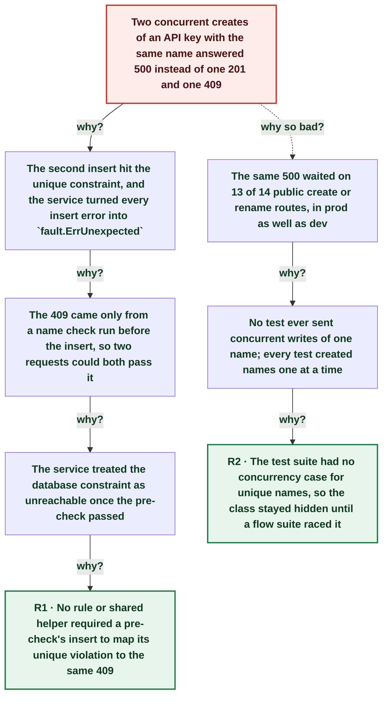

# Concurrent API key creates with one name answered 500: the insert's unique violation was not mapped to the 409

| | |
|---|---|
| **Date** | 2026-10-16 |
| **Severity** | SEV4 |
| **Status** | In review |
| **Service** | anchor |
| **Authors** | Nanostack routine (posthog-error-watch) |
| **Duration** | ~1s (trigger to resolution) |
| **Time to detect** | 40m 32s |

> Blameless: this document names systems, processes and missing guards, not people.

## Summary

On dev at 01:02:04Z two `POST .../organizations/<org>/api-keys` requests with the same name, sent in the same millisecond by a flow-suite run, both answered 500 `Unexpected error`. The service checks the name before the insert, so both requests passed the check and the second insert hit `organization_api_keys_organization_id_name_key` (23505), which the service mapped to `fault.ErrUnexpected`. A new concurrency test found the same 500 on 13 of 14 public create or rename routes. anchor#237 maps each unique violation to the 409 the pre-check already returns; it is live on dev. Prod carries the same latent race until the next anchor prod deploy.

## Impact

Dev only: two API key creates from the CI flow suite answered 500 instead of 201 and 409. The same race existed on 13 of 14 create or rename routes in prod; no prod occurrence was logged.

- **2** creates answered 500 (dev)
- **13 of 14** routes failing the new race test
- **0** prod occurrences logged

## Trigger

Two same-name API key creates for one organization reached anchor dev in the same millisecond.

## Detection

The 500s and the 23505 error rows were in PostHog logs at once. A parallel session opened the fix (anchor#237) 40 minutes later; the daily `posthog-error-watch` routine triaged the rows at about 11:15Z. No alert fired for two isolated dev 500s, which is fine at this volume.

## Resolution

anchor#237 maps the unique violation on every create or rename with a name pre-check to the existing 409, with a concurrency test per route; merged 11:21Z and live on dev.

## Timeline (UTC)

| Time | | Event |
|---|---|---|
| ~21:16 | T−157d 03h | **Check-then-insert name rule in the initial anchor snapshot** `organization_api_key_service.go` `Create`: `nameUniqueValidation`, then the insert inside a transaction; any insert error becomes `fault.ErrUnexpected`. |
| 01:02:04 | T+0s | **Two same-name creates answer 500 on dev** `jet: pq: duplicate key value violates unique constraint "organization_api_keys_organization_id_name_key" (23505)` logged by the repository and the service, then `Internal server error: Unexpected error`. ([link](https://us.posthog.com/project/471972/logs)) |
| ~01:02 | T+1s | **No further 500s: the suite run moved on** |
| 01:42:36 | T+40m 32s | **anchor#237 opened with the fix and the race test** ([link](https://github.com/nanostack-dev/anchor/pull/237)) |
| 11:21:20 | T+10h 19m | **anchor#237 merged, live on dev** ([link](https://github.com/nanostack-dev/anchor/pull/237)) |

## Root cause analysis: the five whys

Start at the impact and ask why until the answer is something the team can change. Solid edges ask why it happened; dashed edges ask why the impact was as large as it was.

- **Problem:** Two concurrent creates of an API key with the same name answered 500 instead of one 201 and one 409
  - **Why?** The second insert hit the unique constraint, and the service turned every insert error into `fault.ErrUnexpected` _Evidence: Log rows at 01:02:04Z (23505 on `organization_api_keys_organization_id_name_key`); `organization_api_key_service.go` `Create` returns `fault.ErrUnexpected` on any transaction error._
    - **Why?** The 409 came only from a name check run before the insert, so two requests could both pass it _Evidence: `nameUniqueValidation` runs outside the insert transaction; a concurrent writer's row is invisible until it commits._
      - **Why?** The service treated the database constraint as unreachable once the pre-check passed _Evidence: Only the license services matched 23505 (`pgerr.IsUniqueViolation`), added after their own incidents._
        - **Why?** No rule or shared helper required a pre-check's insert to map its unique violation to the same 409 → **Root cause R1** (fixed by A1, A3, A4, A5)
  - **Why so bad?** The same 500 waited on 13 of 14 public create or rename routes, in prod as well as dev _Evidence: `TestConcurrentSameNameWritesReturnConflict` failed 13 of 14 cases on the old code (anchor#237)._
    - **Why?** No test ever sent concurrent writes of one name; every test created names one at a time _Evidence: The race tests in anchor#237 are the first concurrent-write tests for named resources._
      - **Why?** The test suite had no concurrency case for unique names, so the class stayed hidden until a flow suite raced it → **Root cause R2** (fixed by A2, A3)

## Root causes

- **R1** No rule or shared helper required a pre-check's insert to map its unique violation to the same 409
- **R2** The test suite had no concurrency case for unique names, so the class stayed hidden until a flow suite raced it

## Contributing factors

- The same class caused the 2026-10-07 duplicate Clerk reconcile incident (anchor#211); that fix stayed local to the reconcile path.
- Two leftovers need a different fix than a 409: concurrent inbound webhook deliveries on `integration_events_..._external_event_id_key` and concurrent email template draft/publish version numbers (listed in anchor#237).

## Lessons learned

### What went well

- Both the repository and the service logged the constraint name, so the cause read from one row.
- The fix swept the class with a concurrency test per route instead of patching one endpoint.

### What went wrong

- A check-then-act pattern sat in the codebase since the first snapshot, and the earlier 23505 incident did not trigger a class-wide look.

### Where we got lucky

- A CI flow suite raced the route on dev before any customer did on prod.
- The endpoints already declared 409, so the fix needed no contract change.

## Action items

| ID | Action | Type | Owner | Due | Status | Ticket | Fixes |
|---|---|---|---|---|---|---|---|
| A1 | Map every pre-checked unique violation to the existing 409 with `OnUnique`, 12 resources (create and rename) | prevent | anchor backend |  | done | [anchor#237](https://github.com/nanostack-dev/anchor/pull/237) | R1 |
| A2 | Concurrency tests per route: `TestConcurrentSameNameWritesReturnConflict`, `TestConcurrentUniqueInsertsReturnSentinel` | detect | anchor backend |  | done | [anchor#237](https://github.com/nanostack-dev/anchor/pull/237) | R2 |
| A3 | Rule in `docs/development/agent-rules.md`: a pre-check's write maps the unique violation and adds a race-test case | process | anchor backend |  | done | [anchor#237](https://github.com/nanostack-dev/anchor/pull/237) | R1, R2 |
| A4 | Fix the two leftovers: idempotent inbound webhook event insert, email template version race | prevent | anchor backend (human) | 2026-10-30 | open |  | R1 |
| A5 | Deploy anchor#237 to prod (prod still on 48bdb77) | mitigate | anchor backend (human) | 2026-10-23 | open |  | R1 |
| A6 | Schema-wide check: `TestEveryUniqueGuardMapsToADomainError` fails on a unique guard that no write maps. It found that a permission listed twice on an API key or role create answered 500; those names are now deduplicated. | detect | anchor backend |  | done |  | R1, R2 |

## Responders

- **Fix**: Claude Code session (anchor name race)
- **Detection and write-up**: Nanostack routine (posthog-error-watch)

## Messaging

### Internal

Two same-millisecond API key creates on anchor dev answered 500 (unique violation after the name pre-check). anchor#237 maps it to 409 on 12 resources with race tests; live on dev, prod pending deploy.

### Customers

None needed: dev only.

## Supporting information

- [Postmortem report (artifact)](https://claude.ai/artifact/6VvGbBnpGRfy2ssVs8jCsF)
- [anchor#237 (fix and race tests)](https://github.com/nanostack-dev/anchor/pull/237)
- [2026-10-07 duplicate Clerk reconcile postmortem](https://github.com/nanostack-dev/anchor/blob/main/docs/postmortems/2026-10-07-duplicate-clerk-reconcile.md)
- [PostHog logs project](https://us.posthog.com/project/471972/logs)
