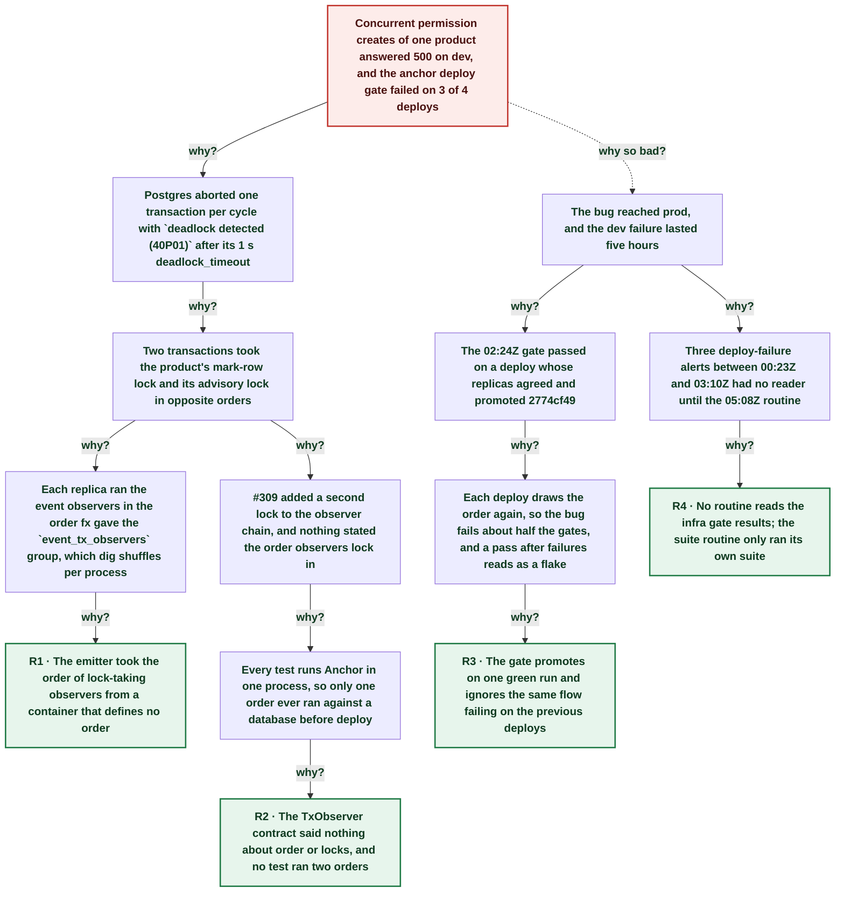

# Concurrent catalog writes deadlocked: replicas ran the transaction observers in opposite orders

| | |
|---|---|
| **Date** | 2026-10-31 |
| **Severity** | SEV3 |
| **Status** | In review |
| **Service** | anchor |
| **Authors** | Nanostack routine (echopoint-investigation) |
| **Duration** | 5h 32m (trigger to resolution) |
| **Time to detect** | 3m 57s |
| **Time to mitigate** | 5h 31m |

> Blameless: this document names systems, processes and missing guards, not people.

## Summary

From 00:20Z on 2026-10-31, concurrent resource permission creates of one product failed on dev anchor with `pq: deadlock detected (40P01)` and a 500. Three of four anchor post-deploy gates failed (`anchor: roles`, `anchor: resource-permission`), which held two merges off prod, while one gate passed and promoted the latent bug to prod. Since #309, a catalog write runs two in-transaction observers that take locks: the authz sync marker locks the product's `authz_sync_marks` row and the model size guard takes a product advisory lock. fx hands that observer group over in a random order per process, and dev and prod run two replicas, so each deploy has about one chance in two of opposite orders, and then concurrent writes deadlock. anchor#314 makes the emitter run observers in type-name order on every replica; it was live on dev at 05:51Z and on prod at 05:54Z. Prod logged no deadlock: nothing wrote its catalog concurrently.

## Impact

Dev: concurrent permission creates of one product answered 500 after about 1 s (Postgres deadlock_timeout). The anchor post-deploy gate failed on three deploys and held anchor#313 (Go SDK) and anchor#308 (log level) off prod. Prod ran the same code from 21:43Z on 2026-10-30, with two replicas whose order is unknown after its 02:25Z restart; VictoriaLogs shows no prod deadlock, so no customer request is known to have failed.

- **28** dev 500s with deadlock detected (VictoriaLogs, 00:20Z–05:20Z)
- **3 of 4** anchor post-deploy gates failed
- **0** prod deadlocks since 2026-10-29

## Trigger

The 00:14Z dev deploy of anchor 7c4e3e55 (#310/#311) restarted both dev replicas. Each drew a new observer order, and the two came out opposite. The latent cause shipped with #309 at 21:40Z the day before, on a deploy whose replicas happened to agree.

## Detection

The 00:23Z post-deploy gate failed and the deploy-failure alert fired, as it did again at 02:59Z and 03:10Z, at night with nobody watching. The 05:08Z echopoint-investigation run reproduced the failure, isolated it with a 4-writer flow (serial creates 100 ms, concurrent 1.08 s and a 500), and found `deadlock detected (40P01)` on both dev replicas in VictoriaLogs.

## Resolution

anchor#314 sorts the observers by type name in `events.NewEmitter`, so every replica takes the mark-row lock before the advisory lock. A unit test proves that two group orders run the same order, and a CT races 8 distinct-name creates over 5 rounds. The fix went live on dev at 05:51Z; the gate was green at 05:52Z and the fix reached prod at 05:54Z. On dev, the 4-writer repro flow passed 3× and the `roles` and `resource-permission` flows passed.

## Timeline (UTC)

| Time | | Event |
|---|---|---|
| 21:28:04 | T−2h 51m | **#309 merged: model size guard takes an advisory lock** ([link](https://github.com/nanostack-dev/anchor/pull/309)) |
| 21:43:29 | T−2h 36m | **#309 live on dev and prod; anchor gate green** ([link](https://github.com/nanostack-dev/infra/actions/runs/41132730321)) |
| ~23:08 | T−1h 12m | **Routine suite green on e34948a4 (anchor 29/29)** |
| 00:14:53 | T−5m 07s | **Dev deploy of 7c4e3e55 restarts both replicas** ([link](https://github.com/nanostack-dev/infra/actions/runs/41149107377)) |
| ~00:20 | T+0s | **First dev deadlocks on resource-permissions (6 rows)** VictoriaLogs `error:~"deadlock"`, both replicas. |
| 00:23:57 | T+3m 57s | **Anchor gate fails; deploy-failure alert fires** ([link](https://github.com/nanostack-dev/infra/actions/runs/41149107377)) |
| 02:24:05 | T+2h 04m | **Gate passes on a deploy whose replicas agree** ([link](https://github.com/nanostack-dev/infra/actions/runs/41159637931)) |
| 02:25:39 | T+2h 05m | **2774cf49 promoted to prod with the latent bug** ([link](https://github.com/nanostack-dev/infra/actions/runs/41159637931)) |
| 02:59:16 | T+2h 39m | **Gate fails again** ([link](https://github.com/nanostack-dev/infra/actions/runs/41162168770)) |
| 03:10:42 | T+2h 50m | **Gate fails again** ([link](https://github.com/nanostack-dev/infra/actions/runs/41163034758)) |
| 05:10:35 | T+4h 50m | **Routine suite: roles + resource-permission 500, rerun same** |
| ~05:30 | T+5h 10m | **4-writer repro flow and 40P01 in VictoriaLogs** |
| 05:38:09 | T+5h 18m | **anchor#314 merged (a0af6a51)** ([link](https://github.com/nanostack-dev/anchor/pull/314)) |
| 05:51:02 | T+5h 31m | **Fix live on dev; both replicas in one order** ([link](https://github.com/nanostack-dev/infra/actions/runs/41174157985)) |
| 05:52:43 | T+5h 32m | **Anchor gate green on the fix** ([link](https://github.com/nanostack-dev/infra/actions/runs/41174157985)) |
| 05:54:08 | T+5h 34m | **Fix live on prod (a0af6a51)** ([link](https://github.com/nanostack-dev/infra/actions/runs/41174157985)) |

## Root cause analysis: the five whys

Start at the impact and ask why until the answer is something the team can change. Solid edges ask why it happened; dashed edges ask why the impact was as large as it was.

- **Problem:** Concurrent permission creates of one product answered 500 on dev, and the anchor deploy gate failed on 3 of 4 deploys
  - **Why?** Postgres aborted one transaction per cycle with `deadlock detected (40P01)` after its 1 s deadlock_timeout _Evidence: VictoriaLogs: 28 dev rows `pq: deadlock detected (40P01)` on POST /resource-permissions; repro flow: serial 100 ms, concurrent 1.08 s, one 500_
    - **Why?** Two transactions took the product's mark-row lock and its advisory lock in opposite orders _Evidence: `fgasync.Marker` upserts `authz_sync_marks` (WholeProduct); `ModelSizeGuard` runs `pg_advisory_xact_lock(authz-model-size:<product>)`; deadlocks on replica .1 and .2 at the same second_
      - **Why?** Each replica ran the event observers in the order fx gave the `event_tx_observers` group, which dig shuffles per process _Evidence: dig v1.19.0 `scope.go:109` seeds with time.Now, `shuffledCopy`; `events.NewEmitter` kept the slice as given; anchor runs 2 replicas (`NANOSTACK_REPLICAS=2`)_
        - **Why?** The emitter took the order of lock-taking observers from a container that defines no order → **Root cause R1** (fixed by A1)
      - **Why?** #309 added a second lock to the observer chain, and nothing stated the order observers lock in _Evidence: `model_size.go` comment "It runs inside every write that emits an event"; agent-rules had no rule on observer locks_
        - **Why?** Every test runs Anchor in one process, so only one order ever ran against a database before deploy _Evidence: TestConcurrentCatalogWritesOfOneProductAllSucceed passes on the unfixed code locally_
          - **Why?** The TxObserver contract said nothing about order or locks, and no test ran two orders → **Root cause R2** (fixed by A2)
  - **Why so bad?** The bug reached prod, and the dev failure lasted five hours
    - **Why?** The 02:24Z gate passed on a deploy whose replicas agreed and promoted 2774cf49 _Evidence: infra run 41159637931: suite success, prod deploy 02:25:39Z_
      - **Why?** Each deploy draws the order again, so the bug fails about half the gates, and a pass after failures reads as a flake
        - **Why?** The gate promotes on one green run and ignores the same flow failing on the previous deploys → **Root cause R3** (fixed by A3, A4)
    - **Why?** Three deploy-failure alerts between 00:23Z and 03:10Z had no reader until the 05:08Z routine _Evidence: alert-deploy-failure success at 00:23:57Z, 02:59:23Z, 03:10:49Z_
      - **Why?** No routine reads the infra gate results; the suite routine only ran its own suite → **Root cause R4** (fixed by A5)

## Root causes

- **R1** The emitter took the order of lock-taking observers from a container that defines no order
- **R2** The TxObserver contract said nothing about order or locks, and no test ran two orders
- **R3** The gate promotes on one green run and ignores the same flow failing on the previous deploys
- **R4** No routine reads the infra gate results; the suite routine only ran its own suite

## Contributing factors

- The flows race their permission creates on purpose (sibling nodes); a serial graph would have hidden the deadlock.
- PostHog no longer receives logs since infra#259 (2026-10-27); the first log search there found nothing, and VictoriaLogs held the 40P01 rows.

## Lessons learned

### What went well

- The flow suite's sibling creates sample races, and caught a cross-replica deadlock that no single-process test can.
- A 4-writer throwaway flow turned a gate failure into a timing signature (1 s = deadlock_timeout) within minutes.

### What went wrong

- A green gate after two red ones promoted the bug to prod.
- Three alerts went unread for five hours.

### Where we got lucky

- No prod caller wrote one product's catalog concurrently, so no customer saw a 500.
- The merges held off prod were an SDK change and a log level, not a fix someone waited for.

## Action items

| ID | Action | Type | Owner | Due | Status | Ticket | Fixes |
|---|---|---|---|---|---|---|---|
| A1 | Run event observers in type-name order in `events.NewEmitter`, with a unit test over both group orders | prevent | Nanostack routine (echopoint-investigation) | 2026-10-31 | done | [anchor#314](https://github.com/nanostack-dev/anchor/pull/314) | R1 |
| A2 | agent-rules line: an observer takes its locks in type-name order; CT racing 8 distinct-name catalog writes | prevent | Nanostack routine (echopoint-investigation) | 2026-10-31 | done | [anchor#314](https://github.com/nanostack-dev/anchor/pull/314) | R2 |
| A3 | flow-suite-testing lesson: a flow that fails on some deploys of unchanged code is a per-process or per-replica order bug, not a flake | process | Nanostack routine (echopoint-investigation) | 2026-10-31 | done | [skills#43](https://github.com/nanostack-dev/skills/pull/43) | R3 |
| A4 | Decide whether the gate holds promotion while the same flow failed on one of the last 3 deploys | detect | infra maintainers | 2026-11-14 | open |  | R3 |
| A5 | echopoint-investigation reads Deploy Router gate failures since its last run, every run | detect | Nanostack routine (echopoint-investigation) | 2026-10-31 | done |  | R4 |

## Responders

- **Investigation**: Nanostack routine (echopoint-investigation)

## Messaging

### Internal

anchor dev deadlocked concurrent permission creates since 00:20Z (observer order differs per replica since #309). Gate failed 3/4 deploys; one pass promoted it to prod (no prod deadlock seen). Fix anchor#314.

### Customers

None: no customer request is known to have failed.

## Supporting information

- [Fix anchor#314](https://github.com/nanostack-dev/anchor/pull/314)
- [Cause anchor#309](https://github.com/nanostack-dev/anchor/pull/309)
- [Report (artifact)](https://claude.ai/artifact/FFLYQH4P1bi6KGHQVkUA8M)
