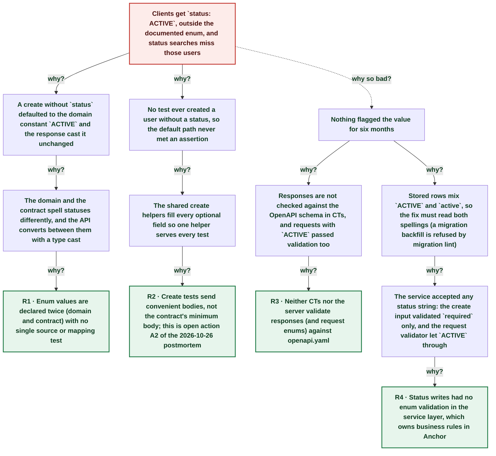

# Product users created without a status were stored and returned as ACTIVE, outside the contract enum

| | |
|---|---|
| **Date** | 2026-11-04 |
| **Severity** | SEV3 |
| **Status** | In review |
| **Service** | anchor (product users) |
| **Authors** | Nanostack routine (echopoint-investigation) |
| **Duration** | ~176d 03h (trigger to resolution) |
| **Time to detect** | 176d 02h |
| **Time to mitigate** | 176d 02h |

> Blameless: this document names systems, processes and missing guards, not people.

## Summary

Since the v1 snapshot (2026-05-11), `POST /v1/products/{id}/product-users` without `status` stored the user as `ACTIVE` and answered `"status": "ACTIVE"`, although the contract enum is `active`, `invited`, `suspended`. Every Clerk-synced user was stored the same way. A `statuses: ["active"]` search does not match those rows, and a client that decodes the enum strictly cannot read the response. The flow suite found it on 2026-11-04 at 00:13Z, when an email-only create added to `anchor: product-user` after anchor#321 got `ACTIVE` back. The fix stores and returns the contract spelling, folds a requested status to lower case, validates it against the enum in the service, and reads stored `ACTIVE` rows back as `active` (search matches both spellings); it waits for human review because it changes a visible response.

## Impact

Prod and dev, every product. Responses for default and Clerk-synced users carry a value outside the documented enum, and status searches with the documented values miss those users. The number of affected clients is unknown: nothing logs enum mismatches. This is the same class as the 2026-10-26 name contract drift.

- **~6 months** since the v1 snapshot
- **2** write paths storing ACTIVE (API default, Clerk sync)
- **0** tests that created a user without a status

## Trigger

The routine's email-only create in `anchor: product-user` (run 01a1a3e7, 00:13:56Z) asserted `$.status` equals `active` and got `ACTIVE`; the same flow's creates that send `status: active` get `active` back.

## Detection

Detected by a new flow check written from the contract, not from observed responses, while the routine updated the check for anchor#321. No test, alert or customer report had shown it in six months.

## Resolution

Not resolved on dev or prod yet. The fix, anchor#323, passes the product user CTs and repository tests locally (full CT suite with shuffle and race pending at writing) and waits for review. The reproduction moved to `anchor: known bugs`; the gate flow no longer asserts the default status.

## Timeline (UTC)

| Time | | Event |
|---|---|---|
| 21:16:14 | T+0s | **v1 snapshot: domain status ACTIVE, API enum active** ([link](https://github.com/nanostack-dev/anchor/commit/98d19607)) |
| ~21:16 | T+0s | **Users created without status return ACTIVE** |
| 05:13:10 | T+167d 07h | **Same class found: name required against the contract** ([link](https://claude.ai/artifact/9cd5VjqLrPT86J5Kr7rsVq)) |
| 18:59:33 | T+175d 21h | **anchor#321: email-only create accepted (CT still sends status)** ([link](https://github.com/nanostack-dev/anchor/pull/321)) |
| 00:13:56 | T+176d 02h | **Flow email-only create: status ACTIVE, expected active** |
| 00:14:51 | T+176d 02h | **Gate flow stops asserting the default; known bug flow added** |
| ~00:40 | T+176d 03h | **Fix branch green locally; PR waiting for review** |

## Root cause analysis: the five whys

Start at the impact and ask why until the answer is something the team can change. Solid edges ask why it happened; dashed edges ask why the impact was as large as it was.

- **Problem:** Clients get `status: ACTIVE`, outside the documented enum, and status searches miss those users
  - **Why?** A create without `status` defaulted to the domain constant `ACTIVE` and the response cast it unchanged _Evidence: `product_api.go` `OrElse(user.ProductUserStatusActive)`; `user.go` `ProductUserStatusActive = "ACTIVE"`; mapper `ProductUserStatus(user.Status)`_
    - **Why?** The domain and the contract spell statuses differently, and the API converts between them with a type cast _Evidence: Domain `ACTIVE`/`INACTIVE` vs contract `active`/`invited`/`suspended`; Clerk upsert also writes `ACTIVE`_
      - **Why?** Enum values are declared twice (domain and contract) with no single source or mapping test → **Root cause R1** (fixed by A1)
  - **Why?** No test ever created a user without a status, so the default path never met an assertion _Evidence: CT DSL `product_links_builder.go` sends `ACTIVE`; #321's email-only CT sends `status: active`; every flow create sent a status_
    - **Why?** The shared create helpers fill every optional field so one helper serves every test _Evidence: `createDSLProductUser` always sends name and status; flows copied full bodies_
      - **Why?** Create tests send convenient bodies, not the contract's minimum body; this is open action A2 of the 2026-10-26 postmortem → **Root cause R2** (fixed by A2, A5)
  - **Why so bad?** Nothing flagged the value for six months
    - **Why?** Responses are not checked against the OpenAPI schema in CTs, and requests with `ACTIVE` passed validation too _Evidence: The DSL's `ACTIVE` create returns 201 on main; CT asserts compare to generated constants only_
      - **Why?** Neither CTs nor the server validate responses (and request enums) against openapi.yaml → **Root cause R3** (fixed by A3, A4)
    - **Why?** Stored rows mix `ACTIVE` and `active`, so the fix must read both spellings (a migration backfill is refused by migration lint)
      - **Why?** The service accepted any status string: the create input validated `required` only, and the request validator let `ACTIVE` through _Evidence: `CreateProductUserInput.Status validate:"required"`; the CT DSL's `ACTIVE` create answers 201_
        - **Why?** Status writes had no enum validation in the service layer, which owns business rules in Anchor → **Root cause R4** (fixed by A1)

## Root causes

- **R1** Enum values are declared twice (domain and contract) with no single source or mapping test
- **R2** Create tests send convenient bodies, not the contract's minimum body; this is open action A2 of the 2026-10-26 postmortem
- **R3** Neither CTs nor the server validate responses (and request enums) against openapi.yaml
- **R4** Status writes had no enum validation in the service layer, which owns business rules in Anchor

## Contributing factors

- Clerk upsert compares `existing.Status != ACTIVE`, so a user created through the API with `active` counted as changed on every sync.
- The 2026-10-26 postmortem's contract-minimum action was still open.

## Lessons learned

### What went well

- Writing the new check from the contract, not from the observed response, found the bug at once.
- The fix keeps clients that send `ACTIVE` working by folding the case instead of refusing them.

### What went wrong

- The same class of drift was found nine days earlier and its prevention action is still open.
- #321 fixed the name default but its CT still sent a status, so the minimum body stayed untested.

### Where we got lucky

- The bug surfaced only because the gate check for #321 needed rewriting that night; the default path had no other test.
- Lower-casing on read is lossless for both spellings seen in code (`ACTIVE`, `active`), so no backfill is needed.

## Action items

| ID | Action | Type | Owner | Due | Status | Ticket | Fixes |
|---|---|---|---|---|---|---|---|
| A1 | Store and return contract statuses, fold input case, validate the enum in the service, read legacy rows as active | prevent | anchor maintainers (review) | 2026-11-11 | open | [anchor#323](https://github.com/nanostack-dev/anchor/pull/323) | R1, R4 |
| A2 | CT per create operation with only the contract's required fields, asserting every defaulted field | prevent | anchor maintainers | 2026-11-18 | open |  | R2 |
| A3 | Validate CT responses against openapi.yaml (kin-openapi response validation in the CT client) | detect | anchor maintainers | 2026-11-18 | open |  | R3 |
| A4 | Known-bugs reproduction; move into `anchor: product-user` once the fix is live | detect | Nanostack routine (echopoint-investigation) | 2026-11-04 | done |  | R3 |
| A5 | flow-suite-testing skill: a create check sends only required fields and asserts each default against the contract | process | Nanostack routine (echopoint-investigation) | 2026-11-04 | done | [skills#48](https://github.com/nanostack-dev/skills/pull/48) | R2 |

## Responders

- **Detection and fix**: Nanostack routine (echopoint-investigation)

## Messaging

### Internal

Anchor returns product user status ACTIVE for users created without a status and for Clerk-synced users; the contract says active. Fix waiting for review.

### Customers

Product users created without a status, and users synced from Clerk, were returned with status ACTIVE instead of active. Responses now use the documented values, and searches by status find these users.

## Supporting information

- [Report (artifact)](https://claude.ai/artifact/NXLTbTpn4q1aJo85G41tUC)
- [SEV3 name contract drift (same class)](https://claude.ai/artifact/9cd5VjqLrPT86J5Kr7rsVq)
- [anchor#321](https://github.com/nanostack-dev/anchor/pull/321)
- [anchor#323 (fix, waiting review)](https://github.com/nanostack-dev/anchor/pull/323)
- [skills#48](https://github.com/nanostack-dev/skills/pull/48)
