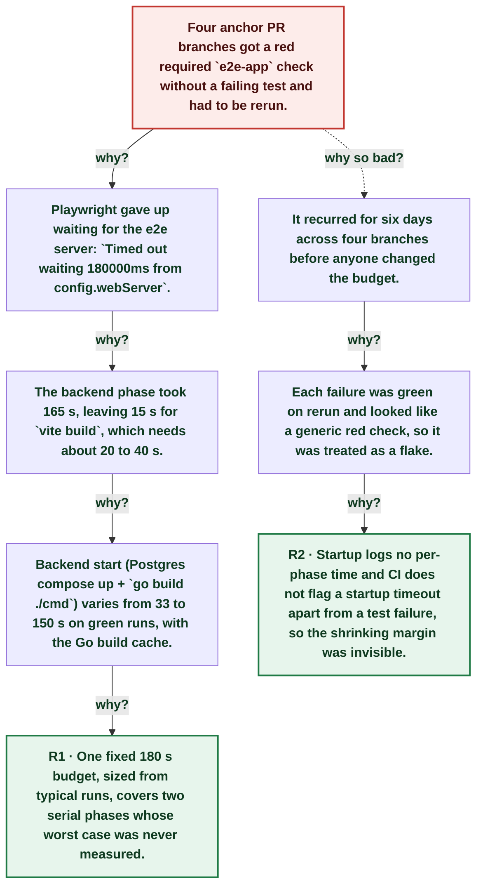

# Anchor e2e-app check timed out starting its server on 4 branches

| | |
|---|---|
| **Date** | 2026-11-09 |
| **Severity** | SEV4 |
| **Status** | In review |
| **Service** | anchor CI (e2e-app, GitHub-hosted) |
| **Authors** | Nanostack routine (echopoint-investigation) |
| **Duration** | ~5d 18h (trigger to resolution) |
| **Time to detect** | ~21m 49s |
| **Time to mitigate** | ~5d 18h |

> Blameless: this document names systems, processes and missing guards, not people.

## Summary

The anchor `e2e-app` PR check failed on four branches between 2026-11-04 and 2026-11-09 before any browser test ran: Playwright stopped waiting for the disposable e2e server after its 180 s `webServer` timeout. That budget covers two serial phases: the backend (Postgres plus `go build ./cmd`) and `vite build`. On green runs the backend phase alone took 33 to 150 s; on the 16:18Z run it took 165 s, leaving 15 s for a frontend build that needs about 20 to 40 s. Each failure was green on rerun, so it read as a flake. The fix raises the budget to 420 s and logs the backend phase time.

## Impact

CI only. Four PR branches got a red required e2e check with no test failure and needed a manual rerun; no deploy or customer impact.

- **4** branches with a red e2e-app check
- **4 of ~62** completed e2e-app runs since 2026-11-02 (~6%)
- **0** browser tests that actually failed

## Trigger

On `feat/search-db-adopt` the backend phase of `serve-e2e-full.mjs` took 165 s, and `vite build` could not finish inside the remaining 15 s.

## Detection

The echopoint-investigation routine logged the first two failures (anchor#323 branch, 2026-11-04) as an open ledger row and waited for a second branch; it found three more on 2026-11-09 by grepping job logs for `Timed out waiting 180000ms`. No CI signal separates a startup timeout from a test failure, so authors saw a generic red check and reran.

## Resolution

Each affected run went green on rerun. anchor PR (this postmortem) raises the `webServer` timeout in `playwright.app.config.ts` to 420 s and prints `Anchor backend ready in … ms` so the next budget question has data.

## Timeline (UTC)

| Time | | Event |
|---|---|---|
| 00:30:11 | T+0s | **First timeout, anchor#323 branch (green on rerun)** ([link](https://github.com/nanostack-dev/anchor/actions/runs/41747296067)) |
| ~00:52 | T+21m 49s | **Routine logs it as an open ledger row, waits for a 2nd branch** |
| 07:56:00 | T+5d 07h | **Timeout on p1/bind-email** ([link](https://github.com/nanostack-dev/anchor/actions/runs/42582421926)) |
| 08:05:22 | T+5d 07h | **Timeout on p1/bind-repository-hub** ([link](https://github.com/nanostack-dev/anchor/actions/runs/42583446057)) |
| 16:19:30 | T+5d 15h | **Backend phase starts on feat/search-db-adopt** ([link](https://github.com/nanostack-dev/anchor/actions/runs/42653368599)) |
| 16:22:15 | T+5d 15h | **`vite build` starts after a 165 s backend phase** ([link](https://github.com/nanostack-dev/anchor/actions/runs/42653368599)) |
| 16:22:32 | T+5d 15h | **Timed out waiting 180000ms from config.webServer** ([link](https://github.com/nanostack-dev/anchor/actions/runs/42653368599)) |
| ~16:36 | T+5d 16h | **Next run on the branch is green** |
| 18:11:38 | T+5d 17h | **Routine finds the second-branch timeouts in job logs** |
| ~18:40 | T+5d 18h | **Fix PR opened: 420 s budget + backend phase log** |
| ~19:00 | T+5d 18h | **Fix merged to anchor main** |

## Root cause analysis: the five whys

Start at the impact and ask why until the answer is something the team can change. Solid edges ask why it happened; dashed edges ask why the impact was as large as it was.

- **Problem:** Four anchor PR branches got a red required `e2e-app` check without a failing test and had to be rerun.
  - **Why?** Playwright gave up waiting for the e2e server: `Timed out waiting 180000ms from config.webServer`. _Evidence: [run 42653368599](https://github.com/nanostack-dev/anchor/actions/runs/42653368599) log line at 16:22:32Z; same line in the other three failed runs_
    - **Why?** The backend phase took 165 s, leaving 15 s for `vite build`, which needs about 20 to 40 s. _Evidence: `test:e2e:verify` starts 16:19:29Z, `[WebServer] $ vite build` 16:22:15Z, timeout 16:22:32Z_
      - **Why?** Backend start (Postgres compose up + `go build ./cmd`) varies from 33 to 150 s on green runs, with the Go build cache. _Evidence: 14 green runs on 2026-11-09: gap from `test:e2e:verify` to `vite build` 33 s to 150 s (`scripts/e2e-runtime.mjs` runs `go build` before starting Anchor)_
        - **Why?** One fixed 180 s budget, sized from typical runs, covers two serial phases whose worst case was never measured. → **Root cause R1** (fixed by A1, A4)
  - **Why so bad?** It recurred for six days across four branches before anyone changed the budget.
    - **Why?** Each failure was green on rerun and looked like a generic red check, so it was treated as a flake. _Evidence: anchor#323 runs 2 of 3 red then green (ledger row `ci:github:anchor:e2e-app`); later branches green on their next push_
      - **Why?** Startup logs no per-phase time and CI does not flag a startup timeout apart from a test failure, so the shrinking margin was invisible. → **Root cause R2** (fixed by A2, A3)

## Root causes

- **R1** One fixed 180 s budget, sized from typical runs, covers two serial phases whose worst case was never measured.
- **R2** Startup logs no per-phase time and CI does not flag a startup timeout apart from a test failure, so the shrinking margin was invisible.

## Contributing factors

- Branches that touch many Go packages (codegen migrations, search refactor) recompile most of `./cmd`, the slow end of the backend range.
- The e2e job timeout is 15 min, so the 180 s startup budget was far tighter than the job needed.

## Lessons learned

### What went well

- The failing log kept enough timestamps to split the 180 s into its two phases after the fact.

### What went wrong

- A red-then-green check was logged and left open for six days instead of measured once.

### Where we got lucky

- The timeouts hit PR checks only; the e2e suite does not gate deploys, so nothing was held from prod.

## Action items

| ID | Action | Type | Owner | Due | Status | Ticket | Fixes |
|---|---|---|---|---|---|---|---|
| A1 | Raise the `webServer` timeout in `playwright.app.config.ts` from 180 s to 420 s, with the measured range in a comment | prevent | Nanostack routine (echopoint-investigation) |  | done |  | R1 |
| A2 | `serve-e2e-full.mjs` prints `Anchor backend ready in … ms` before the frontend build; e2e guide line on sizing the budget | detect | Nanostack routine (echopoint-investigation) |  | done |  | R2 |
| A3 | Report a webServer startup timeout as its own annotation in `run-e2e-affected.mjs`, so it is not read as a test failure | detect | anchor maintainers | 2026-11-23 | open |  | R2 |
| A4 | Build the backend and the frontend in parallel in `serve-e2e-full.mjs` (startup becomes the max of the two phases, not the sum) | mitigate | anchor maintainers | 2026-11-30 | open |  | R1 |

## Responders

- **Investigation**: Nanostack routine (echopoint-investigation)

## Messaging

### Internal

anchor e2e-app red checks with `Timed out waiting 180000ms from config.webServer` were a startup budget, not flaky tests: backend build + frontend build ran serially inside 180 s. Budget raised to 420 s; the log now prints the backend phase time.

### Customers

None (CI only).

## Supporting information

- [Report](https://claude.ai/artifact/C3QGtA5xhRfr1oD1Rq9Krp)
- [Failed run, feat/search-db-adopt](https://github.com/nanostack-dev/anchor/actions/runs/42653368599)
- [Failed run, anchor#323 branch](https://github.com/nanostack-dev/anchor/actions/runs/41747296067)
- [Atelier](http://nanostack-dev-1340p:4320/postmortems/01a1c2ce-9cb1-7a6c-a739-4359ee2e346f)
- [anchor#360 (fix)](https://github.com/nanostack-dev/anchor/pull/360)
