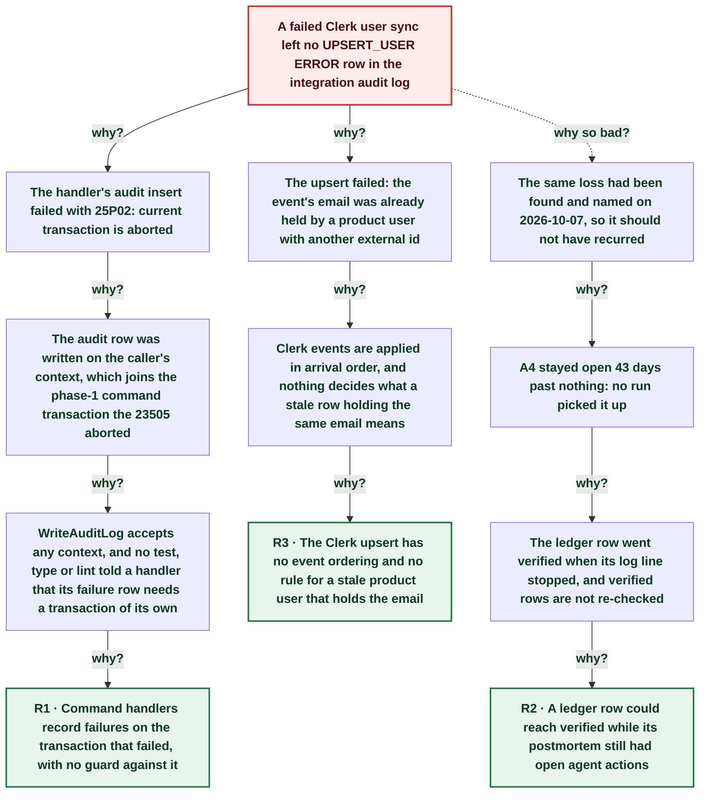

# A failed Clerk user sync left no ERROR row in the integration audit log: the row was written on the transaction the failure had aborted

| | |
|---|---|
| **Date** | 2026-11-19 |
| **Severity** | SEV4 |
| **Status** | In review |
| **Service** | anchor |
| **Authors** | Nanostack routine (grafana-watch) |
| **Duration** | 18s (trigger to resolution) |
| **Time to detect** | ~2h 18m |

> Blameless: this document names systems, processes and missing guards, not people.

## Summary

On 2026-11-19 at 06:43Z, on dev, a Clerk `user.created` event carried an email that another product user (other external id) already held. The upsert failed on `product_users_product_id_email_key` (23505) on all 6 attempts, and each time the handler's `UPSERT_USER` ERROR audit row failed with 25P02, because it was written on the command transaction the failed insert had just aborted. This is root cause R4 of the [2026-10-07 postmortem](2026-10-07-duplicate-clerk-reconcile.md): its action A4 (anchor#210) stayed open for 43 days while the ledger row was marked verified. The fix lets a command handler return its failure audit row with the error, and the webhook and reconcile paths write it in a fresh transaction after the rollback; a ruleguard rule refuses the old pattern. The email conflict itself comes from Clerk events applied without ordering, a design change deferred by anchor#399.

## Impact

Dev only, no customer impact. One Clerk event failed permanently after 6 attempts, and the integration audit log lost the 6 `UPSERT_USER` ERROR rows that name the failing external id; the phase-2 retry and failure rows were kept. Prod runs the same code: any Clerk upsert or delete failure there lost its row too, and a failed reconcile batch left no failure row at all.

- **6** UPSERT_USER ERROR audit rows lost (25P02)
- **1** Clerk event permanently failed
- **43 days** the A4 fix for this class stayed open

## Trigger

A Clerk `user.created` event for product `prd_3MJZRxg3…` (MCP audit Clerk probes) whose email another external id already held; the upsert raised 23505 and aborted the command transaction.

## Detection

The grafana-watch routine found the paired `failed to upsert product user` / `failed to create integration audit log … (25P02)` rows in its 2026-11-19T09:02Z scan, about 2 h 18 min later, and recorded ledger row 102. Detection was good enough for a dev-only loss: since the fix, a failed command leaves an ERROR row a product owner sees in the audit log.

## Resolution

The impact ended when the event exhausted its retries at 06:44:12Z. The fix (this PR) adds `provider.WithFailureAudit`: the Clerk upsert and delete handlers return their ERROR audit row with the error, `handleEventFailure` writes it in the phase-2 transaction, and `executeCommandsInBatches` writes it in a new transaction after a reconcile batch rolls back. A ruleguard rule reports any `provider.WriteAuditLog` of an ERROR row, and a component test asserts the row after a forced 23505.

## Timeline (UTC)

| Time | | Event |
|---|---|---|
| 18:10:38 | T−42d 12h | **First 25P02 audit loss; 10-07 postmortem names R4** Action A4 (persist failure audit rows outside the aborted batch transaction) opened as anchor#210, due 2026-10-24. ([link](https://github.com/nanostack-dev/anchor/issues/210)) |
| ~19:15 | T−41d 11h | **Ledger row 22 marked verified while A4 is open** The row went `verified` when the 23505 stopped after anchor#211; the open A4 was not part of the check. |
| ~00:00 | T−3d 06h | **anchor#210 status note: still open** ([link](https://github.com/nanostack-dev/anchor/issues/210)) |
| 06:43:47 | T−7s | **MCP audit Clerk probes reach the dev webhook** `webhook ingested and queued as PENDING` rows from 06:43:47Z. |
| 06:43:54 | T+0s | **Upsert fails 23505; its audit row fails 25P02** `failed to upsert product user` (`product_users_product_id_email_key`) paired with `failed to create integration audit log … (25P02)` at `provider/audit.go:38`. |
| 06:43:58 | T+4s | **Attempts 2 to 5 fail the same way** Each `event scheduled for retry` row is kept by phase 2; each UPSERT_USER row is lost. |
| 06:44:12 | T+18s | **Event permanently failed after 6 attempts** `event permanently failed after max retries` (integration_service.go:1427), then `queue job permanently failed`. |
| ~09:02 | T+2h 18m | **grafana-watch records ledger row 102** |
| 17:05:00 | T+10h 21m | **anchor#399 defers Clerk event ordering as design** Audit finding `clerk-upsert-no-ordering-email-conflict`: skipping older events needs a stored last-event time and a rule for a stale row with the same email. ([link](https://github.com/nanostack-dev/anchor/pull/399)) |
| 15:09:00 | T+1d 08h | **Fix PR anchor#403 opened** ([link](https://github.com/nanostack-dev/anchor/pull/403)) |

## Root cause analysis: the five whys

Start at the impact and ask why until the answer is something the team can change. Solid edges ask why it happened; dashed edges ask why the impact was as large as it was.

- **Problem:** A failed Clerk user sync left no UPSERT_USER ERROR row in the integration audit log
  - **Why?** The handler's audit insert failed with 25P02: current transaction is aborted _Evidence: 6 pairs of `failed to upsert product user` + `failed to create integration audit log … (25P02)`, 2026-11-19 06:43:54–06:44:12Z (VictoriaLogs, dev anchor)_
    - **Why?** The audit row was written on the caller's context, which joins the phase-1 command transaction the 23505 aborted _Evidence: `executeUpsertUser` calls `provider.WriteAuditLog(ctx, …)` after `InTx` returns; `processOneEvent` runs it inside phase 1, `executeCommandsInBatches` inside the batch tx (`integration_service.go`)_
      - **Why?** WriteAuditLog accepts any context, and no test, type or lint told a handler that its failure row needs a transaction of its own _Evidence: `internal/integration/provider/audit.go` on 61d4fcdd; no CT asserted a failure audit row_
        - **Why?** Command handlers record failures on the transaction that failed, with no guard against it → **Root cause R1** (fixed by A1)
  - **Why?** The upsert failed: the event's email was already held by a product user with another external id _Evidence: `duplicate key value violates unique constraint "product_users_product_id_email_key" (23505)` on every attempt_
    - **Why?** Clerk events are applied in arrival order, and nothing decides what a stale row holding the same email means _Evidence: anchor#399 audit finding `clerk-upsert-no-ordering-email-conflict`, deferred as design_
      - **Why?** The Clerk upsert has no event ordering and no rule for a stale product user that holds the email → **Root cause R3** (fixed by A3)
  - **Why so bad?** The same loss had been found and named on 2026-10-07, so it should not have recurred _Evidence: 2026-10-07 postmortem R4, action A4 → anchor#210 (open)_
    - **Why?** A4 stayed open 43 days past nothing: no run picked it up _Evidence: anchor#210 open with no PR; status note 2026-11-16 'Still open'_
      - **Why?** The ledger row went verified when its log line stopped, and verified rows are not re-checked _Evidence: ledger row 22: `verified (no 23505 from 2026-10-08T19:15…)` with A4 still open_
        - **Why?** A ledger row could reach verified while its postmortem still had open agent actions → **Root cause R2** (fixed by A2)

## Root causes

- **R1** Command handlers record failures on the transaction that failed, with no guard against it
- **R3** The Clerk upsert has no event ordering and no rule for a stale product user that holds the email
- **R2** A ledger row could reach verified while its postmortem still had open agent actions

## Contributing factors

- The phase-2 retry rows carried the error text, so the audit log was not empty and the gap was easy to miss.
- The reconcile path has no phase 2 at all: a failed batch left no failure row of any kind.

## Lessons learned

### What went well

- Every lost audit insert logged its own error with `code.file.path`, so the cause was one query away.
- The 10-07 postmortem had already named the exact mechanism and the fix options.

### What went wrong

- An action tracked only in an issue was forgotten once its ledger row closed.
- Two runs deferred row 102 for budget before anyone wrote its postmortem.

### Where we got lucky

- It happened on dev, from an audit probe. On prod a real customer's failed sync would have left no ERROR row in the log they read.
- The 23505 was permanent and loud. A transient failure would have retried to success and hidden the lost row entirely.

## Action items

| ID | Action | Type | Owner | Due | Status | Ticket | Fixes |
|---|---|---|---|---|---|---|---|
| A1 | Return failure audit rows with the error (`provider.WithFailureAudit`); write them after the rollback in the webhook and reconcile paths; ruleguard `failureAuditLeavesTheAbortedTx`; CT `TestClerkWebhookFailedCommandAudit` | prevent | anchor | 2026-11-20 | done | [anchor#210](https://github.com/nanostack-dev/anchor/issues/210) | R1 |
| A2 | Postmortem loop: a ledger row reaches verified only when every action of its postmortem is done or owned by a human | process | grafana-watch routine | 2026-11-20 | done |  | R2 |
| A3 | Design change: order Clerk events per user and decide how a stale product user that holds the email is resolved | prevent | anchor maintainers (design review) | 2026-12-04 | open | [anchor#399](https://github.com/nanostack-dev/anchor/pull/399) | R3 |

## Responders

- **Investigation**: Nanostack routine (grafana-watch)

## Messaging

### Internal

Dev anchor: a failed Clerk user sync lost its UPSERT_USER ERROR audit row (25P02 on the aborted command tx), the R4 class from 2026-10-07. Fixed: failure audit rows now ride the error to a fresh transaction, with a lint rule and a CT. Clerk event ordering stays a design item.

### Customers

None: dev only.

## Supporting information

- [2026-10-07 postmortem (R4, A4)](2026-10-07-duplicate-clerk-reconcile.md)
- [anchor#210](https://github.com/nanostack-dev/anchor/issues/210)
- [anchor#399 (deferred ordering design)](https://github.com/nanostack-dev/anchor/pull/399)
- [Fix PR anchor#403](https://github.com/nanostack-dev/anchor/pull/403)
- [Atelier](http://nanostack-dev-1340p:4320/postmortems/01a1f983-35c3-7247-9c3a-9ff2eb7a46da)
