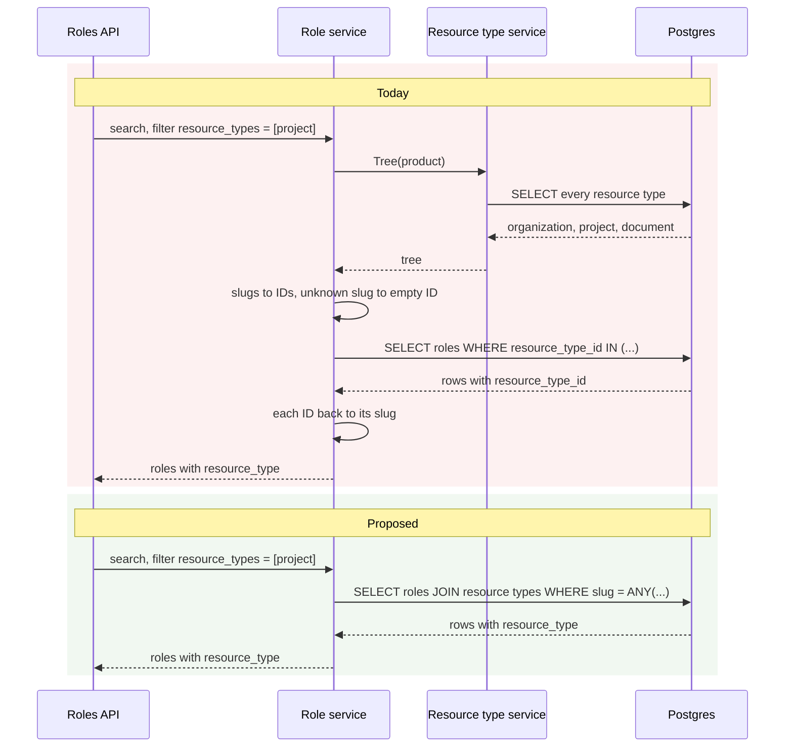

# ADR-0022: optional improvements

Status: open list, nothing here is required.

[ADR-0022](../adr/0022-resource-types-scope-roles-and-permissions.md) is delivered by milestones #260 to #266. Reviews of those PRs found changes worth making that do not block any of them. They are collected here so the delivery stays scoped and nothing is forgotten.

Each entry is independent. Pick one up as its own PR when it is worth it, then mark it done here.

**Every entry has the same parts:** today, the proposal, what it removes and keeps, its cost, then a folded **📌 Real example** with concrete requests or code and a **diagram** of before and after, so the reason is visible without reading the code.

| # | Improvement | Where | State |
| :-- | :-- | :-- | :-- |
| [I1](#i1) | Resolve a role's or permission's scope in SQL, not through the tree | role and permission search and reads (#270) | open |

---

<a id="i1"></a>
## I1 · Resolve scopes in SQL, not through the tree

**Today (#270).** The database stores a role's or permission's scope as `resource_type_id` (`rtype_…`). The API filters by and returns the type's slug (`project`). `scopedSearch` in `internal/service/resource_type_scope.go` bridges the two for every search:

1. load the Product's whole resource type tree;
2. turn the filter's slugs into IDs (`Tree.ResolveScopes`), with an empty ID for an unknown slug and `IncludeUnscoped` for rows the backfill has not reached yet;
3. run the search;
4. turn each item's ID back into a slug (`withRoleScope`, `withPermissionScope`, `scopeSlug`).

It is generic over roles and permissions, so it takes four type parameters and three functions. `GetProductRole` and `GetByRole` repeat the tree read and step 4.

**Proposal.** The role and permission repositories join `product_resource_types` and read the slug in the same query. Once the cleanup above #270 makes `resource_type_id` `NOT NULL`, the `LEFT JOIN` and `COALESCE` become a plain `JOIN`.

**Removes:** `scopedSearch`, `withRoleScope`, `withPermissionScope`, `scopeSlug`, `Tree.ResolveScopes` and `ScopeFilter`, and one tree read per search, get and list-by-role call. Searches become plain repository calls like every other Anchor search, and an unknown slug simply matches nothing.

**Keeps:** the tree read where it decides something: the permission scope check on role writes, and tree writes.

**Cost:** the role and permission search queries, their jet scan structs and the search index review in `docs/technical/cursor-pagination.md`. Behaviour is unchanged, so the existing CTs are the proof.

<details>
<summary>📌 Real example</summary>

A Product declares `organization → project → document`. An admin lists the roles scoped to `project`:

```http
POST /v1/products/prod_2qL9/roles/search
{ "filter": { "resource_types": ["project"] } }
```

```json
{
  "items": [
    { "id": "role_2qLBd0cV", "name": "project-admin", "resource_type": "project" }
  ]
}
```

The answer is the same before and after. What changes is how Anchor gets there.

**Today**, three steps in Go around one query:

```go
tree, _ := types.Tree(ctx, productID)            // query 1: every resource type of the product
filter.Scopes = tree.ResolveScopes(["project"])  // "project" → ["rtype_2qLCf0"]
result, _ := roles.SearchByProductID(ctx, ...)   // query 2: WHERE resource_type_id IN ('rtype_2qLCf0')
for i := range result.Items {                    // "rtype_2qLCf0" → "project", item by item
    result.Items[i].ResourceType = scopeSlug(tree, result.Items[i].ResourceTypeID)
}
```

Edge cases the Go code has to model by hand:

| Case | Today | With the join |
| :-- | :-- | :-- |
| `"resource_types": ["nope"]` | slug maps to the ID `""` so the `IN` matches nothing | `slug = ANY('{nope}')` matches nothing |
| role written by the previous release, scope still `NULL` | `IncludeUnscoped` adds `OR resource_type_id IS NULL` when `organization` is asked | `COALESCE(rt.slug, 'organization')` |
| response field `resource_type` | filled in Go from the tree | read from the row |

**Proposed**, one query that answers in slugs:

```sql
SELECT r.id, r.name, COALESCE(rt.slug, 'organization') AS resource_type
FROM product_roles r
LEFT JOIN product_resource_types rt ON rt.id = r.resource_type_id
WHERE r.product_id = 'prod_2qL9'
  AND COALESCE(rt.slug, 'organization') = ANY('{project}')
-- sort, cursor and limit unchanged from today's search
```

</details>

<details>
<summary>Diagram: before and after</summary>



</details>
