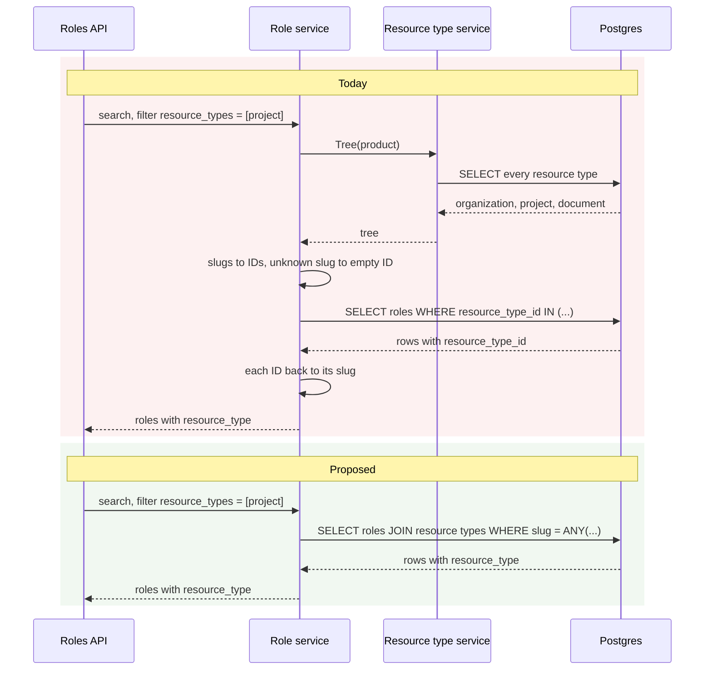
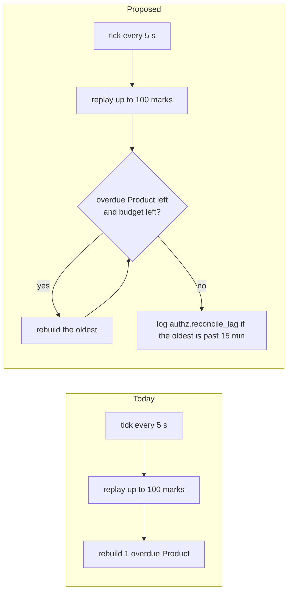
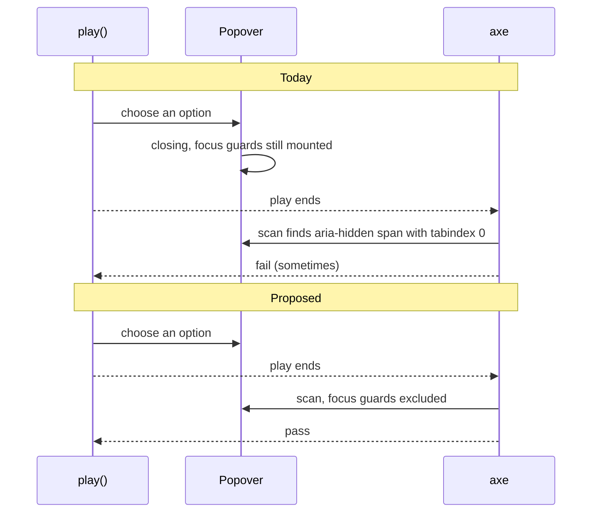

# ADR-0022: optional improvements

Status: open list, nothing here is required.

[ADR-0022](../adr/0022-resource-types-scope-roles-and-permissions.md) is delivered by milestones #260 to #266. Reviews of those PRs found changes worth making that do not block any of them. They are collected here so the delivery stays scoped and nothing is forgotten.

Each entry is independent. Pick one up as its own PR when it is worth it, then mark it done here.

**Every entry has the same parts:** today, the proposal, what it removes and keeps, its cost, then a folded **📌 Real example** with concrete requests or code and a **diagram** of before and after, so the reason is visible without reading the code.

| # | Improvement | Where | State |
| :-- | :-- | :-- | :-- |
| [I1](#i1) | Resolve a role's or permission's scope in SQL, not through the tree | role and permission search and reads (#270) | open |
| [I2](#i2) | Reconcile as many Products per pass as the 15-minute window needs | authz sweeper (M2, PR 4) | open |
| [I3](#i3) | Keep Base UI's focus guards out of the Storybook axe check | Storybook a11y config | open |

---

<a id="i1"></a>
## I1 · Resolve scopes in SQL, not through the tree

**Today (#270).** The database stores a role's or permission's scope as `resource_type_id` (`rtype_…`). The API filters by and returns the type's slug (`project`). `scopedSearch` in `internal/service/resource_type_scope.go` bridges the two for every search:

1. load the Product's whole resource type tree;
2. turn the filter's slugs into IDs (`Tree.ResolveScopes`), with an empty ID for an unknown slug and `IncludeUnscoped` for rows the backfill has not reached yet;
3. run the search;
4. turn each item's ID back into a slug (`withRoleScope`, `withPermissionScope`, `scopeSlug`).

It is generic over roles and permissions, so it takes four type parameters and three functions. `GetProductRole` and `GetByRole` repeat the tree read and step 4.

**Proposal.** The role and permission repositories join `product_resource_types` and read the slug in the same query. Once the cleanup above #270 makes `resource_type_id` `NOT NULL`, the `LEFT JOIN` and `COALESCE` become a plain `JOIN`.

**Removes:** `scopedSearch`, `withRoleScope`, `withPermissionScope`, `scopeSlug`, `Tree.ResolveScopes` and `ScopeFilter`, and one tree read per search, get and list-by-role call. Searches become plain repository calls like every other Anchor search, and an unknown slug simply matches nothing.

**Keeps:** the tree read where it decides something: the permission scope check on role writes, and tree writes.

**Cost:** the role and permission search queries, their jet scan structs and the search index review in `docs/technical/cursor-pagination.md`. Behaviour is unchanged, so the existing CTs are the proof.

<details>
<summary>📌 Real example</summary>

A Product declares `organization → project → document`. An admin lists the roles scoped to `project`:

```http
POST /v1/products/prod_2qL9/roles/search
{ "filter": { "resource_types": ["project"] } }
```

```json
{
  "items": [
    { "id": "role_2qLBd0cV", "name": "project-admin", "resource_type": "project" }
  ]
}
```

The answer is the same before and after. What changes is how Anchor gets there.

**Today**, three steps in Go around one query:

```go
tree, _ := types.Tree(ctx, productID)            // query 1: every resource type of the product
filter.Scopes = tree.ResolveScopes(["project"])  // "project" → ["rtype_2qLCf0"]
result, _ := roles.SearchByProductID(ctx, ...)   // query 2: WHERE resource_type_id IN ('rtype_2qLCf0')
for i := range result.Items {                    // "rtype_2qLCf0" → "project", item by item
    result.Items[i].ResourceType = scopeSlug(tree, result.Items[i].ResourceTypeID)
}
```

Edge cases the Go code has to model by hand:

| Case | Today | With the join |
| :-- | :-- | :-- |
| `"resource_types": ["nope"]` | slug maps to the ID `""` so the `IN` matches nothing | `slug = ANY('{nope}')` matches nothing |
| role written by the previous release, scope still `NULL` | `IncludeUnscoped` adds `OR resource_type_id IS NULL` when `organization` is asked | `COALESCE(rt.slug, 'organization')` |
| response field `resource_type` | filled in Go from the tree | read from the row |

**Proposed**, one query that answers in slugs:

```sql
SELECT r.id, r.name, COALESCE(rt.slug, 'organization') AS resource_type
FROM product_roles r
LEFT JOIN product_resource_types rt ON rt.id = r.resource_type_id
WHERE r.product_id = 'prod_2qL9'
  AND COALESCE(rt.slug, 'organization') = ANY('{project}')
-- sort, cursor and limit unchanged from today's search
```

</details>

<details>
<summary>Diagram: before and after</summary>



</details>

---

<a id="i2"></a>
## I2 · Reconcile as many Products per pass as the window needs

**Today (M2, PR 4).** The sweeper in `internal/authz/service/sweeper.go` runs every `sweepInterval` (5 s) on one replica at a time. Each pass does two things:
1. it replays up to 100 sync marks;
2. it rebuilds **one** Product whose last rebuild is older than `reconcileInterval` (15 min), through `DueForReconcileInternal`.

So one replica can rebuild at most 15 min / 5 s = **180 Products** per window. With a 181st Product, the oldest rebuild gets later every window. Nothing reports it, except the age of `authz_stores.reconciled_at`.

Writes reach the store right after their commit, so this lag does not delay decisions. The rebuild is only the backup that repairs drift from writes that left no mark.

**Proposal.** In each pass, rebuild overdue Products until a time budget runs out, for example 3 s of the 5 s interval, oldest first. Log `authz.reconcile_lag` with the oldest `reconciled_at` age when it passes the interval.

**Removes:** the hard limit of 180 Products. It also removes the silent lag past that limit.

**Keeps:** one sweeper replica at a time, marks replayed before rebuilds in each pass, and the 15-minute target.

**Cost:** a loop and a deadline in `reconcileOverdue`, a `limit` on `DueForReconcileInternal`, one log event, and a service test with more Products than one pass can take.

<details>
<summary>📌 Real example</summary>

Take a Product count past the limit, say 240, with rebuilds of about 40 ms each. The numbers are illustrative.

| | Products rebuilt per 15 min | Oldest `reconciled_at` after one hour |
| :-- | :-- | :-- |
| Today, one per pass | 180 | 20 min, then 25, 30 … it keeps growing |
| Proposed, 3 s budget per pass | all 240 in the first ~4 passes | under 15 min |

The query that shows the lag today:

```sql
SELECT count(*) FILTER (WHERE reconciled_at < now() - interval '15 minutes') AS overdue,
       max(now() - reconciled_at)                                         AS oldest
FROM authz_stores;
```
</details>

<details>
<summary>Diagram: before and after</summary>


</details>

---

<a id="i3"></a>
## I3 · Keep Base UI's focus guards out of the Storybook axe check

**Today.** `anchor-ui/.storybook/preview.ts` runs axe on every story with `a11y.test: "error"`. Its comment still says it reports violations "without failing the run". Base UI 1.8 renders a focus guard around an open popover: a visually hidden `<span tabindex="0" aria-hidden="true" data-base-ui-focus-guard>` (`@base-ui/react/utils/FocusGuard.js`). axe reports that span as `aria-hidden-focus`.

When axe runs depends on the timing of the story. If it runs while a popover is still open or closing, the story fails. Otherwise it passes. This has failed CI at random on stories such as `ResourceTypeSelect › Chooses By Slug` and on `LicenseSchemaEditor`, and each time a rerun passed.

**Proposal.** In `preview.ts`, leave the guards out of the axe context:

```ts
a11y: {
	test: "error",
	// Base UI's focus guards are aria-hidden on purpose: they only catch Tab
	// to keep focus in an open popover.
	context: { exclude: ["[data-base-ui-focus-guard]"] },
},
```

Also fix the stale comment.

**Removes:** the random `aria-hidden-focus` failure and its reruns.

**Keeps:** every other axe rule on every story, including `aria-hidden-focus` on Anchor's own markup.

**Cost:** one config line, plus one story that opens a popover and asserts axe passes.

<details>
<summary>📌 Real example</summary>

`ResourceTypeSelect › Chooses By Slug` failed one Storybook shard with the axe rule `aria-hidden-focus`. The element is Base UI's guard, as `FocusGuard.js` renders it:

```html
<span tabindex="0" aria-hidden="true" data-base-ui-focus-guard="" style="position: absolute; …"></span>
```

Rerunning the same story file passed 3 of 3 times. The guard exists only while the popup is mounted, so whether axe sees it depends on the timing of the play function's last step.
</details>

<details>
<summary>Diagram: before and after</summary>


</details>
