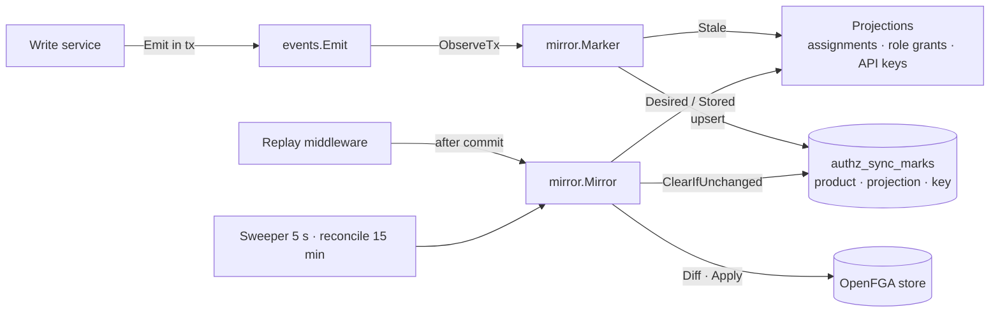

# Authorization mirror

The mirror keeps every Product's OpenFGA store in step with Anchor's tables (ADR-0022 E5). Anchor's tables stay the source of truth. A store holds the tuples they imply.

A module mirrors its slice of the tables by writing one **projection**: a small type that says which events make which keys stale, which keys exist, the tuples a key implies, and the tuples a key owns in the store. The mirror does everything else, once for every projection: marks in the write's transaction, the replay after commit, the sweeper, the full rebuild, locking, model writes, retries and batching.

Read this guide to add a projection, to change one, or to operate the sync. [`authorization-mirror.html`](authorization-mirror.html) shows the same framework visually: its layers, the contract, one sync step by step, who owns which tuples, and which marks each event leaves. [The authorization engine](authorization-engine.md) describes the engine, the stores, the model and Anchor's projections. [The sync flow](authorization-sync-flow.html) shows one write table by table.



## Packages

| Package | What it is | Depends on |
| --- | --- | --- |
| [`fga`](../../apps/anchor/internal/authz/fga) | The generic OpenFGA surface: `Tuple`, `Diff`, `Store` (read every page, apply in batches, check), `Relations` of a model, `WriteModel` | OpenFGA's API only |
| [`fga/fgatest`](../../apps/anchor/internal/authz/fga/fgatest) | A real OpenFGA server on an in-memory datastore, for unit tests | `fga` |
| [`mirror`](../../apps/anchor/internal/authz/mirror) | The sync engine: `Projection`, `Mirror`, `Marker`, `Scope`, and the Postgres adapters of its seams | `fga`, `events` |
| [`mirror/mirrortest`](../../apps/anchor/internal/authz/mirror/mirrortest) | In-memory adapters of the mirror's seams: `Repository`, `Locker`, `Stores`, `Engines` | `mirror`, `fga` |
| [`projection`](../../apps/anchor/internal/authz/projection) | Anchor's projections and its model source | `mirror`, `model`, Anchor's tables |
| [`model`](../../apps/anchor/internal/authz/model) | Anchor's OpenFGA vocabulary: type and relation names, and the catalog compiler | OpenFGA's language |

`fga` and `mirror` know nothing of Anchor's domain. Only `projection` and `model` do.

## Words

| Word | Meaning |
| --- | --- |
| Projection | One slice of the tables, mirrored into every Product's store. It has a stable name, such as `organization_assignments`. |
| Key | The unit a projection syncs: one Organization, one role. |
| Scope | What a mark makes stale: one key of one projection, every key of a projection (key `*`), or the whole Product (no projection). |
| Mark | A row of `authz_sync_marks`: a stale scope and a revision. |
| Desired | The tuples a key implies, read from the tables now. |
| Stored | The tuples a key owns in the store now. |
| Sync | Make Stored equal Desired: write what is missing, delete what is left over. |

## The interface

```go
type Projection interface {
	// Name identifies the projection in marks. It must stay stable.
	Name() string
	// Stale lists the keys an event makes stale, or none.
	Stale(event events.Event) ([]string, error)
	// Keys lists every key the Product holds now.
	Keys(ctx context.Context, productID string) ([]string, error)
	// Desired lists the tuples the key implies now.
	Desired(ctx context.Context, productID, key string) ([]fga.Tuple, error)
	// Stored lists the tuples the key owns in the store.
	Stored(ctx context.Context, store fga.Reader, key string) ([]fga.Tuple, error)
}
```

The mirror also needs a `ModelSource`, which reads what a Product's model compiles from, and a `ModelChanges` function, which says which events change the model. In Anchor both come from the catalog (`projection.Catalog`, `projection.ChangesModel`).

Callers use five methods of `*mirror.Mirror` and one of `*mirror.Marker`:

| Call | Used by | Does |
| --- | --- | --- |
| `Marker.ObserveTx(ctx, event)` | `events.Emit`, inside the write's transaction | Marks every scope the event makes stale |
| `mirror.CollectMarks(ctx)` | The replay middleware | Collects what a request marks |
| `Mirror.Replay(ctx, scopes)` | The replay middleware, after commit | Syncs what the request marked |
| `Mirror.Sync(ctx, scope)` | Replay, sweep, tests | Syncs one scope and clears the marks it covers |
| `Mirror.Reconcile(ctx, productID)` | The sweeper | Syncs the whole Product, then deletes every tuple no projection claims |
| `Mirror.Sweep(ctx)`, `Mirror.Run(lc)` | The application | Runs the sweeper on one replica at a time |

## The rules a projection must keep

1. **Own disjoint tuples.** Two projections, or two keys of one projection, must never return the same tuple from `Stored`. If they do, each sync deletes the other's tuples. `TestOwnership` in `projection` writes every projection's tuples for one Organization and checks that each `Stored` returns its own and nothing else. Add your projection to it.
2. **`Stored` covers `Desired`.** `Stored(key)` must return every tuple `Desired(key)` can return. A tuple that `Stored` cannot see is written again on every sync and never deleted.
3. **Keep the name stable.** The name is stored in marks. A mark that names an unknown projection, for example after a rename, syncs the whole Product and is then cleared, so a rename is safe but costs one full sync per Product.
4. **`Stale` is pure.** It runs inside the write's transaction, on every event. It reads only the event: no query, no I/O. An error rolls the write back, so return one only for an event that breaks its own contract, such as a role event without a role ID.
5. **Use `mirror.EveryKey` for a cascade.** When a change reaches many keys without naming them, such as a deleted product user whose memberships cascade away, return `[]string{mirror.EveryKey}`.
6. **`Desired` reads the tables as they are now, scoped to the Product.** A key that no longer exists implies no tuple. Filter every query by the Product, so a key of another tenant implies nothing.
7. **`Keys` lists every key that exists.** The mirror adds the keys that only a mark still names, such as a deleted Organization, so `Keys` never needs to remember deleted ones.
8. **Nothing a projection needs may emit events.** The `Marker` runs inside every write that emits an event, and fx builds it from the projections. A projection that depends on a service that emits events creates a dependency cycle. Read tables through `projection.Tables`, not through services.

The mirror does the rest:

- It drops each desired tuple whose relation the current model does not define. A permission deleted from the catalog therefore leaves its grants deleted, not rejected.
- It deletes before it writes, in batches of 100, and treats a tuple already there or already gone as done.
- It compiles a model once per hash per process, and writes it only when the hash differs from the one recorded in `authz_stores`.

## Adding a projection

This example mirrors which Organization owns each project, for a model where `rt_project` has `define parent: [organization]`. The table and the events are an illustration.

**1. Make sure the model defines the relation.** The mirror drops tuples the model does not define, so a missing relation shows up as tuples that never appear, not as an error.

**2. Write the projection** in `internal/authz/projection/project_parents.go`:

```go
// ProjectParents mirrors which Organization each project sits in, so a check
// on a project walks up to its Organization's assignments. Keyed by project.
type ProjectParents struct{ tables Tables }

func NewProjectParents(tables Tables) ProjectParents { return ProjectParents{tables: tables} }

func (ProjectParents) Name() string { return "project_parents" }

func (ProjectParents) Stale(event events.Event) ([]string, error) {
	if isOneOf(event, events.ProjectCreated, events.ProjectMoved, events.ProjectDeleted) {
		return keyOf(event, events.FieldProjectID)
	}
	if isOneOf(event, events.OrganizationDeleted) {
		return []string{mirror.EveryKey}, nil // its projects cascade away without events
	}
	return nil, nil
}

func (p ProjectParents) Keys(ctx context.Context, productID string) ([]string, error) {
	return p.tables.projectIDs(ctx, productID)
}

func (p ProjectParents) Desired(ctx context.Context, productID, projectID string) ([]fga.Tuple, error) {
	parent, err := p.tables.projectOrganization(ctx, productID, projectID) // Option: none once deleted
	if err != nil {
		return nil, err
	}
	organizationID, found := parent.Get()
	if !found {
		return nil, nil
	}
	return []fga.Tuple{{
		Object:   fga.Ref(model.ResourceType("project"), projectID),
		Relation: model.RelationParent,
		User:     model.Organization(organizationID),
	}}, nil
}

func (ProjectParents) Stored(ctx context.Context, store fga.Reader, projectID string) ([]fga.Tuple, error) {
	return store.Read(ctx, fga.Filter{
		Object: fga.Ref(model.ResourceType("project"), projectID), Relation: model.RelationParent,
	})
}
```

**3. Register it** in [`authz.NewModule`](../../apps/anchor/internal/authz/module.go):

```go
mirror.AsProjection(projection.NewProjectParents),
```

**4. Classify its events.** Remove the events it now claims from `projection.WithoutAccess()`. `TestEveryEventIsClassified` fails while an event type is both claimed and listed, or neither.

**5. Test it.**

- Add a `TestStale` case per event it claims, and a `TestTuples` case for any pure tuple builder.
- Add its tuples to `TestOwnership`, so it proves it owns disjoint tuples.
- Add a service test in `apps/anchor/cmd/it/service/authz_sync_test.go`: write the rows, `Sync` the key, and `Check` the store. Then change or delete the rows, sync again, and check that the access went.

No migration is needed: marks of every projection share `authz_sync_marks`.

## Using `fga` directly

```go
store := fga.NewStore(engine, storeID, modelID)

tuples, err := store.Read(ctx, fga.Filter{Object: "organization:org_acme", Relation: "assignment"})
err = store.Apply(ctx, fga.Diff(stored, desired)) // deletes first, batched, idempotent
allowed, err := store.Check(ctx, "user:pu_ana", model.CanRelation("billing:write"), "organization:org_acme")
```

`fga.RelationsOf(model).Defines(tuple)` tells whether a model defines a tuple's relation. `fga.Ref`, `fga.Wildcard`, `fga.TypeOf` and `fga.IDOf` build and split references.

## Testing toolkit

| Helper | Gives |
| --- | --- |
| `fgatest.NewEngine(t)` | A real OpenFGA server on an in-memory datastore, closed when the test ends |
| `fgatest.StoreWithModel(t, engine, dsl)` | A new store at a model written in OpenFGA's DSL |
| `fgatest.Model(t, dsl)` | A compiled model |
| `mirrortest.NewRepository(clock)` | Marks and store records in memory, with `AddProduct`, `RemoveProduct` and `Marks()` for assertions |
| `mirrortest.NewLocker()` | A per-Product lock; `Hold` and `Release` make it busy from the test |
| `mirrortest.NewStores(engine)` | One store per Product, named after it; `Store(t, repo, productID)` returns it at the recorded model |
| `mirrortest.Engines{Engine: engine}` | An engine provider that is always ready |

`internal/authz/mirror/mirror_test.go` builds a whole mirror from these and a toy projection (documents and their owners). Copy its `givenWorld` to test the mirror's behaviour with a new kind of projection.

## Operating the sync

| Setting | Value | Where |
| --- | --- | --- |
| Wait for a busy Product lock | 3 s, backoff 10 ms to 200 ms | `mirror.go` |
| Replay limit after commit | 30 s, ignores a client disconnect | `sweeper.go` |
| Sweep interval, batch | 5 s, 100 oldest marks | `sweeper.go` |
| Reconcile interval | 15 min per Product, one Product per sweep | `sweeper.go` |
| Postpone after a failed sync | 1 min | `sweeper.go` |
| Compiled models kept per process | 256 | `model_cache.go` |

- **Locks.** `authz-sync:<product>` is a transaction advisory lock: commit or rollback releases it. `authz-sweep` is a session advisory lock, so one replica sweeps at a time.
- **Logs.** `authz replay after commit failed; the sweeper retries it`, `authz sync failed; it is retried after the other products` and `reconcile repaired the relationship store` (with write and delete counts) are the lines to watch. A reconcile that repairs tuples often means a projection misses an event.
- **Force a resync of a Product.** Insert a whole-Product mark; the next sweep syncs it:

  ```sql
  INSERT INTO authz_sync_marks (product_id, projection, scope_key)
  VALUES ('prod_tasks', '', '')
  ON CONFLICT (product_id, projection, scope_key)
  DO UPDATE SET revision = nextval('authz_sync_mark_revisions'), marked_at = NOW();
  ```

- **Force a rebuild.** `UPDATE authz_stores SET reconciled_at = NULL WHERE product_id = 'prod_tasks';` makes it the next Product to reconcile.

## Why it is built this way

- **A mark says what to read again, not what changed.** [The engine doc](authorization-engine.md#why-a-mark-not-a-tuple-write) explains why: races, cascades without events, and one place that maps state to tuples.
- **The `Marker` is separate from the `Mirror`.** It runs inside every write, so it depends only on the projections and `ModelChanges`. The `Mirror` depends on the model source, which reads services that emit events; one type doing both would close a dependency cycle.
- **The mirror drops tuples the model does not define.** Projections then never need the catalog: after a permission is deleted, its tuples are simply no longer desired, and the sync deletes them.
- **One lock per Product, held per key.** A model write and a whole-Product sync must not race with a key's sync. Holding the lock per key, not per Product sync, keeps a write from waiting behind a whole Product.
- **Seams with two adapters each.** The repository, the lock, the stores and the engine each have a Postgres or OpenFGA adapter and an in-memory one. That is what lets `mirror` test every rule in milliseconds, without Postgres.
