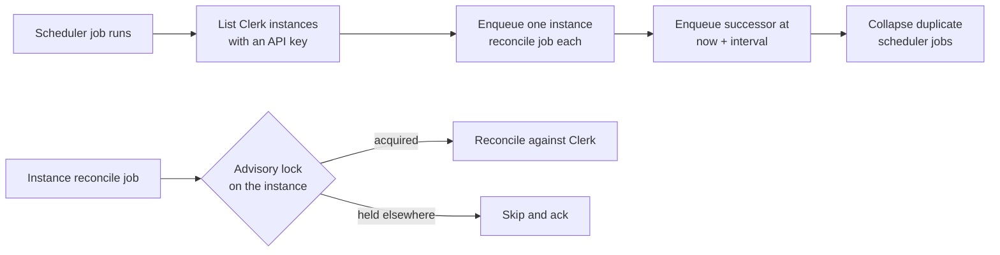
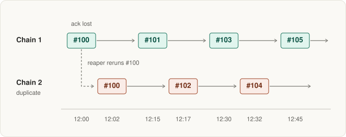
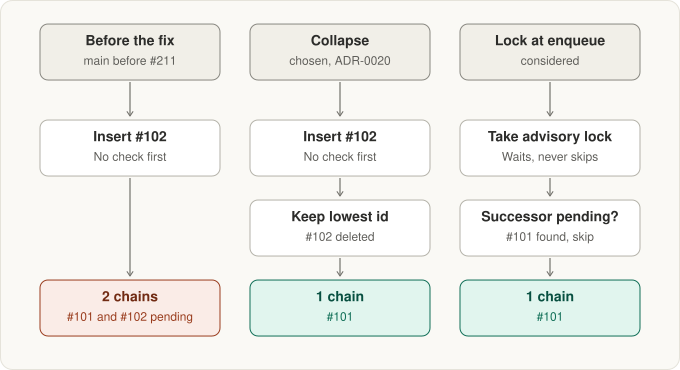

# Clerk reconcile scheduler

Clerk webhooks deliver user changes as they happen. On a fixed interval Anchor also reconciles every Clerk integration instance: it reads the instance's users from the Clerk API and applies them through the same commands a webhook produces, so product users converge even when a webhook was missed.

Both job kinds run on the pgqueue queue `integration-reconcile` ([`integration_event_worker.go`](../../apps/anchor/internal/service/integration_event_worker.go), [`integration_service.go`](../../apps/anchor/internal/service/integration_service.go)):

| Job | Payload | Does |
| --- | --- | --- |
| Scheduler | `{"is_scheduler":true}` | Enqueues one instance reconcile job per Clerk instance with an API key, then enqueues its own successor. |
| Instance reconcile | `{"integration_instance_id":"…"}` | Reads the instance's users from Clerk and applies them as webhook commands. |

## One cycle



The interval is `integration.reconcile_schedule_interval` (`INTEGRATION_RECONCILE_SCHEDULE_INTERVAL`, default `15m`). An invalid value logs a warning and falls back to the default.

## Starting and stopping the chain

The scheduler is a chain: each run inserts the next run. Nothing else drives it, so these paths create or remove it:

| When | Function | Effect |
| --- | --- | --- |
| Every replica starts | `seedReconcileScheduler` | Under the advisory lock `integration.reconcile_scheduler.seed`, inserts a scheduler job when the Clerk provider is registered, a Clerk instance has an API key, and no scheduler job is pending or processing. |
| A Clerk instance gains its first API key | `maybeStartReconcileScheduler` | Same lock and check as the startup seed. |
| The last API key is removed, or its instance deleted | `maybeCancelReconcileScheduler` | Deletes every pending scheduler job. |
| An instance is created with a key, or its key is added, rotated or removed | `enqueueReconcileJobIfRequired` | Enqueues an immediate instance reconcile job inside the write transaction. |

## Invariant: one scheduler chain

Exactly one scheduler job may be pending at a time. A second chain doubles every reconcile and every Clerk API call, and two reconciles of the same instance can insert the same new user at once ([postmortem](../postmortems/2026-10-07-duplicate-clerk-reconcile.md): dev ran six chains for 14+ days).

### How a chain forks

A run inserts its successor with a plain `Enqueue`, and the queue worker acks the run afterwards in a separate statement. When the ack is lost, for example during a database restart, the run stays `processing`. After the 2-minute visibility timeout (`integrationVisibilityTimeout`) the reaper moves it back to `pending`, it runs again, and it inserts a second successor:



The startup seed can also fork the chain: it checks `pending` and then `processing` in two queries, and a running scheduler does not take the seed lock, so a successor inserted and acked between the two queries goes unseen. The postmortem leaves open which path created the six dev chains.

### How the collapse keeps one chain

After inserting its successor, every run calls `collapseDuplicateSchedulerJobs`. It lists the pending scheduler jobs (`Search: "is_scheduler"`, at most 1000), keeps the lowest id and deletes the rest. Every replica keeps the same lowest id, so concurrent runs converge on one chain. When it deletes anything it logs `removed duplicate reconcile scheduler jobs` at warn with `scheduler_jobs_removed`.

The same rerun of `#100`, with `#101` already pending, under each design:



[ADR-0020](../adr/0020-self-rescheduling-jobs-collapse-duplicates.md) records why the collapse was chosen over the lock and over unique jobs in pgkit.

## Per-instance lock

One chain does not guarantee one reconcile per instance at a time:

- A reaped scheduler rerun enqueues every instance a second time before its successor is collapsed.
- A key change enqueues an immediate reconcile that can overlap the scheduled one.
- A reconcile slower than the visibility timeout is reaped and run again while the first run is still working.

`runInstanceReconcile` wraps the work in `pglock.TryWithLock` on `integration.reconcile.instance:<instance id>` so two overlapping runs do not duplicate Clerk API calls or contend on the same rows. A run that does not get the lock logs `instance reconcile already running on another worker, skipping` at info and acks; the run holding the lock covers the same users. If any command inside a reconcile batch still fails and rolls back the batch transaction, the handler returns its `ERROR` audit row with the error (`provider.WithFailureAudit`) and `executeCommandsInBatches` persists it in a fresh transaction ([postmortem](../postmortems/2026-11-19-failure-audit-in-aborted-tx.md)).

## Event ordering, tombstones, conflicts and reconcile deletion

See [ADR-0026](../adr/0026-clerk-sync-event-ordering-and-tombstones.md) for rationale.

- **Ordering & tombstones:** Clerk upserts stamp `product_users.last_synced_event_at` with Clerk's `updated_at` (ms) (never `Svix-Timestamp`, which refreshes on retry) and serialize with deletes under a per-`(product_id, external_id)` advisory xact lock (`clerk-user:<product>:<external_id>`). Deletes always upsert a **tombstone** in `product_user_tombstones`, even when no `product_users` row exists yet, so delayed `user.created`/`user.updated` events with `event_at <= deleted_at` (or no timestamp) cannot resurrect the user. Older updates (`event_at < last_synced_event_at`) are skipped. Product API `Create`/`Update` never modifies `last_synced_event_at`.
- **Email conflicts & verified adoption:** Before inserting or changing an email, Clerk upserts inspect `(product_id, email) FOR UPDATE`. An existing row with `external_id IS NULL` is adopted only when the Clerk primary email has `verification.status == "verified"` (preserving its ID and `suspended` status); unverified emails are skipped with a warning audit entry. When another `external_id` already holds the email, webhooks return a retryable `ErrProductUserEmailConflict` (in case the old user's delete is still in flight), while reconcile skips the user with a warning audit entry instead of failing the batch. New inserts use `ON CONFLICT DO NOTHING` and skip on reconcile races; a rare concurrent insert racing an email-change `UPDATE` may still roll back that batch and recover on the next reconcile tick.
- **404-confirmed reconcile deletion:** Reconcile records `snapshotStart` before page 1, pages Clerk with `order_by=+created_at`, and fails the run on any page error or early empty page (`len(users) == 0 && offset < total_count`) with zero deletes. Deletion candidates are restricted to Clerk-stamped rows (`external_id IS NOT NULL`, `last_synced_event_at IS NOT NULL`, `last_synced_event_at < snapshotStart`, `created_at < snapshotStart`) absent from `SeenIDs`. When `SeenIDs` is empty while stamped rows exist, or when none of the previously synced users appear in `SeenIDs` (guarding against an API key swapped to another Clerk app on small products), the entire reconcile run (both deletes and upserts) aborts with a warning audit entry so wrong-app users cannot be inserted and bypass the guard on the next run. When candidates exceed `max(25, 10% of stamped rows)`, deletions abort with a warning audit entry while upserts still run. Up to 50 candidates per run are confirmed via `GET /v1/users/{id}` requiring an explicit HTTP 404; confirmed deletes run before upserts so same-email re-signups heal in a single pass.

## Known limitations

- The collapse removes a duplicate after it exists. The run that created it has already enqueued every instance once more; the per-instance lock absorbs that.
- `DeleteJob` refuses a job a worker has just claimed. That copy runs once more and the next run collapses its successor.
- `TryWithLock` holds a database transaction, and one pooled connection, open for the whole instance reconcile, including the Clerk API calls.
- Product users synced before migration `000078` keep `last_synced_event_at = NULL` until a webhook or reconcile updates them; rows whose Clerk account was already deleted before `000078` are never stamped and therefore never auto-deleted by reconcile.
- Deleting a user through Anchor's Product API does not write a tombstone: if the user still exists in Clerk, the next Clerk event recreates them (Clerk remains the source of truth).
- A full-run abort (`no_overlap_with_existing_users` or `empty_clerk_user_list`) does not clear itself on later ticks because upserts are skipped. If the warning was caused by a swapped API key, restore the original key; if you intentionally migrated the product to a different Clerk application, rotate both the API key and webhook secret so a new-app webhook establishes overlap (or clear stale `last_synced_event_at` stamps on the old rows before reconciling).

## Diagnose

- Healthy: one `reconcile scheduler completed` info log per interval per environment. N logs per interval means N chains.
- A fork that the collapse removed shows as the warn `removed duplicate reconcile scheduler jobs`. Repeated warns mean something keeps forking the chain; look for lost acks or reaper activity on `integration-reconcile` around the same time.
- Inspect the queue directly:

  ```sql
  SELECT id, status, available_at, attempts
  FROM pgqueue_jobs
  WHERE queue_name = 'integration-reconcile'
    AND status IN ('pending', 'processing')
    AND encode(payload, 'escape') LIKE '%"is_scheduler":true%'
  ORDER BY id;
  ```

  Expect one `pending` row, plus one `processing` row while a run is in flight. Zero rows while a Clerk instance has an API key means the chain is gone; restarting a replica seeds it again.

## Tests

`TestSchedulerLifecycle_*` in [`integration_reconcile_lifecycle_test.go`](../../apps/anchor/cmd/it/ct/integration_reconcile_lifecycle_test.go) cover start, cancel and `DuplicateSchedulerJobs_CollapseToOne`. They run serially because they count jobs on the process-wide reconcile queue.
