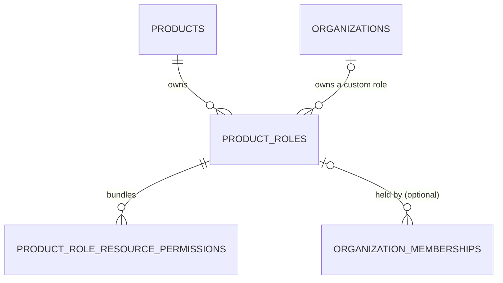

# Managed and custom roles

A role is **MANAGED** or **CUSTOM** ([ADR-0022](../adr/0022-resource-types-scope-roles-and-permissions.md)). Both live in `product_roles`, told apart by `type` and `organization_id`.

| | MANAGED | CUSTOM |
| --- | --- | --- |
| Owner | the Product, through `/v1/products/{product_id}/roles`, the admin UI and Terraform | one Organization |
| `organization_id` | `NULL` | the Organization |
| Who may hold it | a member of any Organization of the Product | a member of its own Organization only |
| A change | reaches every member who holds it at once: a membership references the role row | reaches the members of its Organization |

Example, in one Product:

| Role | `type` | `organization_id` | A member of Acme may hold it | A member of Globex may hold it |
| --- | --- | --- | --- | --- |
| `Admin` | `MANAGED` | `NULL` | yes | yes |
| `Billing auditor` | `CUSTOM` | Acme | yes | no |

The Go code owns the rules, not SQL: `role.NewManaged` and `role.NewCustom` are the only constructors, so `type` and `organization_id` always agree, and `ProductRole.AssignableIn` decides who may hold a role.

## The Organization boundary

A request that names a role for a member names one of the Product's managed roles or a custom role of that member's Organization. Every such write checks it (`service.CheckAssignableRole`): member add and role update, invitation create and update, and an Organization's founding member, whose new Organization has no custom role yet. Any other role answers `400 ROLE_NOT_FOUND_IN_REQUEST`, as an unknown ID does, so a request learns nothing about another Organization's roles.

The Product's role routes (`/v1/products/{product_id}/roles`) read and write managed roles only. A custom role's ID there answers `404 ROLE_NOT_FOUND`.

## Names

Managed role names are unique in their Product, regardless of case (`idx_product_roles_managed_lower_name`). Custom role names are unique in their Organization (`idx_product_roles_custom_lower_name`), so two Organizations may each have a `Billing auditor`.

## A member with no role

A member may hold no role ([ADR-0022](../adr/0022-resource-types-scope-roles-and-permissions.md) D5). They belong to the Organization and hold no permission there: an access check reaches the Organization and denies every action with `MISSING_PERMISSION`, until the member gets a role.

| Request | Body | Result |
| --- | --- | --- |
| Add a member, create an invitation, create an Organization with a founding member | `role_id` left out | a member, or an invitation, with no role |
| Update a member's role, update an invitation | `"role_id": null` | the role is removed |
| Update a member's role, update an invitation | `role_id` left out | `400 VALIDATION_ERROR` on `role_id`, as before |
| Accept an invitation with no role | — | a member with no role |

Responses show `"role": null` on a member and on a product user's organization, and `"role_id": null` on an invitation. Released clients always name a role, so they never see null. The access decision context leaves `role` out.

The update routes tell a missing `role_id` from `null` on the server only: the request type is `nullable.Nullable[string]` (`x-go-type` in `openapi.yaml`, read by `requiredRoleID` in `internal/api`). `generate_anchor.sh` drops that hint from the client spec, so the generated clients send a nil pointer as `null`.

In the domain, `organization.Membership.Role` and `user.OrganizationMembership.Role` are a `*role.Ref`, nil for no role, and the role IDs of the write inputs and of an invitation are a `*string`. Membership reads join the role with `LEFT JOIN`, so such a member still lists, with no permission. Membership and invitation events carry no role, so they do not change.

## Deletes

- **A role.** A role that a membership, a workspace membership or a pending invitation still holds answers `409 ROLE_IN_USE`. The delete reads the role row with `transactor.ForUpdate`, not `ForNoKeyUpdate`: a membership insert takes `FOR KEY SHARE` through its foreign key, which `FOR NO KEY UPDATE` lets through, and the delete's `ON DELETE CASCADE` would then remove the new member. Under `FOR UPDATE` the insert waits, then fails its foreign key, and answers `400 ROLE_NOT_FOUND_IN_REQUEST`.
- **A permission.** Deleting a permission removes it from every role that bundles it, custom roles included, through the foreign key cascade.
- **An Organization.** Deleting an Organization deletes its custom roles (`ON DELETE CASCADE`).

A resource type that a custom role is scoped to is in use (`CountUsage`), and a tree change checks custom roles' permission scopes as it checks managed ones (`FindRoleBundles`).

## Rollout

This ships in steps, because a rolling deploy runs the previous release beside the next one:

1. **The first release** adds `type` and `organization_id`, makes the membership role nullable, and reads custom roles and role-less members correctly. It writes neither.
2. **The second release** adds members and invitations without a role. The first release runs beside it during that deploy, and shows such a member's role as an empty `{"id": "", "name": ""}` until its replicas stop.
3. **A later release** lets Organizations create custom roles.
4. **The cleanup** (`000066`) fills any `type` still `NULL` with `MANAGED` and makes it `NOT NULL`, in one migration.

`type` has no default. Migration `000059` stores `MANAGED` on every existing role. The release before it kept writing roles without a type during that deploy, all of them managed, so `000066` stores `MANAGED` on those. Every release since writes the type.

Every `ALTER` migration sets `lock_timeout` to 5 seconds. Production's `autoFixDirty` marks a failed migration as applied and never retries it, and a failed `CONCURRENTLY` build leaves an `INVALID` index, so the resource type module checks on start that each role migration (`000059` to `000066`) holds, and refuses to start otherwise (`roleSchemaFacts` in `internal/resourcetype/schema_check.go`):

| Migration | Must hold |
| --- | --- |
| `000059` | `product_roles` has `organization_id` and `type` |
| `000060` | `product_roles_organization_id_fkey` is validated |
| `000061` | the membership and invitation role are nullable |
| `000062`, `000063` | `idx_product_roles_managed_lower_name` and `idx_product_roles_custom_lower_name` are valid |
| `000064`, `000065` | the product-wide name constraint and index are gone |
| `000066` | `type` is `NOT NULL` |

Each error names the recovery: `migrate force` to the version before, after `DROP INDEX CONCURRENTLY` for an invalid index, then redeploy.

During the deploy, the previous release maps only the product-wide name guards that migrations `000064` and `000065` drop, so a same-name race on an old replica answers 500 instead of 409 until its replicas stop.

## Rollback

- Migrations `000064` and `000065` restore the product-wide name guard only while no two roles of a Product share a name: delete the custom roles first.
- Migration `000061` makes the membership role `NOT NULL` again only while every membership and invitation holds a role.

## Tests

`TestRoleWrittenWithoutAType`, `TestCustomRolesWrittenByTheNextRelease` and `TestMembersWithoutARoleWrittenByTheNextRelease` in `apps/anchor/cmd/it/service` write the rows the next releases write and check this release against them. `TestConcurrentRoleDeleteAndMemberAdd` in `apps/anchor/cmd/it/ct` races a role delete against a member add. `TestOrganizationMemberWithoutARole` and `TestOrganizationInvitationWithoutARole` in `apps/anchor/cmd/it/ct` cover the routes in the table above.
